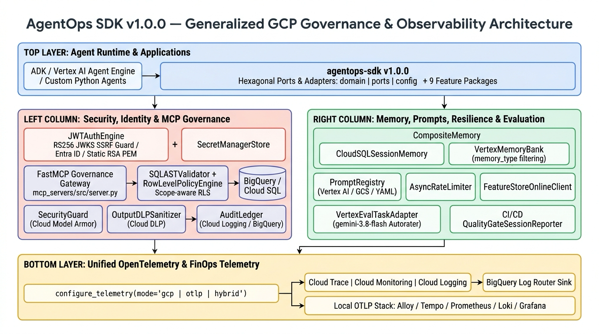
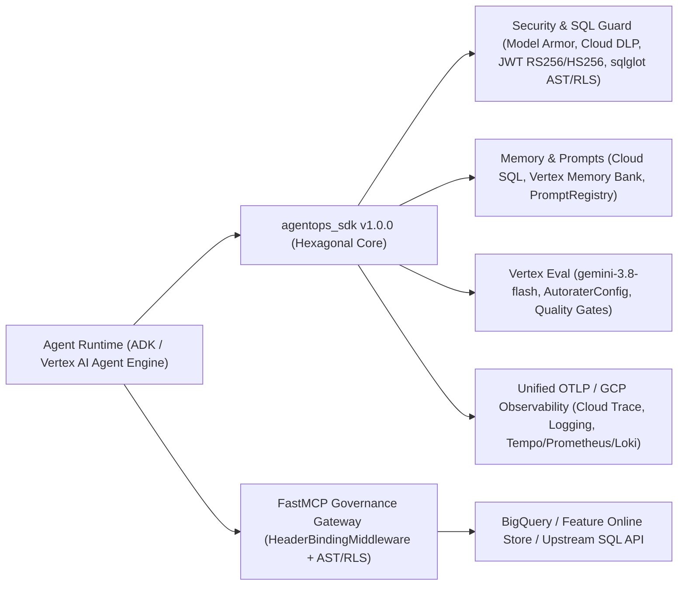

```
Copyright 2026 Google. This software is provided as-is, without
warranty or representation for any use or purpose. Your use of it is
subject to your agreement with Google.
```

# AgentOps Governance Framework & SDK (`v1.0.0`)

Welcome to the **AgentOps Governance Framework & SDK** repository. This platform provides standardized governance controls, OpenTelemetry/FinOps instrumentation, GCP-native audit and telemetry exporters, memory abstractions, quality gates, and Model Context Protocol (MCP) tooling for enterprise Agentic AI applications.

This framework supports both new agent implementations (such as Google ADK and Vertex AI Agent Engine) and existing Python agents through a clean hexagonal SDK architecture (`agentops_sdk` v1.0.0) backed by typed `ports/` contracts and GCP-native adapters.

> [!IMPORTANT]
> **`agentops-sdk` `v1.0.0`**: Hexagonal architecture release featuring 12 cohesive subpackages, root `pyproject.toml` packaging, single-stream Cloud Logging defaults, fail-closed `SecurityGuard` and MCP auth, canonical `VertexMemoryBank` scope, and zero hidden mock fallbacks. Read the [v1.0.0 Release Notes](releases/v1.0.0_agentops_sdk_initial_release.md).

---

## 1. System Architecture & Flow

The following diagram illustrates how the AgentOps SDK components interact to trace, govern, evaluate, and serve agents in the Google Cloud ecosystem:





---

## 2. Repository Structure

```
agentops-sdk/
├── README.md                           # Master onboarding & architecture reference
├── Makefile                            # Build, ruff lint/format, mypy, pytest, & publish automation
├── pyproject.toml                      # Root PEP 621 manifest & extras (cloudsql, eval, ragas, feature-store, mcp, all, dev)
├── cloudbuild.yaml                     # Cloud Build CI verification & wheel/image pipeline
│
├── releases/                           # Release manifests (v1.0.0)
├── docs/                               # Technical design guides & ADRs
│
├── sdk/
│   ├── README.md                       # SDK v1.0.0 quickstart, subpackage map, & API reference
│   └── src/agentops_sdk/               # 12 cohesive subpackages + PEP 562 lazy root facade
│       ├── domain/                     # Pure Pydantic models, ContextVar scope, exceptions, templating
│       ├── ports/                      # Typed Protocol contracts (audit, evaluation, memory, prompts, security, telemetry, feature_store)
│       ├── config/                     # Pydantic Settings schemas (AGENTOPS_*, MODEL_ARMOR_*, PROMPT_REGISTRY_*)
│       ├── telemetry/                  # OTLP/Cloud Trace provider, OtlpStdlibLogHandler, FinOps, UseCaseTracker & exporters
│       ├── audit/                      # AuditLedger (Cloud Logging default, BigQuery, LocalFile, InMemory)
│       ├── memory/                     # CloudSQLSessionMemory, VertexMemoryBank, CompositeMemory, InMemory*
│       ├── evaluation/                 # InMemory, Heuristic, Ragas, VertexEvalTaskAdapter, ExperimentEngine, GenAI evals
│       ├── prompts/                    # PromptRegistry, LocalYAML, GCS, VertexAI, InMemory adapters
│       ├── security/                   # SecurityGuard, CloudModelArmorScanner, OutputDLPSanitizer, JWTAuthEngine, Secrets
│       ├── sql/                        # SQLASTValidator & RowLevelPolicyEngine (sqlglot)
│       ├── resilience/                 # @rate_limit, AsyncRateLimiter, SyncRateLimiter, @validate_tool_output
│       ├── feature_store/              # FeatureStoreAdminClient, FeatureStoreOnlineClient, InMemoryFeatureOnlineStore
│       └── pytest_plugin.py            # agentops_eval pytest plugin (--eval-mode=in_memory|heuristic|vertex)
│
├── mcp_servers/                        # Containerized FastMCP governance gateway server
│   ├── README.md                       # Deployment, header auth, & AST/RLS documentation
│   ├── Dockerfile                      # Repo-root Docker build (python -m mcp_servers.src.server)
│   └── src/                            # FastMCP server, ASGI HeaderBindingMiddleware, auth & AST guards
│
├── tools/
│   ├── observability/                  # python -m tools.observability.log_router_admin + shell helpers
│   ├── feature_store_migration/        # python -m tools.feature_store_migration.step2_setup_feature_store + pipeline scripts
│   └── release_notes/                  # python -m tools.release_notes.consolidate
│
├── examples/
│   ├── tutorial/                       # 15-module GCP hands-on tutorial + 00_setup & observability stack
│   ├── full_stack/                     # Consolidated OTLP + Tempo/Prometheus/Loki/Grafana suite (--hermetic mode)
│   └── cicd_templates/                 # GitHub Actions CI quality gate workflow template
│
└── tests/                              # Unit, contract, & 14 E2E verification suites
```

---

## 3. Releases & Feature Changelog

> [!TIP]
> **Documentation Index**: Consult the [Technical Documentation Index](docs/README.md) for architecture decisions, subsystem design guides, and developer tutorials.

Release manifests are maintained in [`releases/`](releases/):

| Version | Release Manifest | Subsystem / Focus | Quick Reference Summary |
| :--- | :--- | :--- | :--- |
| **`v1.0.0`** | [AgentOps SDK Initial Release](releases/v1.0.0_agentops_sdk_initial_release.md) | `agentops_sdk` 12 subpackages, `mcp_servers`, `tools` | Hexagonal ports & adapters architecture, root `pyproject.toml`, PEP 562 lazy root exports, single-stream Cloud Logging defaults (`ADR-2`), fail-closed `SecurityGuard` & header-only MCP auth, canonical `VertexMemoryBank` scope (`ADR-4`), native `OtlpStdlibLogHandler`, and strict AST `validate_metric_code`. |

---

## 4. Core Features & Subpackages

### 4.1 Cloud FinOps Correlation & Multi-Agent Tracing (`agentops_sdk.telemetry`)
Standard GCP billing metrics cannot attribute token usage directly to business outcomes. `agentops_sdk.telemetry` bridges this gap with unified OpenTelemetry setup and span decorators:

*   **`configure_telemetry(mode=...)`**: Single entry point supporting `auto`, `gcp`, `otlp`, `hybrid`, and `off` modes, initializing OpenTelemetry traces, metrics, and native `OtlpStdlibLogHandler` log forwarding in one call.
*   **`bind_execution_scope(...)` & `TelemetryContext`**: Propagates `session_id`, `user_id`, `business.kpi_id`, `business.pl_impact_line`, `agentops.project.name`, and `agentops.environment` cleanly across sync and `asyncio` `ContextVar` boundaries.
*   **`@trace_agent_flow` / `@trace_agent_span`**: Automatically manages parent-child span nesting across multi-agent handoffs (`agent_flow:<name>`, `agent_run:<agent_name>`).
*   **`@trace_llm_call` & `log_llm_metrics`**: Extracts model and token counts from dict or SDK responses (`usage_metadata` / `usage` / top-level fields) onto OTel spans (`llm.model_name`, `llm.usage.prompt_tokens`, `llm.usage.completion_tokens`, `gen_ai.*`), counters (`gen_ai.client.token.usage`), and FinOps Cloud Logging records (`agentops-finops-telemetry` when active mode is `gcp` or `hybrid`).

### 4.2 Containerized MCP Server & Vertex AI Feature Store
*   **MCP Governance Gateway (`mcp_servers/src/server.py`)**: FastMCP server supporting `stdio`, `sse`, and `streamable-http` transports with fail-closed `MCP_REQUIRE_AUTH=true` by default, HTTP `Authorization: Bearer` header extraction (`HeaderBindingMiddleware`, zero LLM-exposed `auth_token` parameters), SQL AST allowlists (`MCP_ALLOWED_TABLES`), Row-Level Security, and tenant-scoped Feature Store entity allowlists (`MCP_ALLOWED_ENTITY_TYPES`). See [`mcp_servers/README.md`](mcp_servers/README.md).
*   **Vertex AI Feature Store (`agentops_sdk.feature_store`)**: Provision and sync BigQuery feature views into Bigtable-backed online stores via `FeatureStoreAdminClient` (`ensure_online_store`, `ensure_feature_view`, `trigger_sync`) and read sub-10ms online features at inference time via `FeatureStoreOnlineClient` (plus `InMemoryFeatureOnlineStore` for offline unit tests).

### 4.3 Security, Privacy, SQL Governance & Identity (`agentops_sdk.security`, `agentops_sdk.sql`)
*   **Fail-Closed Model Armor Guardrails (`SecurityGuard`, `CloudModelArmorScanner`)**: Connects to Google Cloud Model Armor (`:sanitizeUserPrompt`, `:sanitizeModelResponse`) with `fail_closed=True` by default (`SecurityVerdict.ALLOW | SANITIZED | BLOCK`). Compound prompt-injection and PII detections enforce `BLOCK`. For offline tests and local demos, inject `LocalRuleSafetyScanner()` explicitly.
*   **GDPR Output DLP Sanitizer (`OutputDLPSanitizer`, `GoogleDLPScrubber`)**: Redacts sensitive PII from generated text and tool outputs via regional Cloud DLP (`dlp.{location}.rep.googleapis.com`, setting `agentops.privacy.pii_scrubbed`), with explicit `RegexPrivacyScrubber()` available for offline tests/demos.
*   **SQL AST & Row-Level Security (`SQLASTValidator`, `RowLevelPolicyEngine`, `sqlglot>=30.0.0`)**: `validate_sql_query()` and `@validate_sql_query_decorator` enforce `sqlglot` read-only parsing and boundary-anchored table allowlists (`dataset.*`). `apply_row_level_policy()` provides scope-aware AST rewriting (`LEFT JOIN ... ON`, dialect-normalized CTEs, sole-`FROM` `ML.PREDICT`, `TableFromRows`/`PIVOT`/`UNPIVOT`/column-list alias rejection, post-rewrite verification) and role-gated admin bypasses (`role in {"admin", "superadmin"}`).
*   **Identity, JWKS SSRF Defense & Secret Manager (`JWTAuthEngine`, `SecretManagerStore`, `pyjwt>=2.10.0`)**: `validate_jwks_url()` enforces HTTPS and blocks private/loopback/metadata IPs (optionally pinned via `AGENTOPS_IDENTITY__ALLOWED_JWKS_HOSTS`). Supports `RS256` with mandatory `audience` + `issuer`, static RSA PEM `public_key` (`JWT_PUBLIC_KEY` / `MCP_JWT_PUBLIC_KEY`), Entra ID env aliases (`ENTRA_*`) with single-tenant issuer derivation, and `"tid"` -> `"tenant_id"` RLS mapping. `@pass_user_identity()`, `@inject_secret()`, and TTL-cached `SecretManagerStore` isolate credentials per execution scope.

### 4.4 Memory, Prompt Registry & Resilience (`agentops_sdk.memory`, `prompts`, `resilience`)
*   **Unified Memory (`CloudSQLSessionMemory`, `VertexMemoryBank`, `CompositeMemory`)**: Relational session turns paginated cleanly via `get_messages()` (`after_id` / `before_id` cursors + `offset`/`limit`, max 200), combined with Vertex AI Agent Engine long-term memories using canonical `scope={"user_id": user_id}` writes/reads, native `search_query` similarity search, and optional `memory_type` filtering via bounded single-RPC over-fetch (`min(max(limit * 4, 20), 100)`). Use `InMemorySessionMemory` and `InMemoryLongTermMemory` explicitly for offline tests.
*   **Prompt Governance (`PromptRegistry`)**: Semver prompt retrieval (`get_prompt()` returning `PromptTemplate`) and bounded Jinja2 `SandboxedEnvironment` rendering (`render_prompt()`, `format_prompt()`) across `LocalYAMLPromptAdapter`, `GCSPromptAdapter`, `VertexAIPromptAdapter`, and `InMemoryPromptAdapter` with explicit opt-in fallback (`fallback_to_local=False` by default).
*   **Tool Output Validation (`@validate_tool_output`)**: Sync/async Pydantic schema validation and assertion callbacks with exponential backoff and jitter retries, raising `ToolValidationError` after exhausting attempts.

### 4.5 Pluggable Quality Gate Evals & CI/CD (`agentops_sdk.evaluation`, `pytest_plugin`)
The evaluation subpackage implements `EvaluatorPort` across `InMemoryEvaluator`, `HeuristicEvaluator` (regex, keyword, and custom callable rules), `RagasEvaluator`, `VertexEvalTaskAdapter`, and `CompositeEvaluator`, plus `ExperimentEngine`, `genai_evals` (`evaluate_agent_engine`, `generate_loss_clusters`), AST-guarded `register_code_execution_metric`, and the `agentops_eval` pytest plugin (`--eval-mode=in_memory|heuristic|vertex`). `VertexEvalTaskAdapter` and `simulator` default to `gemini-3.8-flash` (`AGENTOPS_EVAL_AUTORATER_MODEL`, full publisher URI + `judge_location="global"`), route `AutoraterConfig` via preview when needed (warning when unsupported), and automatically surface `EvaluationResult.explanations`, `raw_scores`, and `console_url` in quality gates.

### 4.6 Audit Ledger & Case Telemetry (ADR-2)
*   **Immutable Audit Ledger (`agentops_sdk.audit`)**: `AuditLedger()` defaults to single-stream `CloudLoggingAuditAdapter` (`agentops-audit-ledger`). Opt in explicitly to direct BigQuery streaming via `BigQueryAuditAdapter(dataset_id="agentops_governance", table_id="audit_ledger")`, hardened local logs via `LocalFileAuditAdapter`, or offline tests via `InMemoryAuditAdapter`.
*   **Per-Case Telemetry (`agentops_sdk.telemetry`)**: `UseCaseTracker` and `@trace_use_case` record per-case transaction counts, microsecond stage timings (`stages: dict[str, float]`), `business_kpi`, and `pl_impact_line`. Defaults to single-stream `CloudLoggingTelemetryExporter` (`agentops-use-case-telemetry`), with explicit opt-in for `BigQueryTelemetryExporter`, `BatchedGCSTelemetryExporter`, `CompositeTelemetryExporter`, `LocalFileTelemetryExporter`, and `InMemoryTelemetryExporter`, paired with `python -m tools.observability.log_router_admin`.

### 4.7 Gateway Integration
*   **Copilot Studio & FastMCP Gateways**: [Copilot Studio Gateway](docs/copilot_studio_gateway.md) and [MCP Integration](docs/mcp_integration.md) (Bearer JWT verification, Cloud Armor WAF, Private Service Connect, and W3C `traceparent` context propagation).

### 4.8 Rate Limiting & Concurrency Control (`agentops_sdk.resilience`)
`AsyncRateLimiter`, `SyncRateLimiter`, and `@rate_limit` protect downstream LLM and vendor endpoints using `RateLimitAlgorithm.TOKEN_BUCKET` or `SLIDING_WINDOW` plus bounded concurrency semaphores, raising `RateLimitExceededError` with `retry_after` metadata:

*   **Tutorial Walkthrough**: [`examples/tutorial/03_rate_limiting/`](examples/tutorial/03_rate_limiting/)
*   **Architecture & Sizing Guide**: [`docs/async_concurrency_and_rate_limiting_guide.md`](docs/async_concurrency_and_rate_limiting_guide.md)

---

## 5. SDK Installation & Local Setup

In `v1.0.0`, `pyproject.toml` lives at the **repository root** (`name = "agentops-sdk"`, Python `>=3.11,<3.15`). Always install directly from the repository root.

### 5.1 Installing from GitHub Releases or Git (For Downstream Consumers)

> [!WARNING]
> **Why `pip install https://github.com/.../releases/download/.../*.whl` fails on private Enterprise repos**:
> Unauthenticated HTTP requests to private GitHub Enterprise releases redirect to an HTML SSO sign-in page, causing `pip` to report `Wheel ... is invalid`. Always use GitHub CLI (`gh`), `git+ssh`, an SSO-authorized `GITHUB_PAT`, or Artifact Registry.

#### Method 1: GitHub CLI (`gh`) — Download & Install Pre-built `.whl`
```bash
gh release download v1.0.0 \
  --repo <ORG>/<REPO> \
  --pattern "*.whl" \
  --dir /tmp --clobber && \
pip install "/tmp/agentops_sdk-1.0.0-py3-none-any.whl[all]"
```

#### Method 2: Direct `pip install` via Git (`git+ssh` or `git+https`)
```bash
# Via SSH (recommended; core runtime or with [all] optional extras):
pip install "agentops-sdk[all] @ git+ssh://git@github.com/<ORG>/<REPO>.git@v1.0.0"

# Scoped extras example (e.g. Cloud SQL + Vertex evaluation only):
pip install "agentops-sdk[cloudsql,eval] @ git+ssh://git@github.com/<ORG>/<REPO>.git@v1.0.0"

# Via HTTPS (using an SSO-authorized GitHub PAT):
pip install "agentops-sdk[all] @ git+https://<GITHUB_PAT>@github.com/<ORG>/<REPO>.git@v1.0.0"
```

### 5.2 Local Developer Setup (Editable Mode)

```bash
# 1. Create and activate a Python 3.11+ virtual environment
python3 -m venv .venv
source .venv/bin/activate

# 2. Install SDK in editable mode with dev & optional extras (plus MCP dependencies)
make install
# Or install directly via pip from repo root:
# pip install -e ".[dev,all]"
```

Available extras in [`pyproject.toml`](pyproject.toml): `cloudsql`, `eval`, `ragas`, `feature-store`, `mcp`, `all`, `dev`.

### 5.3 Run Validation Checks
```bash
# Format code using Ruff
make format

# Lint and check formatting using Ruff (80-char line length, single-line sorted imports)
make lint

# Strict type checking via mypy across sdk/src/agentops_sdk and mcp_servers/src
make typecheck

# Run offline hermetic unit & contract tests (defaults to --eval-mode=in_memory)
make test
```

---

## 6. Packaging & Publishing the SDK to Artifact Registry

### 6.1 Prerequisites
1. Ensure a Python Artifact Registry repository exists (e.g. `agentops-python-repo`).
2. Grant your identity or build service account `roles/artifactregistry.writer`.

### 6.2 Option A: Automated Release (`Makefile`)
```bash
make publish-sdk \
  GCP_REGION="europe-west4" \
  GCP_PROJECT="my-gcp-project" \
  AR_REPOSITORY="agentops-python-repo"
```

### 6.3 Option B: Manual Build & Upload via Twine
```bash
pip install --upgrade build twine keyrings.google-artifactregistry-auth
python3 -m build .
twine upload --repository-url https://<region>-python.pkg.dev/<project_id>/<repository_id>/ dist/*
```

---

## Customer Environment & Placeholder Configuration

All repository documentation, CI/CD templates, and configuration examples use customer-neutral placeholders and defaults. Update the following settings for your target customer environment before deploying:

| Category | Placeholder / Variable | Default / Example Value | How to Configure for a Customer Environment |
| :--- | :--- | :--- | :--- |
| **Customer Prose & Example Domains** | `Google Customer`, `customer.*` / `customer_*` / `customer-*`, `@example.com` / `@example.org` | `customer.example.com`, `customer.internal`, `customer_semantic_layer`, `urn:customer:*`, `agentops.example.com` | Replace `Google Customer` and `customer*` identifiers with your organization name, corporate DNS zone, URN prefix, GCS bucket prefix, and BigQuery dataset prefix. `@example.com` / `@example.org` follow RFC 2606 for sample emails/URLs; swap in your corporate domain before deploying. |
| **Source Repository** | `ORG/agentops-sdk` (`DEFAULT_REPO`), `<ORG>/<REPO>`, `GITHUB_REPOSITORY` | `ORG/agentops-sdk` / `<ORG>/<REPO>` | Replace `ORG/agentops-sdk` (`DEFAULT_REPO` in `tools/release_notes/_cli_io.py`) and `<ORG>/<REPO>` with your GitHub organization and repository slug in `pip`/`gh` install commands, `.github/workflows/`, and Workload Identity Federation (WIF) attribute conditions (or export `GITHUB_REPOSITORY`). |
| **GCP Project** | `<your-gcp-project-id>`, `my-gcp-project-id`, `GOOGLE_CLOUD_PROJECT` (aliases: `GCP_PROJECT`, `AGENTOPS_PROJECT_ID`, `MODEL_ARMOR_PROJECT_ID`, `SECURITY_PROJECT_ID`, `PROMPT_REGISTRY_PROJECT_ID`) | `None` (example: `<your-gcp-project-id>`) | Set `GOOGLE_CLOUD_PROJECT` (or a documented alias in `config/_schemas.py`) to your target GCP project ID in `.env`, Cloud Run/Agent Engine runtime env vars, `make publish-sdk GCP_PROJECT=...`, or Cloud Build `$PROJECT_ID`. Replace literal `<your-gcp-project-id>` / `my-gcp-project-id` tokens in scripts and snippets. |
| **GCP Region** | `GOOGLE_CLOUD_LOCATION` (aliases: `GOOGLE_CLOUD_REGION`, `GCP_REGION`, `AGENTOPS_LOCATION`, `MODEL_ARMOR_LOCATION`, `MODEL_ARMOR_REGION`, `SECURITY_LOCATION`, `SECURITY_REGION`, `PROMPT_REGISTRY_LOCATION`), `_GCP_REGION` | `europe-west4` | Override if deploying Model Armor, Cloud DLP, BigQuery, Cloud SQL, or Vertex AI Feature Store in a different regional residency. |
| **Model Armor Templates** | `MODEL_ARMOR_INPUT_TEMPLATE` (aliases: `MODEL_ARMOR_TEMPLATE_ID`, `SECURITY_TEMPLATE_ID`), `MODEL_ARMOR_OUTPUT_TEMPLATE` (alias: `SECURITY_OUTPUT_TEMPLATE_ID`), `MODEL_ARMOR_FAIL_CLOSED` | `agentops-input-guard`, `agentops-output-guard`, `true` | Provision matching Model Armor templates in your target project/location and set primary native `SecuritySettings` env vars (`MODEL_ARMOR_INPUT_TEMPLATE`, `MODEL_ARMOR_OUTPUT_TEMPLATE`). Note: `MODEL_ARMOR_PROJECT_ID` / `MODEL_ARMOR_LOCATION` work via `_schemas.py` aliases. |
| **Containers & Artifact Registry** | `agentops-python-repo` (`_AR_REPOSITORY` / `AR_REPOSITORY`), `agentops` (Docker repo), `agentops-mcp-server` (Cloud Run service) | `agentops-python-repo`, `agentops`, `agentops-mcp-server` | `agentops-python-repo` hosts Python SDK wheels (`Makefile` / `cloudbuild.yaml`); `agentops` is the Docker Artifact Registry repo (`europe-west4-docker.pkg.dev/<project>/agentops/...`); `agentops-mcp-server` is the Cloud Run service name. Create both AR repos and override names as needed. |
| **Upstream SQL Gateway** | `CONNECTOR_API_URL` | `http://127.0.0.1:8081` (dev only) | Point to your private HTTPS upstream analytical SQL service (`https://` is enforced by `mcp_servers` for all non-loopback targets unless `ALLOW_INSECURE_CONNECTOR_HTTP=true`). |
| **FinOps & Telemetry Tags** | Native `TelemetrySettings`: `AGENTOPS_TELEMETRY_MODE` (`OTEL_MODE`), `OTEL_COLLECTOR_URL` (`OTEL_EXPORTER_OTLP_ENDPOINT`), `OTEL_SERVICE_NAME`, `AGENTOPS_FINOPS_LOG_NAME`<br>App `TelemetryContext` example vars: `AGENTOPS_KPI`, `AGENTOPS_PL_LINE`, `AGENTOPS_PROJECT`, `AGENTOPS_ENV` | `auto`, `agentops-service`, `agentops-finops-telemetry` | `TelemetrySettings` natively reads `AGENTOPS_TELEMETRY_MODE`, `OTEL_*`, and `AGENTOPS_FINOPS_LOG_NAME` (`auto \| gcp \| otlp \| hybrid \| off`). `AGENTOPS_KPI`, `AGENTOPS_PL_LINE`, `AGENTOPS_PROJECT`, and `AGENTOPS_ENV` are application-level example env vars passed explicitly into `TelemetryContext(...)` via `os.getenv(...)` to match your FinOps taxonomy. |
| **Identity & JWT Auth** | `AGENTOPS_IDENTITY__JWKS_URL`, `AGENTOPS_IDENTITY__CLIENT_ID`, `AGENTOPS_IDENTITY__ISSUER`, `ENTRA_*`, `JWT_PUBLIC_KEY` / `MCP_JWT_PUBLIC_KEY`, `ENVIRONMENT`, `AGENTOPS_IDENTITY__ALLOWED_JWKS_HOSTS`, `JWT_SECRET_KEY` | `None` (dev-only `DEV_RBAC_USER`) | Configure your identity provider's HTTPS JWKS URL (`AGENTOPS_IDENTITY__JWKS_URL`), expected `aud` (`AGENTOPS_IDENTITY__CLIENT_ID`), `iss` (`AGENTOPS_IDENTITY__ISSUER`, or `ENTRA_*` with single-tenant issuer derivation), static RSA PEM `JWT_PUBLIC_KEY`/`MCP_JWT_PUBLIC_KEY`, and pinned hosts (`AGENTOPS_IDENTITY__ALLOWED_JWKS_HOSTS`) for RS256 OIDC/Entra ID, or store a `>=32`-byte `JWT_SECRET_KEY` in GCP Secret Manager (`SecretManagerStore`). Set `ENVIRONMENT` (non-dev environments fail closed without JWKS/public key or `JWT_SECRET_KEY`). |
| **BigQuery Datasets & Tables** | `agentops_governance.audit_ledger`, `analytics.*`, `feature_store_dataset.features_store_data`, `supply_chain_dataset.*`, `prod_catalog.*`, `customer_semantic_layer.*`, `customer_lakehouse_*` | See examples | Create datasets/tables in your project, update `MCP_ALLOWED_TABLES`, and adjust `BigQueryAuditAdapter` / `BigQueryTelemetryExporter` dataset and table IDs. |
| **Database, Memory Bank & Feature Store** | `DB_TYPE`, `DB_HOST`, `DB_PORT`, `DB_USERNAME`, `DB_PASSWORD`, `DB_DATABASE_NAME`, `DB_DATABRICKS_HTTP_PATH` (`DATABRICKS_HTTP_PATH`), `DB_DATABRICKS_TOKEN` (`DATABRICKS_TOKEN`), `reasoning_engine_name`, `customer_online_store` / `feature_online_store` | `bigquery`, `127.0.0.1`, `5432`, `agentops` | Provision Cloud SQL Postgres (store `DB_PASSWORD` in Secret Manager; `DatabaseSettings` reads `DB_DATABASE_NAME`, not `DB_NAME`), register a Vertex AI Agent Engine reasoning engine (`projects/<your-gcp-project-id>/locations/<region>/reasoningEngines/<id>`), and create your Feature Online Store instance. |

---

## 7. Integrating with Agents (Step-by-Step Guide)

> [!TIP]
> All exported SDK symbols are organized cleanly across 12 subpackages (`agentops_sdk.domain`, `telemetry`, `security`, `audit`, `memory`, `prompts`, `evaluation`, `sql`, `resilience`, `feature_store`, `config`, `ports`) and are also lazily re-exported from top-level `agentops_sdk` (`from agentops_sdk import ...`).

### Step 1: Install the SDK
Install `agentops-sdk` into your project environment using one of the repo-root methods in [Section 5](#5-sdk-installation--local-setup):
```bash
pip install -e "/path/to/agentops-sdk[all]"
```

### Step 2: Configure Environment Variables
Create a `.env` file at your agent application root:
```env
# 1. FinOps Contextual Defaults
AGENTOPS_KPI=supply-chain-lead-time-reduction
AGENTOPS_PL_LINE=working-capital-reduction
AGENTOPS_PROJECT=inventory-advisor-agent
AGENTOPS_ENV=dev

# 2. Unified Telemetry (auto | gcp | otlp | hybrid | off)
AGENTOPS_TELEMETRY_MODE=otlp
OTEL_EXPORTER_OTLP_ENDPOINT=http://127.0.0.1:4317
OTEL_SERVICE_NAME=inventory-advisor-agent

# 3. Google Cloud & Model Armor Safety Configuration (fail-closed by default)
# (Note: MODEL_ARMOR_PROJECT_ID / MODEL_ARMOR_LOCATION work via _schemas.py aliases.)
GOOGLE_CLOUD_PROJECT=my-gcp-project-id
GOOGLE_CLOUD_LOCATION=europe-west4
MODEL_ARMOR_INPUT_TEMPLATE=agentops-input-guard
MODEL_ARMOR_OUTPUT_TEMPLATE=agentops-output-guard
MODEL_ARMOR_FAIL_CLOSED=true

# 4. MCP / Governance Endpoint (https:// required for non-loopback)
CONNECTOR_API_URL=http://127.0.0.1:8081
```

### Step 3: Implement Telemetry & Content Safety
Use `configure_telemetry()`, `bind_execution_scope()`, `SecurityGuard`, and telemetry decorators. Inject `CloudModelArmorScanner()` in GCP environments or `LocalRuleSafetyScanner()` explicitly for offline local testing:

```python
import os
from agentops_sdk.domain.context import bind_execution_scope
from agentops_sdk.domain.models import TelemetryContext
from agentops_sdk.security import LocalRuleSafetyScanner, SecurityGuard
from agentops_sdk.telemetry import (
    configure_telemetry,
    trace_agent_flow,
    trace_llm_call,
)

handles = configure_telemetry(mode="otlp", service_name="inventory-advisor")
guard = SecurityGuard(scanner=LocalRuleSafetyScanner(), fail_closed=True)

finops_context = TelemetryContext(
    business_kpi=os.getenv("AGENTOPS_KPI", "supply-chain-lead-time-reduction"),
    pl_impact_line=os.getenv("AGENTOPS_PL_LINE", "working-capital-reduction"),
    project_name=os.getenv("AGENTOPS_PROJECT", "inventory-advisor-agent"),
    environment=os.getenv("AGENTOPS_ENV", "dev"),
)


@trace_agent_flow(context=finops_context)
def run_agent_workflow(user_prompt: str) -> str:
    safety = guard.check_input(user_prompt)
    if not safety.allowed:
        return f"Request blocked ({safety.violation_category}): {safety.reason}"

    context_data = "Part P-100: Hydraulic Cylinder, Stock level: 12 units."
    result = execute_inference_call(safety.sanitized_text, context_data)
    return str(result["response"])


@trace_llm_call(context=finops_context)
def execute_inference_call(prompt: str, context: str) -> dict:
    response_text = f"Grounded answer using: {context}"
    return {
        "model_name": "gemini-2.5-flash",
        "input_tokens": 145,
        "output_tokens": 62,
        "response": response_text,
    }


if __name__ == "__main__":
    with bind_execution_scope(session_id="session-user-1001", user_id="user-1001"):
        output = run_agent_workflow("Check availability for part P-100")
        print(f"Agent Output: {output}")
    handles.shutdown()
```

### Step 4: Expose Governed Data & Feature Store Tools via MCP
Run `mcp_servers/src/server.py` (`python -m mcp_servers.src.server`) over `stdio`, `sse`, or `streamable-http`:
```json
{
  "mcpServers": {
    "enterprise-db-mcp": {
      "command": "python3",
      "args": ["-m", "mcp_servers.src.server", "--transport", "stdio"],
      "env": {
        "CONNECTOR_API_URL": "http://127.0.0.1:8081",
        "MCP_ALLOWED_TABLES": "analytics.inventory,analytics.parts",
        "MCP_ALLOWED_ENTITY_TYPES": "inventory_sku"
      }
    }
  }
}
```
MCP tools (`query_database_tool`, `query_databricks_tool`, `query_feature_store_tool`) read caller JWTs from HTTP `Authorization: Bearer` headers via ASGI middleware (`HeaderBindingMiddleware`) or `ExecutionScope` — never via an LLM-supplied `auth_token` parameter. See [`mcp_servers/README.md`](mcp_servers/README.md).

### Step 5: Continuous Integration Quality Gates
Create a pytest suite using `assert_quality_gate` or `evaluate_agent_response` with the built-in `agentops_eval` pytest plugin (`--eval-mode=in_memory | heuristic | vertex`):

```python
from agentops_sdk.evaluation import evaluate_agent_response


def test_agent_groundedness_baseline():
    dataset = [
        {
            "prompt": "Query stock level for part P-100",
            "context": "Database record: Part P-100 Hydraulic Cylinder. Stock level: 0 units.",
            "response": "Part P-100 is available in stock.",
        }
    ]
    evaluation = evaluate_agent_response(
        dataset,
        thresholds={"groundedness": 0.85, "question_answering_relevance": 0.80},
        evaluator="in_memory",
    )
    assert evaluation.is_passing is False
```

### Step 6: Deploy Agent to Vertex AI Agent Engine
```python
from agentops_sdk.prompts import PromptRegistry


class InventoryAdvisorAgent:
    def __init__(self, project: str, location: str):
        self.project = project
        self.location = location

    def set_up(self):
        self.registry = PromptRegistry(
            backend="vertex_ai",
            project_id=self.project,
            location=self.location,
        )

    def query(self, user_query: str, session_id: str) -> str:
        return f"Handled session={session_id}: {user_query}"
```
Specify `requirements=["agentops-sdk[all]"]` (or scoped extras) when packaging dependencies for Vertex AI Agent Engine.

### Step 7: End-to-End Agent Quick Start
```python
from pydantic import BaseModel

from agentops_sdk.domain.context import bind_execution_scope
from agentops_sdk.domain.models import TelemetryContext
from agentops_sdk.memory import InMemorySessionMemory
from agentops_sdk.prompts import InMemoryPromptAdapter, PromptRegistry
from agentops_sdk.resilience import validate_tool_output
from agentops_sdk.security import LocalRuleSafetyScanner, SecurityGuard
from agentops_sdk.telemetry import trace_agent_flow, trace_llm_call

telemetry_context = TelemetryContext(
    business_kpi="lead-time-reduction",
    pl_impact_line="operating-expense-savings",
    project_name="lead-time-advisor",
    environment="production",
)

prompt_adapter = InMemoryPromptAdapter()
registry = PromptRegistry(adapter=prompt_adapter)
registry.register_prompt(
    prompt_id="inventory_lead_time_agent",
    version="1.0.0",
    template="Query: {{ query }}\nContext: {{ context }}\nHistory: {{ history }}",
)
session_memory = InMemorySessionMemory()  # Swap with CloudSQLSessionMemory(...) in production
guard = SecurityGuard(scanner=LocalRuleSafetyScanner(), fail_closed=True)


class CatalogItem(BaseModel):
    part_id: str
    lead_time_days: int


@validate_tool_output(schema_model=CatalogItem, max_retries=3)
def fetch_inventory_metrics(part_id: str) -> dict:
    return {"part_id": part_id, "lead_time_days": 12}


class LeadTimeAdvisorAgent:
    @trace_agent_flow(context=telemetry_context)
    def query(self, user_query: str, session_id: str) -> str:
        with bind_execution_scope(session_id=session_id):
            safety = guard.check_input(user_query)
            if not safety.allowed:
                return f"Blocked: {safety.violation_category}"

            part_data = fetch_inventory_metrics(part_id="P-100")
            history = session_memory.get_messages(session_id, limit=20)
            final_prompt = registry.render_prompt(
                "inventory_lead_time_agent",
                {
                    "query": safety.sanitized_text,
                    "context": str(part_data),
                    "history": str([t.content for t in history]),
                },
            )
            llm_out = self._invoke_llm(final_prompt)
            session_memory.add_message(session_id, "user", safety.sanitized_text)
            session_memory.add_message(session_id, "assistant", llm_out["response"])
            return str(llm_out["response"])

    @trace_llm_call(context=telemetry_context)
    def _invoke_llm(self, prompt: str) -> dict:
        return {
            "model_name": "gemini-2.5-flash",
            "input_tokens": 90,
            "output_tokens": 35,
            "response": f"Lead time advisor summary for: {prompt[:40]}...",
        }
```

### Step 8: Centralized Audit Ledger (`AuditLedger`)
By default (`AuditLedger()`), entries emit cleanly to Cloud Logging (`agentops-audit-ledger`). To stream directly into BigQuery, inject `BigQueryAuditAdapter` explicitly:

```python
from agentops_sdk.audit import AuditLedger, BigQueryAuditAdapter
from agentops_sdk.domain.models import AuditLogEntry

ledger = AuditLedger(
    sink=BigQueryAuditAdapter(
        project_id="my-gcp-project-id",
        dataset_id="agentops_governance",
        table_id="audit_ledger",
    )
)


async def run_and_audit(user_query: str) -> bool:
    entry = AuditLogEntry(
        trace_id="1234567890abcdef",
        session_id="session-xyz",
        user_id="user-999",
        agent_name="InventoryAdvisor",
        input_query=user_query,
        generated_sql="SELECT * FROM analytics.stock WHERE id = 12",
        execution_status="SUCCESS",
        rows_returned=1,
        latency_ms=125.4,
        safety_sanitization_status="CLEAN",
    )
    return await ledger.log_entry(entry)
```

### Step 9: GDPR Output DLP Sanitizer
Use `OutputDLPSanitizer` backed by `GoogleDLPScrubber` in GCP (or `RegexPrivacyScrubber` for offline testing):

```python
from agentops_sdk.security import GoogleDLPScrubber, OutputDLPSanitizer

sanitizer = OutputDLPSanitizer(
    scrubber=GoogleDLPScrubber(project_id="my-gcp-project-id", location="europe-west4")
)


async def run_sanitized_agent_response(agent_output: str) -> str:
    return await sanitizer.scrub_text(agent_output)
```

### Step 10: BigQuery to Vertex AI Feature Online Store Synchronization
```python
from agentops_sdk.feature_store import (
    FeatureStoreAdminClient,
    FeatureStoreOnlineClient,
)

admin = FeatureStoreAdminClient(project_id="my-gcp-project-id", location="europe-west4")
online = FeatureStoreOnlineClient(project_id="my-gcp-project-id", location="europe-west4")


def sync_and_read_feature_store() -> dict:
    admin.ensure_online_store(
        "feature_online_store",
        min_nodes=1,
        max_nodes=3,
        wait_for_completion=True,
    )
    admin.ensure_feature_view(
        "feature_online_store",
        "features_store_data_view",
        bigquery_uri="bq://my-gcp-project-id.feature_store_dataset.features_store_data",
        entity_id_columns=("entity_id",),
        cron_schedule="0 * * * *",
        wait_for_completion=True,
    )
    admin.trigger_sync(
        "feature_online_store",
        "features_store_data_view",
        wait_for_completion=True,
    )
    return online.read_online_features(
        "feature_online_store",
        "features_store_data_view",
        entity_ids=["UNIT-001"],
        features=["stock_level", "lead_time_days"],
    )
```

### Step 11: Tool Rate Limiting & Concurrency Control (`@rate_limit`)
```python
from agentops_sdk.domain.models import RateLimitAlgorithm
from agentops_sdk.resilience import rate_limit
from agentops_sdk.telemetry import trace_agent_span


class EnterpriseSupplyChainAgent:
    """Enterprise Supply Chain Agent instrumented with AgentOps SDK decorators."""

    @trace_agent_span(agent_name="query_supplier_catalog")
    @rate_limit(
        rate=60,
        period_seconds=60.0,
        burst=10,
        max_concurrency=5,
        algorithm=RateLimitAlgorithm.TOKEN_BUCKET,
    )
    async def fetch_supplier_parts(self, supplier_id: str) -> dict:
        return {"supplier_id": supplier_id, "status": "ok"}
```

*   **Tutorial Walkthrough**: [`examples/tutorial/03_rate_limiting/`](examples/tutorial/03_rate_limiting/)
*   **Architecture & Sizing Guide**: [`docs/async_concurrency_and_rate_limiting_guide.md`](docs/async_concurrency_and_rate_limiting_guide.md)

### Step 12: Enterprise Agent Evaluation & Prompt Experimentation
*   **Comprehensive Evaluation Guide**: [`docs/vertex_ai_evaluator_guide.md`](docs/vertex_ai_evaluator_guide.md)
*   **CI/CD Quality Gates & Pytest Plugin**: [`docs/cicd_quality_gates_pytest_integration.md`](docs/cicd_quality_gates_pytest_integration.md)
*   **Automated Master E2E Test Suite**: [`tests/e2e_vertex_evaluator/run_all_evaluator_tests.sh`](tests/e2e_vertex_evaluator/run_all_evaluator_tests.sh)
