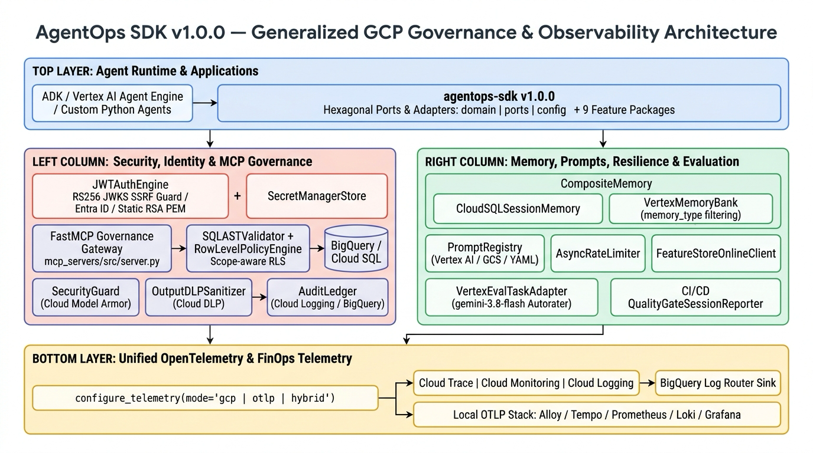
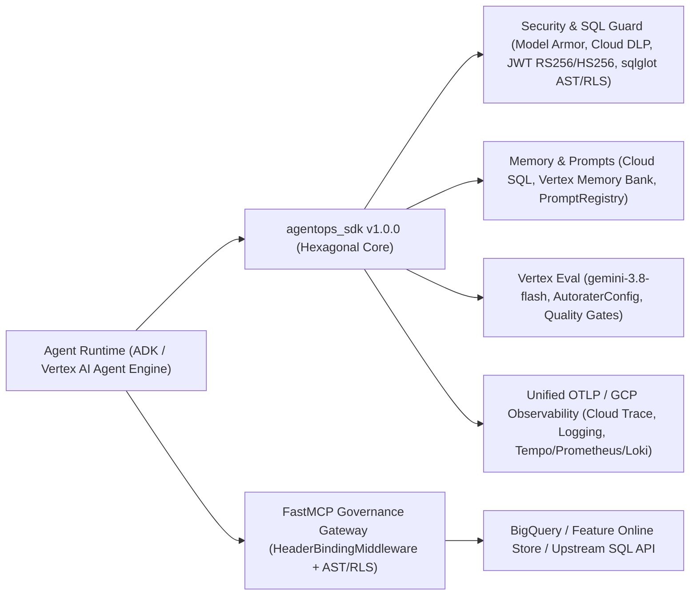

<!--
Copyright 2026 Google. This software is provided as-is, without
warranty or representation for any use or purpose. Your use of it is
subject to your agreement with Google.
-->

# System Architecture & Networking (`v1.0.0`)

This document outlines the high-level system architecture, the MCP governance gateway and upstream analytical API topology, Feature Store serving flow, and GCP networking configurations supporting the AgentOps Governance Framework.

---

## 1. System Architecture Diagram

The following diagram illustrates how the AgentOps components interact to govern, secure, trace, query, and evaluate agents in the Google Cloud ecosystem:

---

## 2. MCP Governance Gateway & Upstream Query Flow

To keep downstream AI agents free from warehouse-specific drivers (such as Databricks SQL or SAP HANA connector binaries) and prevent LLM-level credential tampering, data tool calls route through the **MCP Governance Gateway** ([`mcp_servers/src/server.py`](../mcp_servers/src/server.py)):

### Query Lifecycle
1.  **Caller Identity Binding**: The client sends `Authorization: Bearer <JWT>` over HTTP (`sse` / `streamable-http`), captured by ASGI `HeaderBindingMiddleware` ([`mcp_servers/src/_http.py`](../mcp_servers/src/_http.py)), or binds an `ExecutionScope` token in-process (`bind_execution_scope(identity_token=...)`). Tool schemas intentionally expose zero `auth_token` parameters.
2.  **Pre-Oracle Auth, SQL AST & RLS (`auth_guard.py`)**: `JWTAuthEngine` verifies the JWT signature and claims *before* `SQLASTValidator` (`agentops_sdk.sql`) checks read-only `SELECT` syntax and `MCP_ALLOWED_TABLES`, and `RowLevelPolicyEngine` injects parenthesized tenant predicates.
3.  **Upstream HTTPS Dispatch (`${CONNECTOR_API_URL}/v1/query`)**: Validated payloads are posted over HTTPS (enforced for all non-loopback `CONNECTOR_API_URL` targets unless `ALLOW_INSECURE_CONNECTOR_HTTP=true`) to the upstream analytical SQL endpoint, which executes queries using service credentials loaded via GCP Secret Manager (`SecretManagerStore`).

---

## 3. BigQuery / BigLake to Vertex AI Feature Store Sync

Workloads synchronize analytical feature tables from BigQuery and BigLake Native Delta external tables into **Vertex AI Feature Online Store (v2)** (`europe-west4`) using `agentops_sdk.feature_store` and `tools/feature_store_migration/`:

*   **Control Plane (`FeatureStoreAdminClient`)**: Provisions Bigtable-backed or Optimized `FeatureOnlineStore` instances, registers BigQuery-linked `FeatureView` resources (`bq://project.dataset.table`), triggers syncs, and manages in-engine cron schedules.
*   **Data Plane (`FeatureStoreOnlineClient`)**: Serves low-latency (`<10ms`) online feature lookups over gRPC with cached dedicated serving endpoint discovery and strict Protobuf `WhichOneof("value")` extraction.
*   **See Also**: [Vertex AI Feature Store Sync Guide](vertex_ai_feature_store_sync.md).

---

## 4. Networking & Secure Access Configuration

To secure transit across GCP services, Databricks VPCs, and internal subnets:

### VPC Connectivity
*   **Cloud Router & Cloud NAT**: Configured to translate and route authorized egress traffic securely from private GCP subnets.
*   **Private Google Access (PGA)**: Subnets hosting the MCP gateway, upstream connectors, and Vertex AI Agent Engine runtimes have PGA enabled to reach GCP APIs (Vertex AI, BigQuery, Cloud Trace, Cloud Logging, Model Armor, Cloud DLP) over Google's private backbone without traversing the public internet.
*   **Private Service Connect (PSC)**: Private cross-VPC forwarding rules for internal Databricks workspaces and cross-project spoke services.
*   **Secret Manager Access (`SecretManagerStore`)**: Sensitive credentials (`DATABRICKS_TOKEN`, `DB_PASSWORD`, JWKS/JWT keys) are staged in GCP Secret Manager and accessed by runtime service accounts granted `roles/secretmanager.secretAccessor` via bounded 256-stripe singleflight TTL caching (`agentops_sdk.security.secrets`).
