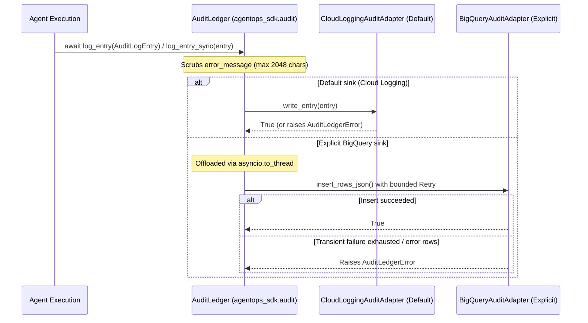

<!--
Copyright 2026 Google. This software is provided as-is, without
warranty or representation for any use or purpose. Your use of it is
subject to your agreement with Google.
-->

# Immutable Audit Ledger Architecture Design (`v1.0.0`)

This document specifies the technical design, port contracts, BigQuery schema, retry policy, and security guarantees of `agentops_sdk.audit` (`AuditLedger`, `CloudLoggingAuditAdapter`, `BigQueryAuditAdapter`, `LocalFileAuditAdapter`, and `InMemoryAuditAdapter`).

---

## 1. Architectural Flow (`ADR-2`)

In `v1.0.0`, `AuditLedger` wraps the `AuditSinkPort` protocol and follows **Single-Stream Default (`ADR-2`)**:

*   **Default Sink (`CloudLoggingAuditAdapter`)**: Calling `AuditLedger()` with no arguments emits immutable structured JSON audit payloads to Cloud Logging (`log_name="agentops-audit-ledger"`), enabling asynchronous ingestion into BigQuery or GCS via Cloud Log Router without blocking agent latency. When `TelemetryMode` is `otlp`, records forward through `OtlpStdlibLogHandler` to the configured OTLP log pipeline.
*   **Direct BigQuery Streaming (`BigQueryAuditAdapter`)**: Pass `sink=BigQueryAuditAdapter(...)` explicitly when immediate row-level BigQuery streaming inserts are required (for example, strict compliance tables).
*   **Zero Silent `.jsonl` Fallback**: `AuditLedger` never silently falls back to local JSONL files when Cloud Logging or BigQuery fails—errors raise `AuditLedgerError` loudly. Opt-in local persistence is available explicitly via `LocalFileAuditAdapter`.



---

## 2. BigQuery Table Schema (`agentops_governance.audit_ledger`)

When `BigQueryAuditAdapter(auto_create_table=True)` initializes the target table (default dataset `agentops_governance`, table `audit_ledger`), it creates a **DAY-partitioned table on `timestamp`** matching `_AUDIT_BQ_SCHEMA`:

| Column Name | BigQuery Data Type | Mode | Description |
| :--- | :--- | :--- | :--- |
| `trace_id` | `STRING` | `REQUIRED` | OpenTelemetry trace ID linking audit rows to traces. |
| `session_id` | `STRING` | `REQUIRED` | Active conversational session identifier. |
| `user_id` | `STRING` | `REQUIRED` | Authenticated caller identifier from `ExecutionScope`. |
| `agent_name` | `STRING` | `REQUIRED` | Identifier of the agent or tool executing the query. |
| `input_query` | `STRING` | `NULLABLE` | Raw natural-language prompt or request input. |
| `generated_sql` | `STRING` | `NULLABLE` | Validated/sanitized SQL statement when applicable. |
| `execution_status` | `STRING` | `REQUIRED` | Outcome label (e.g. `SUCCESS`, `FAILED`, `BLOCKED`). |
| `rows_returned` | `INT64` | `NULLABLE` | Number of rows returned by the data source. |
| `error_message` | `STRING` | `NULLABLE` | Sanitized error summary (PII/secret scrubbed, truncated to 2048 chars). |
| `latency_ms` | `FLOAT64` | `NULLABLE` | End-to-end execution duration in milliseconds. |
| `safety_sanitization_status` | `STRING` | `NULLABLE` | Safety classification (`CLEAN`, `SANITIZED`, `BLOCKED`). |
| `timestamp` | `TIMESTAMP` | `REQUIRED` | UTC ISO-8601 event timestamp (partition column). |

---

## 3. Resiliency & Security Guarantees

### A. Non-Blocking Async Execution & Scrubbing
`AuditLedger.log_entry(entry)` prepares a sanitized `AuditLogEntry` (running `validation.scrub_sensitive_text()` on `error_message`, bounded to 2048 characters) and offloads blocking `write_entry()` calls via `asyncio.to_thread`. Synchronous callers can call `log_entry_sync(entry)`.

### B. Bounded Exponential Backoff (`BigQueryAuditAdapter`)
BigQuery writes use `google.api_core.retry.Retry` with bounded parameters in `_sink_helpers.PartitionedBQWriter`:
*   **Initial delay**: `0.5` seconds
*   **Multiplier**: `2.0`
*   **Maximum delay**: `10.0` seconds
*   **Total deadline**: `30.0` seconds
*   If transient retries exhaust or `insert_rows_json` returns row-level errors, `BigQueryAuditAdapter` raises `AuditLedgerError`.

### C. Explicit Opt-In Sinks (`LocalFileAuditAdapter` & `InMemoryAuditAdapter`)
*   **`LocalFileAuditAdapter(file_path, *, base_dir=None, max_bytes=10_485_760, backup_count=5)`**: Hardened rotating local JSONL sink that validates `realpath` containment (when `base_dir` is set), avoids symlink following (`O_NOFOLLOW`), and enforces `0o600` owner-only permissions.
*   **`InMemoryAuditAdapter()`**: Thread-safe test double exposing `.entries` and `.clear()` for hermetic pytest suites.

```python
from agentops_sdk.audit import AuditLedger, BigQueryAuditAdapter
from agentops_sdk.domain.models import AuditLogEntry

ledger = AuditLedger(
    sink=BigQueryAuditAdapter(
        project_id="my-gcp-project",
        dataset_id="agentops_governance",
        table_id="audit_ledger",
    )
)

entry = AuditLogEntry(
    trace_id="trace-1234",
    session_id="sess-5678",
    user_id="dealer-4711",
    agent_name="InventorySQLAgent",
    input_query="Show available hydraulic valves in Germany",
    generated_sql="SELECT part_id, qty FROM analytics.dealer_stock WHERE country = 'Germany'",
    execution_status="SUCCESS",
    rows_returned=14,
    latency_ms=84.2,
    safety_sanitization_status="CLEAN",
)
await ledger.log_entry(entry)
```
