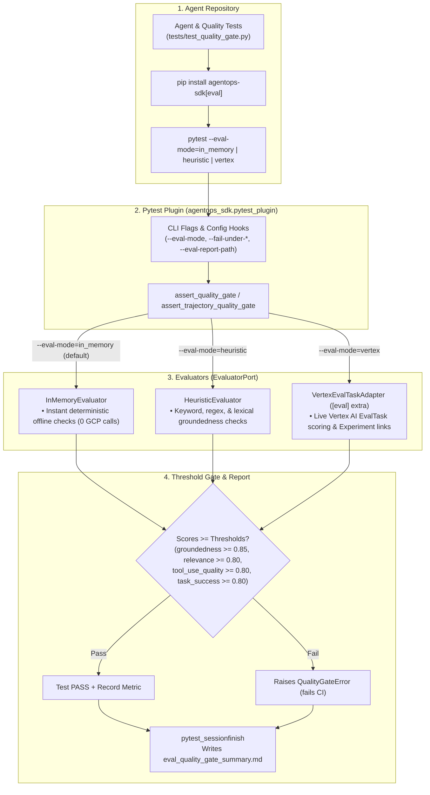

<!--
Copyright 2026 Google. This software is provided as-is, without
warranty or representation for any use or purpose. Your use of it is
subject to your agreement with Google.
-->

# CI/CD Quality Gates: Pytest Integration & Vertex AI Evaluation (`v1.0.0`)

## 1. Executive Summary

To block hallucinations, relevance regressions, and faulty multi-turn tool trajectories before production release, `agentops-sdk` includes an auto-discovered **CI/CD Quality Gate Plugin** (`agentops_eval`) registered via standard `pytest11` entry points in root [`pyproject.toml`](../pyproject.toml).

Teams run fast offline assertions on every Pull Request (`--eval-mode=in_memory` or `--eval-mode=heuristic`) and full autorater benchmarks against Vertex AI (`--eval-mode=vertex`) on main merges and nightly builds.

---

## 2. System Architecture & End-to-End Workflow



---

## 3. Core Components

### 3.1 Zero-Config Pytest Discovery (`pyproject.toml`)
```toml
[project.entry-points.pytest11]
agentops_eval = "agentops_sdk.pytest_plugin"
```
Whenever `agentops-sdk` is installed in the active environment, `pytest` discovers `agentops_sdk.pytest_plugin` automatically without manual `conftest.py` boilerplate.

### 3.2 Pytest CLI Options & Fixtures
| CLI Option | Default Value | Description |
| :--- | :--- | :--- |
| `--eval-mode` | `"in_memory"` | Evaluator mode: `in_memory`, `heuristic`, or `vertex` |
| `--fail-under-groundedness` | `0.85` | Default minimum score (0.0–1.0) for `groundedness` |
| `--fail-under-relevance` | `0.80` | Default minimum score (0.0–1.0) for `question_answering_relevance` |
| `--fail-under-tool-quality` | `0.80` | Default minimum score (0.0–1.0) for `tool_use_quality` |
| `--fail-under-task-success` | `0.80` | Default minimum score (0.0–1.0) for `task_success` |
| `--eval-report-path` | `"eval_quality_gate_summary.md"` | Output file path for the Markdown summary table |
| `--eval-project` | `$GOOGLE_CLOUD_PROJECT` | GCP Project ID used by `--eval-mode=vertex` |
| `--eval-location` | `"europe-west4"` | GCP region used by `--eval-mode=vertex` |

Injected fixtures:
- `eval_mode`: Resolved CLI mode string (`"in_memory"`, `"heuristic"`, or `"vertex"`).
- `quality_gate_evaluator`: Pre-configured `EvaluatorPort` instance matching `--eval-mode`.

### 3.3 Quality Gate Primitives (`agentops_sdk.evaluation`)
*   **`evaluate_agent_response(dataset, *, thresholds=..., evaluator="in_memory", ...)`**: Evaluates a list of `{prompt, context, response}` dictionaries (or single dict) and returns `EvaluationResult(scores, raw_scores, is_passing, failed_metrics, explanations, eval_mode, run_name, console_url)`.
*   **`assert_quality_gate(dataset, thresholds=None, **kwargs)`**: Calls `evaluate_agent_response(...)` and raises `QualityGateError` if any metric falls below threshold (exposing `.failed_metrics` and `.report_markdown`).
*   **`evaluate_agent_trajectory(trajectory, *, thresholds=..., ...)` & `assert_trajectory_quality_gate(...)`**: Evaluates multi-turn conversation/tool trajectories (raises `EvaluationError` cleanly if `trajectory` is empty).

---

## 4. Two-Tier CI/CD Strategy

| Pipeline Stage | Flag | Auth Required | Purpose |
| :--- | :--- | :--- | :--- |
| **Tier 1: Pull Requests** | `--eval-mode=in_memory` or `heuristic` | None | Instant structural, threshold, and heuristic regression checks in `< 5 s` |
| **Tier 2: Main / Nightly** | `--eval-mode=vertex` | GCP Workload Identity Federation (`WIF`) | Full LLM-as-a-judge semantic groundedness, relevance, and trajectory verification |

---

## 5. Writing Quality Gate Tests

### 5.1 Single-Turn Response Quality Gate
```python
import pytest

from agentops_sdk.evaluation import assert_quality_gate


@pytest.mark.quality_gate
def test_parts_recommendation_groundedness(quality_gate_evaluator):
    dataset = [
        {
            "prompt": "What is the coolant capacity for Series-700 7.4L engines?",
            "context": "Service Bulletin: Series-700 7.4L coolant capacity is 28.5 liters.",
            "response": "The Series-700 7.4L engine coolant capacity is 28.5 liters.",
        }
    ]
    result = assert_quality_gate(
        dataset,
        thresholds={
            "groundedness": 0.85,
            "question_answering_relevance": 0.80,
        },
        evaluator=quality_gate_evaluator,
    )
    assert result.is_passing
```

### 5.2 Multi-Turn Agent Trajectory Gate
```python
import pytest

from agentops_sdk.evaluation import assert_trajectory_quality_gate


@pytest.mark.quality_gate
def test_diagnostic_troubleshooting_trajectory(quality_gate_evaluator):
    trajectory = [
        {"role": "user", "content": "Error code DTC-TRANS-802 appears on Series-700."},
        {
            "role": "agent",
            "content": "Checking OEM fault code catalog.",
            "tool_calls": [{"name": "lookup_dtc", "args": {"code": "DTC-TRANS-802"}}],
        },
        {
            "role": "tool",
            "content": "DTC-TRANS-802: Solenoid valve 3 open circuit.",
        },
        {
            "role": "agent",
            "content": "Inspect wiring harness J-4 for Solenoid Valve 3 open circuit.",
        },
    ]
    result = assert_trajectory_quality_gate(
        trajectory,
        thresholds={"tool_use_quality": 0.80, "task_success": 0.80},
        evaluator=quality_gate_evaluator,
    )
    assert result.is_passing
```

### 5.3 Golden Benchmark Evaluation (`tests/data/golden_eval_dataset.yaml`)
```python
import yaml
import pytest

from agentops_sdk.evaluation import assert_quality_gate


def load_golden_cases():
    with open("tests/data/golden_eval_dataset.yaml", encoding="utf-8") as handle:
        return yaml.safe_load(handle)["test_cases"]


@pytest.mark.quality_gate
@pytest.mark.parametrize("case", load_golden_cases(), ids=lambda c: c["id"])
def test_agent_against_golden_benchmark(case, quality_gate_evaluator):
    assert_quality_gate(
        [
            {
                "prompt": case["prompt"],
                "context": case["context"],
                "response": case["expected_response"],
            }
        ],
        thresholds={
            "groundedness": case.get("groundedness_threshold", 0.85),
            "question_answering_relevance": case.get("relevance_threshold", 0.80),
        },
        evaluator=quality_gate_evaluator,
    )
```

---

## 6. Reference CI/CD Workflow ([`examples/cicd_templates/agent_quality_gates.yml`](../examples/cicd_templates/agent_quality_gates.yml))

```yaml
jobs:
  pr-in-memory-gate:
    if: github.event_name == 'pull_request'
    runs-on: ubuntu-latest
    steps:
      - uses: actions/checkout@v4
      - uses: actions/setup-python@v5
        with:
          python-version: "3.11"
      - run: pip install -e ".[dev,eval]"
      - run: pytest -v --eval-mode=in_memory --eval-report-path=eval_summary.md

  vertex-cloud-gate:
    if: github.event_name == 'push' || github.event_name == 'schedule'
    runs-on: ubuntu-latest
    steps:
      - uses: actions/checkout@v4
      - uses: actions/setup-python@v5
        with:
          python-version: "3.11"
      - run: pip install -e ".[dev,eval]"
      - run: pytest -v --eval-mode=vertex --eval-project=${{ secrets.GCP_PROJECT_ID }} --eval-location=europe-west4 --eval-report-path=eval_summary.md
```

Verify locally against the SDK test suite:

```bash
pytest tests/unit/test_pytest_plugin.py tests/unit/test_evaluation.py --eval-mode=in_memory -v
```

---

## 7. Implementation File Map

| Path | Responsibility |
| :--- | :--- |
| [`pyproject.toml`](../pyproject.toml) | Registers `pytest11` entrypoint `agentops_eval = "agentops_sdk.pytest_plugin"` |
| [`sdk/src/agentops_sdk/pytest_plugin.py`](../sdk/src/agentops_sdk/pytest_plugin.py) | CLI options (`--eval-mode`, `--fail-under-*`), fixtures, & session Markdown report hook |
| [`sdk/src/agentops_sdk/evaluation/quality_gates.py`](../sdk/src/agentops_sdk/evaluation/quality_gates.py) | `evaluate_agent_response`, `evaluate_agent_trajectory`, `assert_quality_gate`, `assert_trajectory_quality_gate` |
| [`sdk/src/agentops_sdk/evaluation/reporting.py`](../sdk/src/agentops_sdk/evaluation/reporting.py) | `QualityGateSessionReporter` & Markdown summary table rendering |
| [`tests/data/golden_eval_dataset.yaml`](../tests/data/golden_eval_dataset.yaml) | Reference golden benchmark dataset |
| [`examples/cicd_templates/agent_quality_gates.yml`](../examples/cicd_templates/agent_quality_gates.yml) | Reference GitHub Actions quality-gate pipeline |
