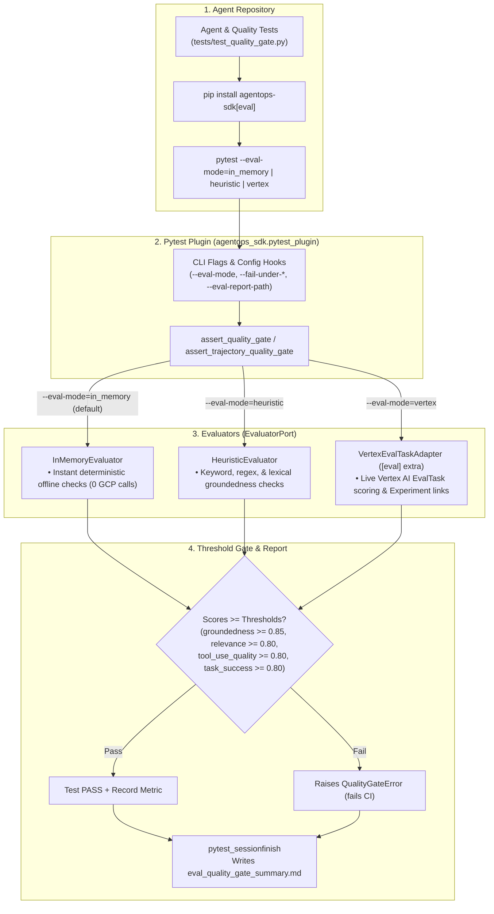

<!--
Copyright 2026 Google. This software is provided as-is, without
warranty or representation for any use or purpose. Your use of it is
subject to your agreement with Google.
-->

# CI/CD Quality Gates: Pytest Integration & Vertex AI Evaluation (`v1.0.0`)

## 1. Executive Summary

To block hallucinations, relevance regressions, and faulty multi-turn tool trajectories before production release, `agentops-sdk` includes an auto-discovered **CI/CD Quality Gate Plugin** (`agentops_eval`) registered via standard `pytest11` entry points in root [`pyproject.toml`](../pyproject.toml).

Teams run fast offline assertions on every Pull Request (`--eval-mode=in_memory` or `--eval-mode=heuristic`) and full autorater benchmarks against Vertex AI (`--eval-mode=vertex`) on main merges and nightly builds.

---

## 2. System Architecture & End-to-End Workflow



---

## 3. Core Components

### 3.1 Zero-Config Pytest Discovery (`pyproject.toml`)
```toml
[project.entry-points.pytest11]
agentops_eval = "agentops_sdk.pytest_plugin"
```
Whenever `agentops-sdk` is installed in the active environment, `pytest` discovers `agentops_sdk.pytest_plugin` automatically without manual `conftest.py` boilerplate.

### 3.2 Pytest CLI Options & Fixtures
| CLI Option | Default Value | Description |
| :--- | :--- | :--- |
| `--eval-mode` | `"in_memory"` | Evaluator mode: `in_memory`, `heuristic`, or `vertex` |
| `--fail-under-groundedness` | `0.85` | Default minimum score (0.0–1.0) for `groundedness` |
| `--fail-under-relevance` | `0.80` | Default minimum score (0.0–1.0) for `question_answering_relevance` |
| `--fail-under-tool-quality` | `0.80` | Default minimum score (0.0–1.0) for `tool_use_quality` |
| `--fail-under-task-success` | `0.80` | Default minimum score (0.0–1.0) for `task_success` |
| `--eval-report-path` | `"eval_quality_gate_summary.md"` | Output file path for the Markdown summary table |
| `--eval-project` | `$GOOGLE_CLOUD_PROJECT` | GCP Project ID used by `--eval-mode=vertex` |
| `--eval-location` | `"europe-west4"` | GCP region used by `--eval-mode=vertex` |

Injected fixtures:
- `eval_mode`: Resolved CLI mode string (`"in_memory"`, `"heuristic"`, or `"vertex"`).
- `quality_gate_evaluator`: Pre-configured `EvaluatorPort` instance matching `--eval-mode`.

### 3.3 Quality Gate Primitives (`agentops_sdk.evaluation`)
*   **`evaluate_agent_response(dataset, *, thresholds=..., evaluator="in_memory", ...)`**: Evaluates a list of `{prompt, context, response}` dictionaries (or single dict) and returns `EvaluationResult(scores, raw_scores, is_passing, failed_metrics, explanations, eval_mode, run_name, console_url)`.
*   **`assert_quality_gate(dataset, thresholds=None, **kwargs)`**: Calls `evaluate_agent_response(...)` and raises `QualityGateError` if any metric falls below threshold (exposing `.failed_metrics` and `.report_markdown`).
*   **`evaluate_agent_trajectory(trajectory, *, thresholds=..., ...)` & `assert_trajectory_quality_gate(...)`**: Evaluates multi-turn conversation/tool trajectories (raises `EvaluationError` cleanly if `trajectory` is empty).

---

## 4. Two-Tier CI/CD Strategy

| Pipeline Stage | Flag | Auth Required | Purpose |
| :--- | :--- | :--- | :--- |
| **Tier 1: Pull Requests** | `--eval-mode=in_memory` or `heuristic` | None | Instant structural, threshold, and heuristic regression checks in `< 5 s` |
| **Tier 2: Main / Nightly** | `--eval-mode=vertex` | GCP Workload Identity Federation (`WIF`) | Full LLM-as-a-judge semantic groundedness, relevance, and trajectory verification |

---

## 5. Writing Quality Gate Tests

### 5.1 Single-Turn Response Quality Gate
```python
import pytest

from agentops_sdk.evaluation import assert_quality_gate


@pytest.mark.quality_gate
def test_parts_recommendation_groundedness(quality_gate_evaluator):
    dataset = [
        {
            "prompt": "What is the coolant capacity for Series-700 7.4L engines?",
            "context": "Service Bulletin: Series-700 7.4L coolant capacity is 28.5 liters.",
            "response": "The Series-700 7.4L engine coolant capacity is 28.5 liters.",
        }
    ]
    result = assert_quality_gate(
        dataset,
        thresholds={
            "groundedness": 0.85,
            "question_answering_relevance": 0.80,
        },
        evaluator=quality_gate_evaluator,
    )
    assert result.is_passing
```

### 5.2 Multi-Turn Agent Trajectory Gate
```python
import pytest

from agentops_sdk.evaluation import assert_trajectory_quality_gate


@pytest.mark.quality_gate
def test_diagnostic_troubleshooting_trajectory(quality_gate_evaluator):
    trajectory = [
        {"role": "user", "content": "Error code DTC-TRANS-802 appears on Series-700."},
        {
            "role": "agent",
            "content": "Checking OEM fault code catalog.",
            "tool_calls": [{"name": "lookup_dtc", "args": {"code": "DTC-TRANS-802"}}],
        },
        {
            "role": "tool",
            "content": "DTC-TRANS-802: Solenoid valve 3 open circuit.",
        },
        {
            "role": "agent",
            "content": "Inspect wiring harness J-4 for Solenoid Valve 3 open circuit.",
        },
    ]
    result = assert_trajectory_quality_gate(
        trajectory,
        thresholds={"tool_use_quality": 0.80, "task_success": 0.80},
        evaluator=quality_gate_evaluator,
    )
    assert result.is_passing
```

### 5.3 Golden Benchmark Evaluation (`tests/data/golden_eval_dataset.yaml`)
```python
import yaml
import pytest

from agentops_sdk.evaluation import assert_quality_gate


def load_golden_cases():
    with open("tests/data/golden_eval_dataset.yaml", encoding="utf-8") as handle:
        return yaml.safe_load(handle)["test_cases"]


@pytest.mark.quality_gate
@pytest.mark.parametrize("case", load_golden_cases(), ids=lambda c: c["id"])
def test_agent_against_golden_benchmark(case, quality_gate_evaluator):
    assert_quality_gate(
        [
            {
                "prompt": case["prompt"],
                "context": case["context"],
                "response": case["expected_response"],
            }
        ],
        thresholds={
            "groundedness": case.get("groundedness_threshold", 0.85),
            "question_answering_relevance": case.get("relevance_threshold", 0.80),
        },
        evaluator=quality_gate_evaluator,
    )
```

---

## 6. Reference CI/CD Workflow & Repository Pipelines

### 6.1 Downstream Agent Quality Gate Workflow ([`examples/cicd_templates/agent_quality_gates.yml`](../examples/cicd_templates/agent_quality_gates.yml))

> [!IMPORTANT]
> **Supply-Chain & Keyless WIF Hardening (`CS-CICD-001`)**: Pin every GitHub Action to an immutable 40-character commit SHA, restrict default `GITHUB_TOKEN` scope to `permissions: contents: read`, and authenticate to Google Cloud exclusively via **Workload Identity Federation (`google-github-actions/auth` + `id-token: write`)** — never store long-lived JSON service account keys in CI secrets.

```yaml
permissions:
  contents: read

jobs:
  pr-in-memory-gate:
    if: github.event_name == 'pull_request'
    runs-on: ubuntu-latest
    permissions:
      contents: read
    steps:
      - uses: actions/checkout@11d5960a326750d5838078e36cf38b85af677262 # v4
      - uses: actions/setup-python@a26af69be951a213d495a4c3e4e4022e16d87065 # v5
        with:
          python-version: "3.11"
      - run: pip install -e ".[dev,eval]"
      - run: pytest -v --eval-mode=in_memory --eval-report-path=eval_summary.md

  vertex-cloud-gate:
    if: github.event_name == 'push' || github.event_name == 'schedule'
    runs-on: ubuntu-latest
    permissions:
      contents: read
      id-token: write
    steps:
      - uses: actions/checkout@11d5960a326750d5838078e36cf38b85af677262 # v4
      - uses: actions/setup-python@a26af69be951a213d495a4c3e4e4022e16d87065 # v5
        with:
          python-version: "3.11"
      - name: Authenticate to Google Cloud via Workload Identity Federation
        uses: google-github-actions/auth@c200f3691d83b41bf9bbd8638997a462592937ed # v2
        with:
          workload_identity_provider: ${{ secrets.GCP_WORKLOAD_IDENTITY_PROVIDER }}
          service_account: ${{ secrets.GCP_TST_DEPLOYER_SA }}
      - run: pip install -e ".[dev,eval]"
      - env:
          GOOGLE_CLOUD_PROJECT: ${{ secrets.GCP_PROJECT_ID || vars.GCP_PROJECT_ID }}
          GOOGLE_CLOUD_LOCATION: "europe-west4"
        run: pytest -v --eval-mode=vertex --eval-report-path=eval_summary.md
```

Verify locally against the SDK test suite:

```bash
pytest tests/unit/test_pytest_plugin.py tests/unit/test_evaluation.py --eval-mode=in_memory -v
```

### 6.2 Repository CI, Wheel Packaging & GitHub Release ([`.github/workflows/build-wheel.yml`](../.github/workflows/build-wheel.yml))
Triggered on pushes, release tags (`v*`), and PRs to `main` (plus `workflow_dispatch`) using immutable 40-char commit-SHA action pins and split least-privilege jobs (`build-and-test` with `contents: read`; `release` with `contents: write`):
*   **Lint & Strict Type Checks**: Runs `ruff check` and `ruff format --check` (`line-length = 80`) across `sdk/src/`, `mcp_servers/src/`, `tests/`, `tools/`, `examples/`, plus `mypy --strict sdk/src/agentops_sdk mcp_servers/src tools`.
*   **Unit & Contract Suite**: Runs `pytest -v tests/unit tests/contract --eval-mode=in_memory --eval-report-path=eval_quality_gate_summary.md` with coverage reporting and publishes the summary to `$GITHUB_STEP_SUMMARY`.
*   **Release Notes & Wheel Integrity**: Runs `python -m tools.release_notes.consolidate`, builds `.whl` from the repository root via `python -m build --wheel .`, verifies `v{__version__}` tag parity and `agentops_sdk/py.typed` inclusion, validates metadata via `twine check`, smoke-tests base and `[all]` wheels in isolated off-`sys.path` virtualenvs, and generates `SHA256SUMS`.

### 6.3 Google Cloud Build Pipeline ([`cloudbuild.yaml`](../cloudbuild.yaml))
1.  **Install & Lint**: Installs `.[dev,all]` and enforces `ruff check`, `ruff format --check`, and `mypy --strict sdk/src/agentops_sdk mcp_servers/src tools` inside `@sha256:` digest-pinned builder containers.
2.  **OPA Policy Check**: Executes digest-pinned static Open Policy Agent (`openpolicyagent/opa:0.70.0-static`).
3.  **Unit & Contract Tests**: Executes `pytest -v tests/unit tests/contract --eval-mode=in_memory`.
4.  **Build & Conditional Artifact Registry Upload**: Builds via `python3 -m build .`, validates via `twine check dist/*`, and publishes via `twine upload` to `https://${_GCP_REGION}-python.pkg.dev/${PROJECT_ID}/${_AR_REPOSITORY}/` only when a release tag (`_TAG_NAME` / `TAG_NAME`) is present.

---

## 7. Cloud FinOps & Post-Deployment Monitoring Correlation

Once an agent passes CI/CD quality gates, `agentops_sdk.telemetry` correlates runtime token consumption, stage latency, and operational telemetry directly to business KPIs and environments:

*   **OpenTelemetry Span & Log Correlation**: `configure_telemetry(mode=...)` (`auto`, `gcp`, `otlp`, `hybrid`, `off`) initializes `TracerProvider`, `MeterProvider`, and `OtlpStdlibLogHandler` bridging. `@trace_agent_flow`, `@trace_agent_span`, and `@trace_llm_call` emit standardized attributes (`business.kpi_id`, `business.pl_impact_line`, `agentops.project.name`, `agentops.environment`, `agentops.agent.role` / `name` / `urn`, `agentops.session.id` / `user.id`, `llm.model_name`, `llm.usage.prompt_tokens` / `completion_tokens`, and `gen_ai.*`).
*   **Single-Stream Cloud Logging Defaults (`ADR-2`)**: Traces export to Google Cloud Trace (`CloudTraceSpanExporter`) and/or an OTLP Collector (`BatchSpanProcessor`) while token metrics emit to `gen_ai.client.token.usage`. Structured FinOps logs (`agentops-finops-telemetry`), per-case telemetry (`UseCaseTracker` -> `agentops-use-case-telemetry`), and compliance audits (`AuditLedger` -> `agentops-audit-ledger`) write to Cloud Logging by default.
*   **Log Router Sinks & Billing Attribution (`tools/observability/`)**: `python -m tools.observability.log_router_admin` and [`tools/observability/setup_log_routers.sh`](../tools/observability/setup_log_routers.sh) provision partitioned BigQuery (`agentops_observability`) and GCS archive sinks asynchronously (with CLI secret redaction). In BigQuery, exported telemetry rows join with live GCP Billing exports (`project.id`, `agentops.project.name`, `business.kpi_id`) to power Looker Studio cost and latency dashboards without hardcoding token pricing in SDK code.

See [`universal_trace_and_finops_guide.md`](universal_trace_and_finops_guide.md) and [`bigquery_gcs_observability_and_case_telemetry_guide.md`](bigquery_gcs_observability_and_case_telemetry_guide.md) for full telemetry schemas.

---

## 8. Implementation File Map

| Path | Responsibility |
| :--- | :--- |
| [`pyproject.toml`](../pyproject.toml) | Registers `pytest11` entrypoint `agentops_eval = "agentops_sdk.pytest_plugin"` |
| [`sdk/src/agentops_sdk/pytest_plugin.py`](../sdk/src/agentops_sdk/pytest_plugin.py) | CLI options (`--eval-mode`, `--fail-under-*`), fixtures, & session Markdown report hook |
| [`sdk/src/agentops_sdk/evaluation/quality_gates.py`](../sdk/src/agentops_sdk/evaluation/quality_gates.py) | `evaluate_agent_response`, `evaluate_agent_trajectory`, `assert_quality_gate`, `assert_trajectory_quality_gate` |
| [`sdk/src/agentops_sdk/evaluation/reporting.py`](../sdk/src/agentops_sdk/evaluation/reporting.py) | `QualityGateSessionReporter` & Markdown summary table rendering |
| [`tests/data/golden_eval_dataset.yaml`](../tests/data/golden_eval_dataset.yaml) | Reference golden benchmark dataset |
| [`examples/cicd_templates/agent_quality_gates.yml`](../examples/cicd_templates/agent_quality_gates.yml) | Reference GitHub Actions quality-gate pipeline (40-SHA pins + keyless WIF) |
| [`.github/workflows/build-wheel.yml`](../.github/workflows/build-wheel.yml) | Repository CI, strict lint/mypy, isolated wheel verification, and GitHub Release workflow |
| [`cloudbuild.yaml`](../cloudbuild.yaml) | Google Cloud Build lint, static OPA check, test, and Artifact Registry wheel pipeline |
