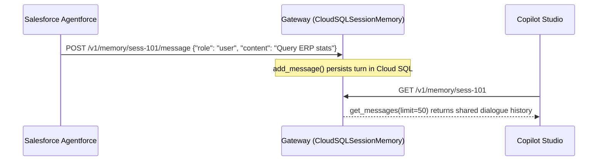

<!--
Copyright 2026 Google. This software is provided as-is, without
warranty or representation for any use or purpose. Your use of it is
subject to your agreement with Google.
-->

# Cross-Platform Multi-Agent Orchestration & Interoperability Design (`v1.0.0`)

This document details the architectural patterns, interoperability protocols, and technical designs for orchestrating multi-agent systems spanning **Microsoft Copilot Studio**, **Salesforce Agentforce**, and **Google Cloud Platform (GCP)** using `agentops-sdk` `v1.0.0` and the hardened MCP Gateway.

---

## 1. Context & Business Case

Enterprise conversational AI architectures span multiple vendor boundaries:
*   **Microsoft Copilot Studio** serves internal corporate users (Microsoft Teams integration).
*   **Salesforce Agentforce** drives customer success and CRM workflows.
*   **Google Cloud Platform (GCP)** hosts core Gemini agent runtimes (Google ADK, Vertex AI Agent Engine, LangGraph), analytical lakehouses (BigQuery, BigLake Native Delta), and low-latency features (`FeatureStoreOnlineClient`).

To avoid fragmented governance, cost leakage, and security silos, the AgentOps framework enforces distributed governance and cross-platform OpenTelemetry traceability.

---

## 2. Key Architectural Patterns

### Pattern A: Hub-and-Spoke (GCP-Centric Orchestrator)
GCP (Google ADK or LangGraph on Vertex AI Agent Engine / Cloud Run) acts as the central orchestrator (Hub), routing specialized subtasks to Spokes hosted on Copilot Studio or Salesforce Agentforce via HTTP REST or A2A.

```text
       +--------------------------------+
       |  GCP ADK / LangGraph Hub       |
       +--------------------------------+
         /                            \
  HTTP REST (Direct Line)       HTTP REST (MuleSoft / Apex)
       /                                \
+------------------------+      +--------------------------+
| Microsoft Copilot Spoke|      | Salesforce Agentforce Spoke|
+------------------------+      +--------------------------+
```

*   **OTel Tracing**: The GCP orchestrator initiates spans via `configure_telemetry()` + `@trace_agent_flow` and propagates W3C `traceparent` headers downstream.

---

### Pattern B: Low-Code Gateway (Low-Code Centric Orchestrator)
Copilot Studio or Salesforce Agentforce acts as the orchestrator and invokes GCP data tools via a Cloud Run API Gateway wrapper ([`copilot_studio_gateway.md`](copilot_studio_gateway.md)) or HTTP-mode MCP Gateway (`mcp_servers/src/server.py --transport streamable-http`).

```text
+------------------------------------+
| Microsoft Copilot Studio /         |
| Salesforce Agentforce Orchestrator |
+------------------------------------+
                  |
   HTTPS + Authorization: Bearer JWT
   + W3C traceparent
                  v
+------------------------------------+
|  AgentOps Gateway / MCP Server     |
|  (HeaderBindingMiddleware + SDK)   |
+------------------------------------+
```

---

### Pattern C: Event-Driven Choreography (Pub/Sub)
Agents communicate asynchronously via an Enterprise Event Bus (Google Cloud Pub/Sub, Azure Event Grid, or Salesforce Event Bus):

```text
+---------------+              +-----------------+              +---------------+
| Copilot Bot   | === event => |  Event Bus      | <= subscribe | ADK / Vertex  |
| (Task Queued) |              | (GCP Pub/Sub)   |              | Agent Engine  |
+---------------+              +-----------------+              +---------------+
```

*   **Shared State**: Handled through shared relational persistence (`CloudSQLSessionMemory`) and long-term facts (`VertexMemoryBank`).

---

## 3. Implementation Blueprint & Interoperability Checklist

### A. Trace Context Propagation (OpenTelemetry W3C)
To trace execution from Copilot Studio through an API/MCP gateway down to BigQuery:
1.  **Format**: Propagate standard W3C `traceparent` headers on outbound HTTP calls:
    ```http
    traceparent: 00-4bf92f3577b34da6a3ce929d0e0e4736-00f067aa0ba902b7-01
    ```
2.  **SDK Support**: `configure_telemetry(mode=...)` configures OpenTelemetry trace context propagation (`TracerProvider` + `BatchSpanProcessor`), linking downstream agent and tool spans under the shared `trace_id`.

### B. Cross-Platform Shared Session Memory (`CloudSQLSessionMemory`)
Separating conversational state from platform runtimes allows seamless handoffs across channels:



### C. Unified Security, Token Verification & Guardrails (`v1.0.0`)
1.  **Asymmetric RS256 JWKS Validation**: `JWTAuthEngine` with `SafeJWKClient` verifies Entra ID or OIDC JWTs (with `validate_jwks_url()` SSRF defense, `RS256` algorithm pinning, and `iss`/`aud`/`exp`/`type` claim checks) and feeds verified claims into `RowLevelPolicyEngine` for tenant SQL isolation.
2.  **MCP Bearer Header Propagation**: `mcp_servers/src/_http.py:HeaderBindingMiddleware` extracts HTTP `Authorization: Bearer <JWT>` headers automatically for `sse` and `streamable-http` MCP sessions without exposing `auth_token` in tool schemas.
3.  **Model Armor, DLP & Audit**: All inbound/outbound payloads pass through `SecurityGuard` (`CloudModelArmorScanner`), `OutputDLPSanitizer` (`GoogleDLPScrubber`), and `AuditLedger` (`CloudLoggingAuditAdapter` default or `BigQueryAuditAdapter`).

---

## 4. Multi-Platform Reference Topology

```text
                  +----------------------------------------------+
                  |            Microsoft Azure Tenant            |
                  |  +----------------------------------------+  |
                  |  |         Copilot Studio (Teams)         |  |
                  |  +-------------------|--------------------+  |
                  +----------------------|-----------------------+
                                         |
                                    traceparent + Bearer JWT
                                         v
+--------------------------+    +-----------------+              +-----------------------------+
|    Salesforce Tenant     |    |   Cross-Cloud   |              |    Google Cloud Platform    |
|  +--------------------+  |    |  Interconnect / |              |  +-----------------------+  |
|  |     Agentforce     |==|===>|   Private VPN   |=============>|  | Gateway / MCP Server  |  |
|  |     Sub-Agent      |  |    |  (No Internet   |  traceparent |  | (Internal LB + VPC)   |  |
|  +--------------------+  |    |    Transit)     |              |  +-----------|-----------+  |
+--------------------------+    +-----------------+              |              v              |
                                                                 |  +-----------------------+  |
                                                                 |  |  Vertex AI Agent      |  |
                                                                 |  |  Engine / ADK         |  |
                                                                 |  +-----------|-----------+  |
                                                                 |              v              |
                                                                 |  +-----------------------+  |
                                                                 |  | Cloud SQL + MemoryBank|  |
                                                                 |  +-----------|-----------+  |
                                                                 |              v              |
                                                                 |  +-----------------------+  |
                                                                 |  | AuditLedger (Cloud    |  |
                                                                 |  | Logging / BigQuery)   |  |
                                                                 |  +-----------------------+  |
                                                                 +-----------------------------+
```

---

## 5. Status of Interoperability Extensions

*   **Implemented in `v1.0.0`**: OpenTelemetry W3C tracing (`configure_telemetry`), Entra ID RS256 JWKS verification (`JWTAuthEngine` + `SafeJWKClient`), ASGI HTTP Bearer header binding (`HeaderBindingMiddleware`), fail-closed Model Armor/DLP (`SecurityGuard`, `OutputDLPSanitizer`), `CloudSQLSessionMemory`, and `AuditLedger`.
*   **Consumer-Owned Extensions**: Lightweight C# (Power Automate / Copilot Studio) and Apex (Salesforce) client wrappers for invoking customer-hosted Cloud Run REST/MCP gateway endpoints remain optional consumer-side packages.
