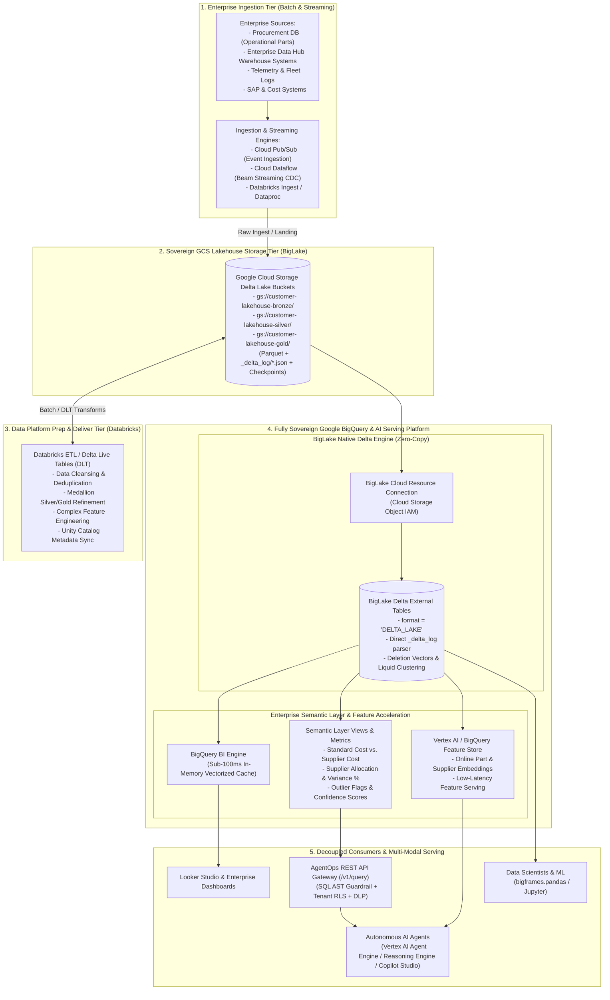
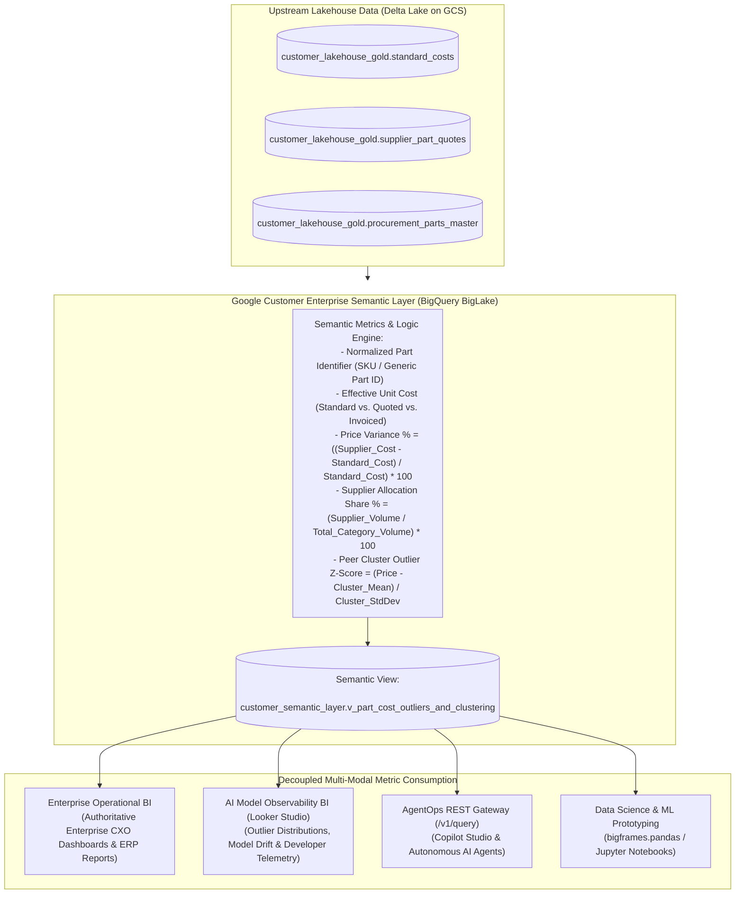
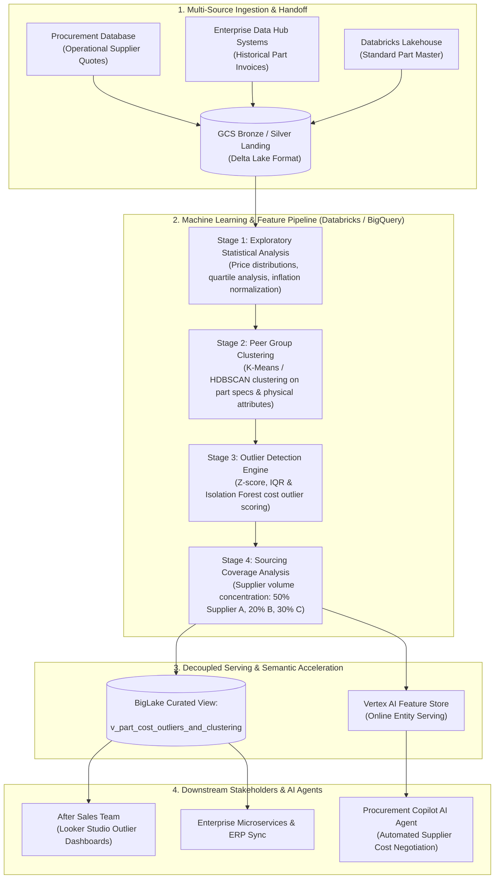
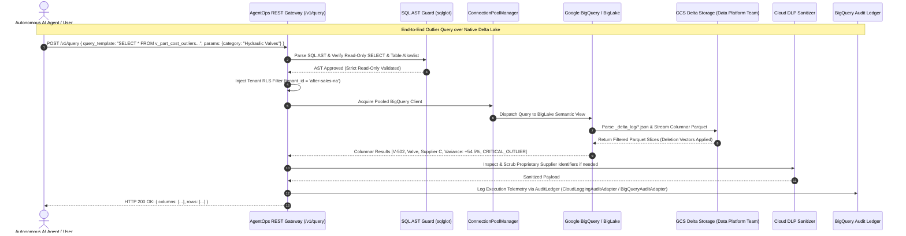
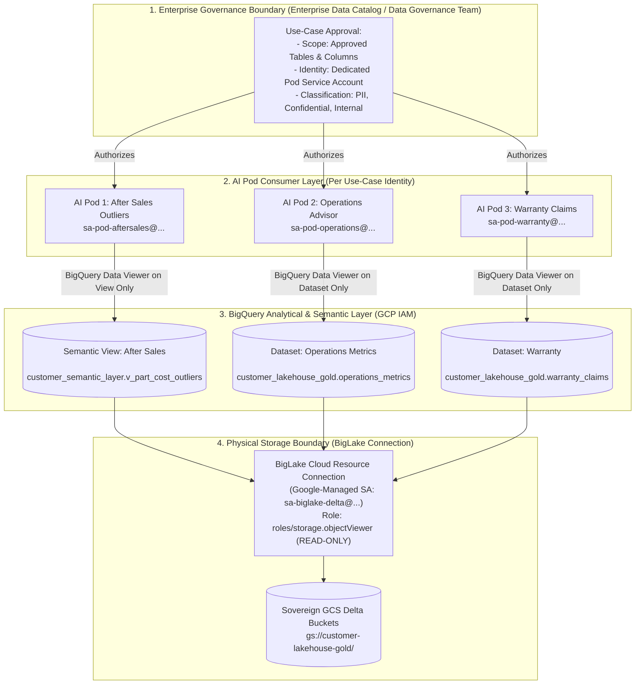

<!--
Copyright 2026 Google. This software is provided as-is, without
warranty or representation for any use or purpose. Your use of it is
subject to your agreement with Google.
-->

# Architectural Design Blueprint: Decoupled Access to Databricks Data via Google BigQuery & BigLake Native Delta Engine

**Document Version:** 5.0.0 (Comprehensive 360° Architectural Evaluation & Post-Alignment Review)  
**Target Platform:** Google BigQuery, BigLake Native Delta Engine, Vertex AI & Databricks on Google Cloud Storage  
**Key Stakeholders & Contributors:**
- **Google Cloud Architecture Lead:** Google Cloud Architecture Team
- **Google Customer Enterprise Data Platform Team:** Enterprise Data Platform Lead & Engineering Team
- **Google Customer AI Platform & AgentOps Engineering:** AI Platform & AgentOps Lead
- **Google Customer Cloud Infrastructure & Network Engineering:** Cloud Infrastructure & Network Lead
- **Business Initiative Lead:** After Sales Business Initiative Lead (*After Sales Division*)  
**Classification:** Enterprise Technical Architecture Blueprint  

---

## 1. Executive Summary & Problem Formulation

### 1.1 The Operational Context: Producer-Consumer Decoupling with Data Platform Team
In the Google Customer enterprise data ecosystem, the **Databricks platform is maintained by the dedicated Data Platform Team** as the primary engine for batch ingestion, heavy ETL, and Medallion pipelines. However, relying directly on upstream Databricks compute clusters at runtime introduces operational friction, resource contention, and latency bottlenecks for downstream application developers, BI teams, and autonomous AI agents:
- **Runtime Availability & Maintenance Dependencies**: Upstream cluster resizing, maintenance windows, and sleeping SQL Warehouses should not disrupt 24/7 client applications, microservices, or AI agent tool-calling loops.
- **Cold-Start Latency Penalties**: 2-to-5 minute cold-start delays when Databricks serverless or classic clusters spin up cause HTTP gateway timeouts in Copilot Studio, Slack bots, and agent swarms.
- **Security & Credential Decoupling**: Eliminates continual reliance on Databricks Personal Access Tokens (PATs), custom network peering, or cross-team access ticketing for routine analytical queries.
- **High-Concurrency Queue Saturation**: Multi-agent swarms issuing parallel queries saturate fixed JDBC/ODBC cluster queues, driving up cloud infrastructure compute costs.

### 1.2 First-Party Native Delta Lake Support on Google BigQuery & BigLake
Because the **Data Platform Team** writes Delta Lake tables directly into **Google Cloud Storage (`gs://...`)**, Google Cloud maintains **full read sovereignty** over the physical storage assets.

With **Google BigQuery's first-party native support for Delta Lake via BigLake**, application developers and AI agents can query Databricks Delta Lake tables directly from GCS with zero data duplication, zero compute dependency on Databricks clusters, and zero manifest generation overhead:
- **Direct Delta Log Parsing (Manifest-Free)**: BigQuery parses the Delta transaction log (`_delta_log/*.json`, checkpoint files) dynamically at query time. This eliminates the legacy symlink manifest approach (`GENERATE symlink_format_manifest`), ensuring **zero read staleness** and immediate consistency.
- **Advanced Delta Feature Support**: Native support for **Deletion Vectors** (soft deletes without rewriting full Parquet files), **Column Mapping** (schema renaming without data rewrites), and **Liquid Clustering**.
- **Automatic Schema Detection & Evolution**: BigQuery automatically tracks schema changes in the Delta log, adapting table schemas dynamically (`bq update --autodetect_schema`).
- **Sub-Second P95 Latency ($< 800\text{ms}$)**: Accelerated by BigQuery BI Engine in-memory caching and Capacitor storage acceleration.
- **Unified Governance & Fine-Grained Security**: Centrally cataloged and governed via **Enterprise Data Catalog** (Google Customer EA standard), with Google Cloud IAM, native BigQuery dataset/view permissions, dynamic data masking, and Cloud DLP sanitization.
- **Zero Physical Storage Duplication**: BigLake Delta tables are external tables pointing to GCS. BigQuery stores **0 bytes** of physical table data, incurring zero BigQuery active/long-term storage costs.

### 1.3 Enterprise Governance vs. AI Developer Velocity (Post-Alignment Scope)
Following joint architectural alignment sessions between Google Cloud, Google Customer Data Platform (Enterprise Data Platform Lead), AI Platform (AI Platform & AgentOps Lead), and Business Initiatives (Business Initiative Lead), this document addresses the core design tensions between **enterprise-wide data asset consolidation** and **downstream AI developer velocity**:
1. **Authoritative Roles & Responsibilities**: Databricks serves as the authoritative enterprise lakehouse engine for heavy batch ingestion, Bronze $\rightarrow$ Silver $\rightarrow$ Gold Medallion pipelines, and central enterprise data cataloging via Unity Catalog. Conversely, Google Cloud serves as the primary runtime environment for AI agent orchestration (Vertex AI / AgentOps), downstream model training, and high-concurrency tool serving.
2. **Comprehensive 360-Degree Evaluation**: Evaluates the trade-offs of serving data and features directly from Databricks (Option A) versus decoupled zero-copy federation via BigQuery BigLake (Option B) across compute costs, query caching, network latency, credential overhead, and developer autonomy.
3. **Clear Boundary Demarcation**:
   - **Data Platform Engineering vs. ML Feature Engineering**: Separates enterprise-certified Gold data products from rapid, iterative, and model-specific ML feature exploration.
   - **Enterprise BI vs. AI Model Observability BI**: Confirms **Enterprise BI** as Google Customer's enterprise operational BI standard, while establishing **Looker Studio / BigFrames** strictly as an internal observability and model evaluation surface for AI product teams.
   - **Infrastructure & Networking Baseline**: Establishes secure VPC peering, Private Service Connect (PSC), and identity governance based on the cloud engineering designs led by the Cloud Infrastructure & Network Lead.

### 1.4 Architectural Clarification: Defining the "Zero-ETL" Boundary
To avoid architectural ambiguity with enterprise stakeholders, it is critical to explicitly delineate what qualifies as **Zero-ETL** versus what represents standard **downstream ML feature transformations**:

1. **What Qualifies as Zero-ETL / Zero-Copy (Data Access & Federation Layer)**:
   - **Databricks GCS $\rightarrow$ BigQuery BigLake Federation**: BigQuery queries Delta Lake Parquet files and transaction logs (`_delta_log/*.json`) residing on sovereign Google Cloud Storage (`gs://customer-lakehouse-gold/`) directly in-place.
   - **Zero Data Movement**: There are no scheduled extraction scripts, batch copy jobs, Airflow DAGs moving files, or CDC replication pipelines ingesting tables into BigQuery managed storage.
   - **Zero Duplicate Storage**: BigQuery stores **0 bytes** of physical table data. This integration layer is strictly **100% Zero-ETL and Zero-Copy**.

2. **What Does NOT Qualify as Zero-ETL (Feature Engineering & ML Workflows)**:
   - Downstream activities—such as computing embedding vectors, rolling window aggregations, outlier Z-scores, materializing derived feature tables, creating training datasets, or syncing online feature stores—are **mathematical transformations and ML pipelines**, not base-table ETL.
   - Conflating feature engineering with "Zero-ETL" is technically inaccurate. While the underlying source data is federated with Zero-ETL, creating derived feature artifacts incurs standard cloud compute and storage resources as detailed in Section 7.4.

---

## 2. End-to-End Reference Architecture: Databricks & BigLake Topology

The architecture follows the **Ingest $\rightarrow$ Store $\rightarrow$ Prep & Deliver $\rightarrow$ Serve** lakehouse reference model:

```
+-------------------------------------------------------------------------------------------------------------------------------+
|                                      DATABRICKS & BIGLAKE ENTERPRISE REFERENCE TOPOLOGY                                       |
+-------------------------------------------------------------------------------------------------------------------------------+
|                                                                                                                               |
|   [1. INGEST]                   [2. STORE]                  [3. PREP & DELIVER]                 [4. SERVE]                    |
|                                                                                                                               |
|   +-----------------------+     +--------------------+      +--------------------+     +----------------------------------+   |
|   | Sensors & IoT (Unstr) |     |                    |      |                    |     | [Databricks Serving Path]        |   |
|   | Logs & Telemetry      |     |                    |      |                    |     | - Databricks Model Serving (ML)  |   |
|   | Media & Documents     |---->| Google Cloud       |=====>| Databricks Compute |---->| - Databricks SQL (Ad-hoc)        |   |
|   | Procurement DB (Raw)  |     | Storage (GCS)      |      | - Heavy ETL / DLT  |     |   --> Custom Internal Apps       |   |
|   | Enterprise Data Hub   |     | (Delta Lake Format)|      | - Feature Pipelines|     +----------------------------------+   |
|   +-----------------------+     |                    |      | - Medallion Bronze |                                              |
|              |                  |                    |      |   Silver & Gold    |     +----------------------------------+   |
|              v                  |                    |      +--------------------+     | [Google BigQuery Serving Path]   |   |
|   +-----------------------+     |                    |                                 | - BigQuery Native Delta / BigLake|   |
|   | Batch & Streaming     |---->|                    |================================>| - BI Engine In-Memory Cache      |   |
|   | - Cloud Dataflow      |     |                    |                                 | - Semantic Layer & Views         |   |
|   | - Cloud Dataproc      |     +--------------------+                                 | - Vertex AI Feature Store        |   |
|   | - Cloud Pub/Sub       |                                                            | - AgentOps FastAPI REST Gateway  |   |
|   +-----------------------+                                                            |   --> Looker Studio / Dashboards |   |
|                                                                                        |   --> Autonomous AI Agents       |   |
|                                                                                        |   --> Microservices & APIs       |   |
|                                                                                        +----------------------------------+   |
+-------------------------------------------------------------------------------------------------------------------------------+
```



---

## 3. Comprehensive 360-Degree Evaluation: Databricks-Centric Serving vs. Decoupled BigLake Federation

Following direct architectural consultations between Google Customer Enterprise Data Platform (Enterprise Data Platform Lead), AI Platform (AI Platform & AgentOps Lead), Business Initiatives (Business Initiative Lead), and Google Cloud (Google Cloud Architecture Lead), this section provides a balanced, comprehensive **360-degree architectural evaluation** of the primary strategies for serving enterprise lakehouse data to downstream autonomous AI agents, microservices, and analytical consumers.

```
+---------------------------------------------------------------------------------------------------+
|                        360-DEGREE ARCHITECTURAL SERVING EVALUATION                                |
+---------------------------------------------------------------------------------------------------+
|                                                                                                   |
|  [OPTION A: DATABRICKS-CENTRIC SERVING & UNITY CATALOG FEATURE STORE]                             |
|  Agents query Databricks SQL Warehouses directly via REST / JDBC / Unity Catalog                  |
|  - Centralized Enterprise Governance | Unity Catalog Lineage | Databricks CI/CD Pipelines         |
|  - Challenges: Cluster Cold Starts (2-5m) | DBU Compute Costs | JDBC Queue Saturation | Auth Hops  |
|                                                                                                   |
|  [OPTION B: DECOUPLED ZERO-COPY BIGQUERY BIGLAKE NATIVE DELTA FEDERATION]                         |
|  Databricks writes Delta to GCS -> BigQuery BigLake queries in-place via native Delta Log         |
|  - Zero Data Duplication | Sub-Second Latency (<800ms) | Free 24h Query Caching | Serverless Scale |
|  - Challenges: Dual IAM / Catalog Policy Alignment | Read-Only Analytical Boundary                |
|                                                                                                   |
|  [OPTION C: RECOMMENDED TIERED LAKEHOUSE SYNERGY (BEST-OF-BOTH)]                                  |
|  Databricks owns Heavy Ingestion & Gold Data Products | BigLake & Vertex Serve High-Speed AI      |
|  - High Developer Velocity | Enterprise Auditability | 100% Compute Decoupling | Production-Ready  |
|                                                                                                   |
+---------------------------------------------------------------------------------------------------+
```

---

### 3.1 Architectural Option A: Databricks Direct Serving & Unity Catalog Feature Store

In Option A, Databricks serves as both the **data processing engine** and the **runtime serving tier**. Downstream AI agents, applications, and data scientists submit queries directly to Databricks SQL Warehouses or use Databricks Model/Feature Serving APIs.

#### Architectural Workflow:
1. **Data Preparation**: Databricks workflows process operational data (Procurement DB, Enterprise Data Hub, SAP) through Medallion Bronze $\rightarrow$ Silver $\rightarrow$ Gold layers.
2. **Feature Store Publication**: Feature tables are defined using the Databricks Feature Engineering client and registered in Unity Catalog with primary keys (e.g., `part_sku`, `supplier_id`).
3. **Serving Channel**: 
   - AI agents on GCP submit HTTP requests to the **Databricks SQL Statement Execution API** (`POST /api/2.0/sql/statements`) or connect via JDBC/ODBC.
   - Low-latency online features are served via **Databricks Online Tables** or the Unity Catalog Feature Serving endpoint.
4. **Governance & CI/CD**: Central Data Platform pipelines govern access via Unity Catalog schemas, and CI/CD pipelines automate the promotion of feature tables across Dev, Staging, and Prod.

#### Operational Strengths:
- **Centralized Enterprise Governance**: A single metadata repository in Unity Catalog provides enterprise-wide cataloging, end-to-end data lineage, and audit logging across all Databricks workloads.
- **Unified Toolchain for Existing Data Platform Engineers**: Data engineers and data scientists already operating in Databricks utilize a familiar UI, notebooks, Delta Live Tables (DLT), and MLflow.
- **Enterprise Asset Democratization**: Feature tables registered in Unity Catalog are discoverable across the enterprise for authorized teams and potential BI reuse.

#### Architectural Bottlenecks & Operational Friction for Downstream AI Agents:
1. **Compute Cold-Start Latency (2–5 Minutes)**: When SQL Warehouses (classic or serverless) are auto-suspended to save cost, spinning up a warehouse introduces a 2 to 5 minute cold start. For autonomous AI agents executing synchronous multi-turn tool-calling loops (e.g., Copilot Studio, LangGraph), this causes immediate HTTP gateway timeouts.
2. **High-Concurrency Queue Saturation**: Databricks SQL Warehouses utilize fixed cluster concurrency queues. A swarm of 100+ concurrent agents executing real-time tool queries quickly saturates query queues, resulting in query queuing and degraded response times.
3. **Cross-Platform Network Hops & Middleman Fragility**: An AI agent running on GCP must initiate a call to an external Databricks endpoint, which provisions compute to query GCS Parquet files, serialize the result, and stream it back across the platform boundary. This "middleman" gateway adds avoidable latency and potential failure points.
4. **Compute Cost Accumulation & Lack of Free Query Caching**: Databricks charges DBUs (Databricks Units) plus underlying GCP compute for active cluster runtime. Unlike BigQuery, Databricks does not offer a deterministic 24-hour free query result cache for identical repeated queries executed across exploratory sessions.
5. **Operational Decoupling & Cluster Management Overhead**: While Databricks does not charge per-user developer seat licenses (pricing is consumption-based via DBUs), relying on active SQL Warehouses requires keeping compute clusters running. When warehouses auto-suspend to conserve cloud spend, subsequent AI agent calls incur cold starts (15 seconds to 3-5 minutes), risking gateway timeouts in synchronous agent frameworks (such as Copilot Studio or LangGraph). In addition, direct access requires managing cluster sizing, cross-platform Entra ID / token provisioning, and ticketed catalog permissions.

---

### 3.2 Architectural Option B: Decoupled Zero-Copy BigQuery BigLake Native Delta Federation

In Option B, Databricks remains the authoritative producer writing Delta Lake tables to GCS, while Google BigQuery BigLake functions as a fully decoupled, zero-copy, serverless serving tier for downstream AI agents, BI, and exploratory data science.

#### Architectural Workflow:
1. **Sovereign Physical Storage**: Databricks writes Medallion Delta Lake tables directly into sovereign Google Cloud Storage buckets (`gs://customer-lakehouse-gold/`).
2. **Direct Delta Log Parsing (Manifest-Free)**: BigQuery leverages its native first-party Delta Lake reader via BigLake Cloud Resource Connections. At query runtime, BigQuery parses `_delta_log/*.json` and checkpoint Parquet files directly, pruning unneeded files using partition metadata, file stats, and **Deletion Vectors**.
3. **Dynamic Schema Tracking**: When Databricks updates schemas or renames columns via Delta Column Mapping, BigQuery detects changes automatically via `bq update --autodetect_schema`.
4. **Sub-Second Acceleration**: BigQuery BI Engine provides sub-100ms in-memory vectorized query execution over frequently accessed semantic views.
5. **Low-Latency Online Feature Serving**: Certified features are synced to Vertex AI Feature Store for sub-25ms online point lookups.
6. **AgentOps Gateway Security**: The **MCP Governance Gateway** (`mcp_servers/src/server.py`, fronted by `HeaderBindingMiddleware` and `auth_guard.py`) and optional upstream Cloud Run connector endpoint validate incoming agent queries against SQL AST guardrails (`agentops_sdk.sql.SQLASTValidator` / `sqlglot`), inject tenant Row-Level Security (`RowLevelPolicyEngine`), and apply `OutputDLPSanitizer` (`GoogleDLPScrubber`) masking before dispatching to BigQuery.

#### Operational Strengths:
- **100% Compute Decoupling from Databricks**: Upstream cluster resizing, maintenance windows, or warehouse pauses have zero impact on downstream AI agents. BigQuery slots allocate dynamically in milliseconds with zero cold starts.
- **Deterministic 24-Hour Free Query Caching**: BigQuery caches query results automatically for 24 hours. Repeated queries against unchanged Delta tables (common during iterative ML evaluation and multi-agent loops) are executed **at zero compute cost**.
- **Zero Data Duplication (Verified via BigQuery Engine)**: BigLake reads the identical physical Parquet files and Delta log created by Databricks on GCS. No data is copied, replicated, or moved into BigQuery storage. Querying `INFORMATION_SCHEMA.TABLE_STORAGE` confirms BigQuery managed storage is **0 bytes**:
  ```sql
  SELECT table_name, table_type, total_logical_bytes, active_logical_bytes
  FROM `<your-gcp-project-id>.customer_lakehouse_gold.INFORMATION_SCHEMA.TABLE_STORAGE`
  WHERE table_name = 'supplier_part_quotes';
  -- Result: table_type = 'EXTERNAL', total_logical_bytes = 0
  ```
- **Developer Agility & Autonomy**: AI developers on GCP explore, transform, and evaluate data using native tools (BigFrames, Jupyter, Vertex AI) using existing Google Cloud IAM and service accounts, without requiring dedicated SQL Warehouse compute sizing, custom JDBC firewall tunnels, or cross-platform credential exchanges.
- **High Concurrency & Scale**: BigQuery serverless architecture easily scales to thousands of concurrent tool queries without queue contention or manual cluster autoscaling.

#### Architectural Considerations:
- **Dual Policy Alignment & Enterprise Data Catalog Governance**: Upstream governance policies defined in **Enterprise Data Catalog** (and reflected in Unity Catalog for data engineers) are mirrored to Google Cloud IAM and BigQuery Authorized Views / Policy Tags for GCP AI consumers.
- **Strict Read-Only Enforcement**: Downstream consumers operate under a strict unidirectional read-only contract. Operational mutations (e.g., purchase order creation) must invoke dedicated business application APIs (SAP, Procurement APIs) rather than mutating lakehouse tables directly.

---

### 3.3 Architectural Option C: Recommended Synergy — Tiered Lakehouse Model

Rather than forcing an "either/or" choice between platforms, Option C harmonizes the distinct strengths of both technologies into a **complementary, tiered enterprise architecture**:

```
+---------------------------------------------------------------------------------------------------+
|                   OPTION C: COMPLEMENTARY TIERED LAKEHOUSE REFERENCE MODEL                        |
+---------------------------------------------------------------------------------------------------+
|                                                                                                   |
|  [TIER 1: ENTERPRISE DATA PLATFORM & INGESTION (DATABRICKS)]                                      |
|  - Sole authoritative writer to GCS Delta Lake storage                                            |
|  - Heavy ETL, Bronze/Silver/Gold Medallion pipelines, Delta Live Tables (DLT)                     |
|  - Enterprise data governance, cataloging, and lineage tracked in Unity Catalog                   |
|                                                                                                   |
|  [TIER 2: PHYSICAL DATA LAKEHOUSE SOVEREIGNTY (GOOGLE CLOUD STORAGE)]                             |
|  - Single source of physical truth: gs://customer-lakehouse-{bronze,silver,gold}/                 |
|  - Delta Lake format: Parquet + _delta_log/*.json + Deletion Vectors                              |
|                                                                                                   |
|  [TIER 3: HIGH-SPEED DECOUPLED SERVING & AI RUNTIME (BIGLAKE + BIGQUERY)]                         |
|  - Manifest-free BigLake external tables querying GCS Delta Lake in-place                         |
|  - BigQuery BI Engine in-memory acceleration (<100ms) for semantic views                         |
|  - Sub-second serving for Autonomous AI Agents, Microservices, and ML Exploration                 |
|                                                                                                   |
|  [TIER 4: LOW-LATENCY ONLINE FEATURE SERVING (VERTEX AI FEATURE STORE)]                           |
|  - Materialized low-latency key-value serving (<25ms P95) for real-time agent tool calls           |
|                                                                                                   |
+---------------------------------------------------------------------------------------------------+
```

1. **Databricks retains full sovereignty over Tier 1 (Enterprise Data Platform)**: Heavy batch pipelines, complex multi-hop joins, ERP ingestion, and foundational Gold product preparation remain in Databricks, fully governed by Unity Catalog.
2. **Google BigLake & BigQuery provide Tier 3 (Decoupled High-Speed Serving)**: Downstream AI agents, Copilot Studio, after-sales outlier models, and developer notebooks query Gold tables in-place via BigLake, eliminating cluster contention and runtime DBU costs.
3. **Vertex AI Feature Store provides Tier 4 (Real-Time Online Serving)**: Curated features required by real-time agents are synchronized to Vertex AI Feature Store, guaranteeing sub-25ms response times.

---

### 3.4 Exhaustive 360-Degree Comparative Trade-Off Matrix

The following matrix compares Option A, Option B, and Option C across all core enterprise, operational, and architectural dimensions:

| Dimension | Option A: Databricks-Centric Serving | Option B: Decoupled BigLake Federation | Option C: Tiered Synergy (Recommended) | Architectural Winner |
|---|---|---|---|:---:|
| **Physical Storage Duplication** | Single source on GCS (`gs://...`); zero duplicate copies. | Zero-copy external table on GCS; **0 bytes in BigQuery storage**. | Single source on GCS; BigLake reads in-place with zero data movement. | 🤝 **Tie (Zero-Copy GCS)** |
| **Runtime Query Latency (P95)** | 800ms – 3.5s (active warehouse); **2–5 min** (suspended cold start). | **300ms – 800ms** (BigLake); **<100ms** (BI Engine in-memory). | **<100ms** (BI Engine); **<25ms** (Vertex AI Online Feature Store). | 🏆 **Option B & C** |
| **Compute Billing & Cost Model** | DBU compute charges billed for entire cluster uptime; warehouse must stay running. | Dynamic serverless slot allocation billed only for bytes scanned. | Heavy batch billed in DBX; high-frequency ad-hoc/agent queries billed serverless in BQ. | 🏆 **Option B & C** |
| **Deterministic Query Caching** | Transient execution caching; no cross-session free cache for identical queries. | **Deterministic 24-hour free query cache** for unchanged tables. | Full 24-hour free query cache on BigQuery serving tier. | 🏆 **Option B & C** |
| **Agent Swarm Concurrency** | Fixed queue limit per warehouse; risk of queue saturation at high concurrency. | Serverless elastic scaling supporting **>2,000 parallel queries** without queue contention. | High-concurrency agent swarms isolated to BigQuery/Vertex AI without cluster limits. | 🏆 **Option B & C** |
| **Network Hops & Middleware** | Multi-hop: Agent (GCP) $\rightarrow$ DBX Gateway $\rightarrow$ GCS $\rightarrow$ DBX Compute $\rightarrow$ Agent. | In-cloud direct: Agent (GCP) $\rightarrow$ BigQuery (GCP) $\rightarrow$ GCS (GCP). | In-cloud direct path for all real-time serving; batch stays upstream. | 🏆 **Option B & C** |
| **Developer Autonomy & Velocity** | Consumption DBU billing; requires warehouse provisioning, cluster sizing, token lifecycle management. | Native GCP IAM, Workload Identity, BigFrames/Jupyter notebook access, zero cluster management. | Data engineers use DBX; AI engineers use native GCP tools autonomously. | 🏆 **Option B & C** |
| **Enterprise Governance (Gold Data)** | Mature in Unity Catalog (central data catalog, column lineage, tagging). | Governed via Google Cloud IAM, BigQuery Authorized Views, Cloud DLP; cataloged in Enterprise Data Catalog. | **Enterprise Unified**: Enterprise Data Catalog for enterprise governance; Unity Catalog for DBX; GCP IAM for AI runtime. | 🤝 **Complementary** |
| **Feature Store Online Serving** | Databricks Online Tables / Feature Serving (REST API; 30–80ms). | Vertex AI Feature Store (<25ms key-value point lookup). | Curated features documented in Unity Catalog, served online via Vertex AI. | 🏆 **Option C** |
| **Upstream Schema Evolution** | Native Unity Catalog schema tracking. | Automatic via native BigQuery Delta log parser (`bq update --autodetect_schema`). | Seamless: Databricks writes Delta commits; BigLake auto-adapts dynamically. | 🤝 **Tie** |
| **Delivery Timeline Feasibility (Initial Milestone)** | High risk: requires cross-platform VPC/PSC peering, Entra ID SSO, DBX API client testing. | **Low risk / Production-ready**: BigLake Delta native connection operational immediately in GCP. | Deploy BigLake serving immediately; preserve open-ended SDK connectors for future DBX. | 🏆 **Option B & C** |

---

## 4. Handling Upstream Schema Changes in Databricks & Multi-Tier Governance

A critical requirement in decoupled lakehouse architectures is managing **upstream schema evolution** performed by the Databricks Data Platform Team without breaking downstream analytical queries, Looker dashboards, or AI agent tool-calling loops.

```
+---------------------------------------------------------------------------------------------------+
|                        DYNAMIC SCHEMA EVOLUTION PROPAGATION & GOVERNANCE                          |
+---------------------------------------------------------------------------------------------------+
|                                                                                                   |
|  [DATABRICKS PIPELINE]                                                                            |
|  Data Platform Team alters schema in Delta Lake                                                   |
|  - Add Column | Column Mapping (Rename) | Deletion Vectors (Drop) | Partition Evolution           |
|                                 |                                                                 |
|                                 v (Writes commit to gs://.../_delta_log/00000000042.json)         |
|  [GOOGLE BIGLAKE NATIVE DELTA PARSER]                                                             |
|  BigQuery dynamically reads _delta_log transaction commits at query execution time                |
|  - Reads logical schema directly from Delta metadata                                              |
|  - Supports Delta Column Mapping (maps physical UUIDs in Parquet to logical column names)         |
|  - Automatically incorporates additive columns when autodetect_schema is active                   |
|                                 |                                                                 |
|         +-----------------------+-----------------------+                                         |
|         |                                               |                                         |
|         v                                               v                                         |
|  [TIER 1: BIGLAKE & CATALOG-ALIGNED GOV]        [TIER 2: FASTAPI CONNECTOR & AST GUARD]           |
|  - Column-Level Security (CLS) policy tags      - sqlglot AST validates column allowlists         |
|    remain intact on existing columns            - Dynamic Tenant RLS injection is preserved       |
|  - Catalog BigQuery scanner discovers new       - Schema introspection endpoint /v1/tables/.../   |
|    columns and syncs enterprise catalog           schema returns updated fields dynamically       |
|  - Dynamic Data Masking rules preserved         - Backward compatibility views prevent agent drift|
|                                                                                                   |
+---------------------------------------------------------------------------------------------------+
```

### 4.1 How BigLake Ingests Databricks Schema Changes
1. **Delta Transaction Log as Ground Truth**: When Databricks pipelines perform `ALTER TABLE`, `mergeSchema`, or column additions, the change is committed directly to `_delta_log/*.json`. BigQuery's native Delta reader reads this transaction log at query start time, immediately recognizing the latest schema without manual DDL alterations.
2. **Delta Column Mapping Support**: In modern Databricks Unity Catalog tables, columns can be renamed or dropped using Delta Column Mapping metadata (`'delta.columnMapping.mode' = 'name'`) without rewriting underlying physical Parquet files. BigLake's first-party Delta connector natively decodes this metadata, projecting the correct logical column names to downstream queries.
3. **Automatic Schema Synchronization Command**:
   ```bash
   # Enable dynamic schema evolution tracking on BigLake Delta external tables
   bq update --autodetect_schema <your-gcp-project-id>:customer_lakehouse_gold.parts_inventory
   ```

### 4.2 Multi-Tier Security Enforcement During Schema Evolution
Security policies are maintained across two independent layers, ensuring zero security regressions when schemas change:
- **BigLake Engine Enforcement & Enterprise Data Catalog Governance**:
  - **Enterprise Catalog Synchronization**: Enterprise Data Catalog's Google BigQuery Scanner discovers newly added columns and syncs metadata to the Google Customer enterprise catalog.
  - **Column-Level Security (CLS)**: Existing taxonomy policy tags attached to sensitive columns (e.g., `standard_cost`, `quoted_unit_cost`) remain enforced even if new columns are appended to the table.
  - **Dynamic Data Masking**: Masking rules (e.g., hash, nullify, partial mask) bound to existing attributes are unaffected by schema additions.
- **FastAPI Data Connector Service Level (Gateway Enforcement)**:
  - **SQL AST Guardrail (`sqlglot`)**: Dynamically refreshes schema metadata via the connection pool and validates that queries target only approved analytical attributes.
  - **Tenant Row-Level Security (RLS)**: Tenant filtering clauses (`WHERE tenant_id = :tenant_id`) operate on row dimensions and remain strictly enforced regardless of column additions or structural modifications.

### 4.3 Semantic Layer Decoupling & Backward Compatibility
To prevent breaking downstream AI agents or BI reports when upstream Delta schemas evolve, the **Enterprise Semantic Layer (`customer_semantic_layer`)** acts as an abstraction buffer:
- Upstream column renames or type conversions are mapped and aliased inside semantic SQL views.
- Downstream AI agents query stable semantic attributes (`standard_cost`, `cost_variance_pct`) rather than raw changing table structures.

---

## 5. Strict Unidirectional Data Flow & Write-Back Guardrails

### 5.1 Validation: The One-Way Producer $\rightarrow$ Consumer Contract
Data synchronization between Databricks and Google BigQuery is **strictly unidirectional (One-Way: Databricks $\rightarrow$ GCP BigLake/BigQuery)**.

```
+---------------------------------------------------------------------------------------------------+
|                        STRICT UNIDIRECTIONAL DATA SYNCHRONIZATION BOUNDARY                        |
+---------------------------------------------------------------------------------------------------+
|                                                                                                   |
|  [UPSTREAM DATA PRODUCER]                                                                         |
|  Google Customer Data Platform Team (Databricks Medallion Pipelines & Unity Catalog)              |
|  - Sole Authoritative Writer to GCS Delta Lake Storage                                            |
|                                 |                                                                 |
|                                 | (ONE-WAY WRITE / SYNC: gs://customer-lakehouse-*)               |
|                                 v                                                                 |
|  [SOVEREIGN GCS DELTA STORAGE]                                                                    |
|  Google Cloud Storage Delta Lake Buckets                                                          |
|  - Parquet Files, _delta_log/*.json, Checkpoints                                                  |
|                                 |                                                                 |
|                                 | (ONE-WAY ZERO-COPY READ-ONLY FEDERATION)                        |
|                                 v                                                                 |
|  [DOWNSTREAM CONSUMING PLATFORM]                                                                  |
|  Google BigQuery, BigLake, AgentOps REST Gateway, Autonomous AI Agents & Developers              |
|  - Read-Only Analytical Serving Tier                                                              |
|  - CANNOT write back / mutate GCS Delta Lake files                                                |
|  - CANNOT commit transactions to Databricks Unity Catalog                                         |
|                                                                                                   |
|  [OPERATIONAL ACTION EXCEPTION PATHWAY]                                                           |
|  If an AI Agent must perform an operational mutation (e.g., Create Purchase Order):               |
|  --> Agent calls dedicated Operational REST / MCP Action API (SAP OData / Procurement API)        |
|  --> NEVER writes directly to the Lakehouse Database                                              |
|                                                                                                   |
+---------------------------------------------------------------------------------------------------+
```

### 5.2 Why Direct Lakehouse Write-Back is Prohibited & Technically Impossible
1. **Delta Log Transactional Integrity**: Delta Lake utilizes strict ACID transaction protocols managed by commit logs (`_delta_log`). BigQuery external tables do not construct Databricks-compatible Delta log commit entries in GCS. Direct write mutations would corrupt the Delta table state and break Databricks Unity Catalog consistency.
2. **Producer-Consumer Separation of Concerns**: The Google Customer Data Platform Team maintains SLA responsibility for Lakehouse data assets. Downstream developers and autonomous AI agents must never mutate upstream data tables directly.
3. **Auditability & Isolation**: Operational modifications must proceed through transactional business applications with full workflow validation (e.g. ERP authorization, approval gates) rather than direct database updates.

### 5.3 Three-Layer Defense-in-Depth Write-Back Blocking Perimeter

| Security Layer | Enforcement Mechanism | Technical Behavior |
|---|---|---|
| **1. Cloud Storage IAM Perimeter** | `roles/storage.objectViewer` | BigLake Service Account is strictly granted read-only permissions on `gs://customer-lakehouse-*` buckets. Write, delete, and overwrite operations return `HTTP 403 Access Denied`. |
| **2. BigQuery Engine Perimeter** | External Table Constraints | BigQuery rejects all DML operations (`INSERT`, `UPDATE`, `DELETE`, `MERGE`) targeting external Delta Lake tables. |
| **3. AgentOps Gateway & AST Guard** | `agentops_sdk.sql` (`SQLASTValidator`, `validate_sql_query`)<br>`mcp_servers/src/auth_guard.py` | After Bearer authentication (`MCP_REQUIRE_AUTH=true`), the SQL AST parser deterministically validates that all submitted queries are pure read-only `SELECT` statements (`UNNEST`-only TVFs, system schemas blocked). Any DDL, DML, or multi-statement payload is blocked before reaching BigQuery. |

---

## 6. Enterprise Semantic Layer Architecture

### 6.1 The Business Need for a Unified Semantic Layer
In discussions with the Enterprise Data Platform Team and Business Initiative Lead, a recurring challenge in after-sales pricing and supplier procurement is **metric fragmentation across systems**:
- Internal ERP systems record **Standard Part Cost** (baseline manufacturing/procurement cost).
- Operational procurement databases (such as **Procurement DB**) track **Quoted Supplier Part Cost** and purchase order records.
- EDH data lakes contain historical invoiced prices, discounts, and regional freight adjustments.

Without a centralized **Semantic Layer**, AI agents, BI dashboards, and data scientists calculate cost variances, supplier coverage ratios, and outlier thresholds inconsistently.



---

### 6.2 BI Tooling Demarcation: Enterprise Operational BI vs. AI Model Observability BI (Looker Studio)

During cross-functional architectural reviews, the Google Customer Data Platform team raised a valid question regarding the coexistence of BI tools: *Why introduce Looker Studio when Enterprise BI is Google Customer's established enterprise BI standard?*

This section explicitly defines the governance and functional boundaries separating **Enterprise Operational BI** from **AI/ML Model Observability & Evaluation BI**:

```
+---------------------------------------------------------------------------------------------------+
|                        ENTERPRISE BI VS. AI OBSERVABILITY BI DEMARCATION                          |
+---------------------------------------------------------------------------------------------------+
|                                                                                                   |
|  [DOMAIN 1: ENTERPRISE OPERATIONAL BI]                                                            |
|  - Sole authoritative platform for corporate-wide business intelligence and KPI reporting         |
|  - Target Audience: Corporate Leadership, CXOs, Business Line Managers, Finance, Global Supply    |
|  - Data Scope: ERP transactions, consolidated revenue, procurement spend, inventory turnover     |
|  - Connectivity: Native Enterprise BI connectors to Databricks Gold and BigQuery Semantic Views   |
|  - Governance: Google Customer Enterprise Data Platform & Enterprise Governance Board             |
|                                                                                                   |
|  [DOMAIN 2: AI / ML MODEL OBSERVABILITY & EVALUATION BI (LOOKER STUDIO & BIGFRAMES)]              |
|  - Scoped strictly to the AI engineering and model evaluation lifecycle (After Sales AI Team)     |
|  - Target Audience: AI Engineers, ML Scientists, Project Stakeholders (After Sales AI Team)       |
|  - Data Scope: Part cost outlier z-scores, clustering scatterplots, inference latency telemetry  |
|  - Governance: Localized to the AI Platform & AgentOps sandbox/project boundaries                |
|  - Non-Intrusive: Zero attempt to displace, replicate, or compete with Enterprise BI              |
|                                                                                                   |
+---------------------------------------------------------------------------------------------------+
```

#### Detailed Functional Demarcation:
1. **Enterprise BI is the Single Source of Truth for Business Metrics**:
   - Enterprise BI remains Google Customer's standard for enterprise-wide decision support.
   - It is designed for cross-departmental aggregation, executive dashboards, and operational reporting.
   - If business stakeholders outside the AI project require access to certified semantic metrics (such as part pricing variance), Enterprise BI connects directly to BigQuery via the native Google BigQuery BI connector or to Databricks Gold tables.
2. **Looker Studio is an Internal AI Model Observability Surface**:
   - The Looker Studio dashboards referenced in this blueprint are **not enterprise business reports**. They are **model diagnostic and evaluation surfaces** designed specifically for the AI application team (e.g., the After Sales outlier project).
   - Their primary purpose is model observability: inspecting statistical distributions (z-scores, IQR boundaries), monitoring model drift, evaluating false-positive rates for price outliers, and inspecting agent execution telemetry.
   - Providing AI engineers with a lightweight, cloud-native dashboard directly adjacent to BigLake enables rapid experimentation without subjecting prototype telemetry to corporate Enterprise BI release cycles.

---

### 6.3 Standardized Semantic Layer SQL Implementation

```sql
-- Create Enterprise Semantic View for After Sales Cost Variance & Outliers
CREATE OR REPLACE VIEW `<your-gcp-project-id>.customer_semantic_layer.v_part_cost_outliers_and_clustering` AS
WITH part_metrics AS (
  SELECT
    p.part_id,
    p.part_name,
    p.part_category,
    p.standard_cost,
    s.supplier_id,
    s.supplier_name,
    s.quoted_unit_cost,
    s.procured_volume_units,
    -- Compute Cost Variance Percentage
    ROUND(((s.quoted_unit_cost - p.standard_cost) / NULLIF(p.standard_cost, 0)) * 100, 2) AS cost_variance_pct,
    -- Calculate Category Total Volume for Supplier Sourcing Share
    SUM(s.procured_volume_units) OVER(PARTITION BY p.part_category) AS category_total_volume,
    -- Calculate Peer Cluster Baseline Metrics
    AVG(s.quoted_unit_cost) OVER(PARTITION BY p.part_category) AS cluster_mean_cost,
    STDDEV(s.quoted_unit_cost) OVER(PARTITION BY p.part_category) AS cluster_stddev_cost
  FROM `<your-gcp-project-id>.customer_lakehouse_gold.parts_inventory` p
  INNER JOIN `<your-gcp-project-id>.customer_lakehouse_gold.supplier_part_quotes` s
    ON p.part_id = s.part_id
)
SELECT
  part_id,
  part_name,
  part_category,
  supplier_id,
  supplier_name,
  standard_cost,
  quoted_unit_cost,
  cost_variance_pct,
  procured_volume_units,
  -- Sourcing Allocation Share within Category
  ROUND((procured_volume_units / NULLIF(category_total_volume, 0)) * 100, 2) AS supplier_coverage_share_pct,
  -- Outlier Statistical Z-Score
  ROUND((quoted_unit_cost - cluster_mean_cost) / NULLIF(cluster_stddev_cost, 0), 3) AS price_outlier_zscore,
  -- Automated Outlier Classification Flag
  CASE 
    WHEN ABS((quoted_unit_cost - cluster_mean_cost) / NULLIF(cluster_stddev_cost, 0)) >= 2.0 THEN 'CRITICAL_OUTLIER'
    WHEN ABS((quoted_unit_cost - cluster_mean_cost) / NULLIF(cluster_stddev_cost, 0)) >= 1.5 THEN 'MODERATE_OUTLIER'
    ELSE 'NOMINAL'
  END AS outlier_status
FROM part_metrics;
```

---

## 7. Enterprise Feature Store Architecture (Vertex AI + BigQuery + Databricks)

### 7.1 Demarcating Data Platform Engineering vs. ML Feature Engineering

A critical insight highlighted during the alignment session is the fundamental difference between **Data Platform Engineering** (managed by the Enterprise Data Platform Lead) and **ML Feature Engineering** (managed by the AI Platform & AgentOps Lead and model developers):

```
+---------------------------------------------------------------------------------------------------+
|               DATA PLATFORM ENGINEERING VS. ML FEATURE ENGINEERING LIFECYCLE                      |
+---------------------------------------------------------------------------------------------------+
|                                                                                                   |
|  [STAGE 1: DATA PLATFORM ENGINEERING (DATABRICKS)]                                                |
|  - Scope: Ingestion of Procurement DB, SAP ERP, Enterprise Data Hub -> Bronze/Silver/Gold Products|
|  - Characteristics: Stable schemas, structured aggregations, strict enterprise CI/CD              |
|  - Governance: Unity Catalog, central data dictionary, enterprise audit trails                    |
|  - Output: Authoritative, certified Lakehouse Gold tables stored in sovereign GCS                 |
|                                 |                                                                 |
|                                 v (Zero-Copy Read via BigLake Native Delta)                       |
|  [STAGE 2: EXPLORATORY ML FEATURE ENGINEERING (GOOGLE CLOUD / BIGFRAMES / JUPYTER)]               |
|  - Scope: Highly iterative mathematical experimentation by AI developers and data scientists       |
|  - Expansion: ~40 raw input features expand to 750+ candidate features during experimentation    |
|  - Iteration Speed: Minutes/hours; notebook-based (Pandas, BigFrames, PySpark); uncertified       |
|  - Autonomy: Zero ticketed CI/CD bottlenecks; queries execute with free BigQuery 24h cache        |
|                                 |                                                                 |
|                                 v (Model Validation & Feature Importance Selection)               |
|  [STAGE 3: FEATURE STORE GRADUATION & DUAL SERVING]                                               |
|  - Offline Store (BigQuery / GCS Delta): Point-in-time time-travel joins for model re-training    |
|  - Online Store (Vertex AI Feature Store): Ultra-low latency (<25ms) key-value serving for agents  |
|  - Enterprise Catalog Sync (Unity Catalog): Certified features cataloged for enterprise discovery|
|                                                                                                   |
+---------------------------------------------------------------------------------------------------+
```

#### Key Architectural Distinctions:
1. **The 40-to-750+ Feature Explosion Reality**:
   - In real-world AI initiatives (such as After Sales outlier detection or Field Quality Telemetry), starting with 40 baseline columns from a Gold table routinely yields **750+ experimental feature permutations** (polynomial interactions, log ratios, sliding-window standard deviations, cluster distance embeddings).
   - The overwhelming majority of these features are temporary exploratory hypotheses that are discarded after model evaluation.
   - Forcing AI developers to create formal Databricks Unity Catalog schemas or run heavy Data Platform CI/CD pipelines for every experimental feature candidate creates unacceptable friction that paralyzes AI development.
2. **The "Democratization" Boundary (Gold Data vs. Model-Specific Features)**:
   - Enterprise data democratization applies to **Gold data products** (e.g., standardized part master, validated supplier quotes, historical order volumes). These belong in central catalogs accessible across business units.
   - Conversely, **ML features are algorithm-specific**:
     * An image annotation feature created for the Field Quality Telemetry vision model (detecting anomalies in field imagery) has zero utility outside the Field Quality Telemetry inference pipeline.
     * A peer cluster outlier z-score calculated specifically for After Sales hydraulic valve pricing is meaningless to corporate accounting.
   - Attempting to force every domain-specific ML feature into a global enterprise catalog creates catalog clutter and misleads general business users.
3. **Serving Proximity to Model Training**:
   - Because subsequent AI agent execution (Vertex AI, Copilot Studio, LangGraph) and deep learning model training reside on Google Cloud, having the feature serving layer physically co-located on GCP avoids cross-platform network hops, serialization overhead, and external authentication dependencies.

---

### 7.2 Dual-Serving Feature Store Concept
Machine learning models (such as the After Sales part clustering and price outlier models) and autonomous AI agents require both **offline features for batch training** and **online features for sub-50ms inference**:

```
+---------------------------------------------------------------------------------------------------+
|                         ENTERPRISE FEATURE STORE DUAL-SERVING TOPOLOGY                            |
+---------------------------------------------------------------------------------------------------+
|                                                                                                   |
|  [UPSTREAM PREPARATION]                                                                           |
|  Databricks / BigQuery SQL Feature Engineering Pipelines                                          |
|  (Aggregations, Window Functions, Dimensionality Reduction, Part Category Embeddings)             |
|                                 |                                                                 |
|                                 v                                                                 |
|  [OFFLINE FEATURE STORE]                                                                          |
|  Google BigQuery / GCS Delta Lake Feature Tables                                                  |
|  - Point-in-Time Correctness | Time-Travel Joins | Batch ML Training (Vertex AI / Databricks ML)  |
|                                 |                                                                 |
|                                 v (Continuous / Scheduled Sync)                                   |
|  [ONLINE FEATURE STORE]                                                                           |
|  Vertex AI Feature Store (Online Serving Service) & BigQuery In-Memory Cache                      |
|  - Ultra-Low Latency (< 25ms P95) | Key-Value Feature Lookup | AI Agent Tool-Calling Loops        |
|                                                                                                   |
+---------------------------------------------------------------------------------------------------+
```

### 7.3 Core Feature Entities for After Sales & Procurement

| Feature Entity | Feature Name | Data Type | Feature Description | Consumption Target |
|---|---|---|---|---|
| `part_sku` | `cluster_id` | `INT64` | Peer cluster ID (e.g. Hydraulic Valves Cluster #4) | Clustering & Outlier Model |
| `part_sku` | `hist_cost_mean_90d` | `FLOAT64` | 90-day moving average of standard cost | Outlier Detection Model |
| `part_sku` | `price_volatility_std` | `FLOAT64` | Standard deviation of price over 12 months | Risk Scoring Agent |
| `supplier_id` | `supplier_hhi_score` | `FLOAT64` | Herfindahl-Hirschman Index for supplier concentration | Sourcing Optimization Agent |
| `supplier_part`| `quote_to_std_ratio` | `FLOAT64` | Ratio of quoted supplier cost to standard baseline cost | Real-Time Agent Tool Call |

### 7.4 BigQuery Cost Breakdown for Downstream ML & Feature Processes

A transparent breakdown of Google BigQuery compute and storage costs associated with machine learning, feature generation, and serving workflows is detailed below:

| ML / Feature Process | BigQuery Compute Cost? | BigQuery Storage Cost? | Cost Details & Architecture Mechanics |
|---|:---:|:---:|---|
| **1. Feature Materialization** | **Yes** | **Yes** *(if persisted)* | • **Compute**: Query execution cost (slot-hours under BigQuery Editions or on-demand bytes scanned) to compute the transformed features.<br>• **Storage**: If materialized into a persistent BigQuery table, standard BigQuery storage applies (\$0.02/GB/month active, \$0.01/GB/month long-term). If defined as a **logical SQL view**, storage is **\$0.00**. |
| **2. Training Datasets** | **Yes** *(during extraction)* | **No / Optional** | • **Compute**: Standard query compute to generate/extract training batches.<br>• **Storage Read API**: If streaming directly into Python/PyTorch/TensorFlow via the Storage Read API (gRPC/Arrow), BigQuery bills \$1.10/TB read (the first **300 TB/month are free** per billing account).<br>• **Storage**: **\$0.00 in BigQuery** if exported directly to GCS (`EXPORT DATA OPTIONS(...)` to Parquet/TFRecord). Billed only if saved as a persistent snapshot table in BigQuery. |
| **3. Feature Store Synchronization** | **Yes** *(during sync run)* | **No** *(in BQ)* | • **Compute**: The scheduled sync job that reads offline features to populate the online store consumes standard BigQuery query compute.<br>• **Storage**: **\$0.00 in BigQuery**. The low-latency online serving tier is billed under **Vertex AI Feature Store** online serving node hours (or BigQuery slot reservations if using the BigQuery-backed online store). |
| **4. Cached Query Results** | **\$0.00 (FREE)** | **\$0.00 (FREE)** | • **Compute**: **\$0.00**. Deterministic 24-hour result cache serves identical repeated queries with zero slots consumed and 0 bytes billed.<br>• **Storage**: **\$0.00**. BigQuery query result cache tables are maintained globally by Google Cloud at no charge for 24 hours. |
| **5. Derived Feature Tables** | **Yes** | **Yes** *(if persisted)* | • **Compute**: Billed during `CREATE TABLE AS SELECT` or pipeline refresh runs.<br>• **Storage**: Standard BigQuery table storage rates (\$0.02/GB/month).<br>• *Optimization*: If implemented as **Authorized Views** over BigLake tables, storage is **\$0.00 (0 bytes)**. |
| **6. Model Artifacts** | **\$0.00 (N/A)** | **\$0.00 (N/A)** | • **Zero BigQuery Cost**: ML model weights, serializations (PyTorch `.pt`, Scikit-learn `.pkl`, ONNX, TensorFlow SavedModel) are stored in **Google Cloud Storage (`gs://...`)** and registered in **Vertex AI Model Registry**, not in BigQuery.<br>• *(Note: Only in-database BigQuery ML models incur BQ model storage, which is negligible—a few megabytes).* |

---

## 8. Baseline Business Case: After Sales Part Cost Outlier & Supplier Peer Clustering

### 8.1 Business Context & Problem Statement
Defined jointly with the Enterprise Data Platform Team and Business Initiative Lead (*After Sales Division*):
1. **Pricing Asymmetry & Outlier Exposure**: After-sales parts (e.g., standard hardware, hydraulic valves, pumps, electrical components) are sourced across multiple suppliers with significant cost variations.
2. **Multi-Supplier Allocation (Coverage Analysis)**: For a single part category (e.g., *Hydraulic Control Valves*), Google Customer procures from multiple suppliers in varying proportions:
   - **Supplier A**: $50\%$ volume allocation
   - **Supplier B**: $20\%$ volume allocation
   - **Supplier C**: $30\%$ volume allocation
3. **Need for Peer Clustering**: Identify peer groups of functionally similar parts to detect anomalous price quotes where one supplier charges significantly higher than peers for the same component specifications.
4. **Multi-Source Ingestion**: Data must be joined across **Enterprise Data Hub cost systems**, GCS Delta Lake, and operational databases like **Procurement DB**.



---

## 9. The 4 Developer API Strategies for BigQuery Delta Access

```
+---------------------------------------------------------------------------------------------------+
|                        4 DEVELOPER API STRATEGIES (DECOUPLED SERVING)                             |
+---------------------------------------------------------------------------------------------------+
|                                                                                                   |
|  [STRATEGY 1: AGENTOPS DECOUPLED FASTAPI GATEWAY]                                                 |
|  POST /v1/query { query_template, parameters }  +  OAuth Bearer Token                             |
|  - Sub-second execution | Dynamic Tenant RLS | SQL AST Guard | Cloud DLP PII Masking              |
|                                                                                                   |
|  [STRATEGY 2: GOOGLE BIGQUERY NATIVE REST & JOBS API]                                             |
|  POST https://bigquery.googleapis.com/bigquery/v2/projects/{project}/queries                      |
|  - Standard Google REST API | Full BigQuery SQL dialect | Cloud IAM & Workload Identity           |
|                                                                                                   |
|  [STRATEGY 3: BIGQUERY STORAGE READ API (gRPC / ARROW)]                                           |
|  gRPC bigquerystorage.googleapis.com -> ReadRowsResponse (Apache Arrow RecordBatches)             |
|  - Millions of rows/sec | Vectorized memory transfer | High-throughput ML & data science         |
|                                                                                                   |
|  [STRATEGY 4: PYTHON BIGQUERY DATAFRAMES (bigframes.pandas)]                                      |
|  import bigframes.pandas as bpd; df = bpd.read_gbq("customer_semantic_layer.v_part_cost_outliers")|
|  - Pythonic pandas API | Zero raw SQL required | Lazy pushdown computation on BigQuery           |
|                                                                                                   |
+---------------------------------------------------------------------------------------------------+
```

---

### Strategy 1: AgentOps Decoupled MCP & REST Gateway (`mcp_servers/src/` -> `POST /v1/query`)

Internal developers and AI agents invoke the **Hardened FastMCP Governance Gateway** (`mcp_servers/src/server.py`, `MCP_REQUIRE_AUTH=true`), which authenticates callers via Bearer headers (`HeaderBindingMiddleware`), validates SQL via `agentops_sdk.sql.SQLASTValidator`, and forwards approved requests over validated HTTPS (`CONNECTOR_API_URL`) to an upstream Cloud Run **BigQuery/BigLake Connector** (`POST /v1/query`). *(Note: the legacy in-repo `connectors/` prototype was retired in `v1.0.0` in favor of `mcp_servers/src/` + upstream service hosting.)*

#### Request Flow (After Sales Outlier Detection Tool Call):
```http
POST /v1/query HTTP/1.1
Host: db-connectors-prod.run.app
Authorization: Bearer <GCP_OAUTH_OR_ENTRA_ID_JWT>
Content-Type: application/json

{
  "query_template": "SELECT part_id, part_name, supplier_name, standard_cost, quoted_unit_cost, cost_variance_pct, supplier_coverage_share_pct, outlier_status FROM customer_semantic_layer.v_part_cost_outliers_and_clustering WHERE part_category = :category AND outlier_status IN ('CRITICAL_OUTLIER', 'MODERATE_OUTLIER')",
  "parameters": {
    "category": "Hydraulic Valves"
  }
}
```

#### Response Flow:
```json
{
  "columns": [
    "part_id", 
    "part_name", 
    "supplier_name", 
    "standard_cost", 
    "quoted_unit_cost", 
    "cost_variance_pct", 
    "supplier_coverage_share_pct", 
    "outlier_status"
  ],
  "rows": [
    ["V-502", "Hydraulic Control Valve Dual-Port", "Supplier C", 120.00, 185.50, 54.58, 30.00, "CRITICAL_OUTLIER"],
    ["V-508", "Hydraulic Proportional Relief Valve", "Supplier B", 240.00, 310.00, 29.17, 20.00, "MODERATE_OUTLIER"]
  ],
  "metadata": {
    "execution_time_ms": 320,
    "source_engine": "BIGLAKE_NATIVE_DELTA",
    "cached_by_bi_engine": true
  }
}
```

---

### Strategy 2: Google BigQuery Native REST & Jobs API

For developers integrating enterprise systems that already leverage Google Cloud SDKs:

```http
POST https://bigquery.googleapis.com/bigquery/v2/projects/<your-gcp-project-id>/queries HTTP/1.1
Authorization: Bearer $(gcloud auth print-access-token)
Content-Type: application/json

{
  "query": "SELECT * FROM `<your-gcp-project-id>.customer_semantic_layer.v_part_cost_outliers_and_clustering` WHERE part_id = @part_id",
  "useLegacySql": false,
  "parameterMode": "NAMED",
  "queryParameters": [
    {
      "name": "part_id",
      "parameterType": { "type": "STRING" },
      "parameterValue": { "value": "V-502" }
    }
  ]
}
```

---

### Strategy 3: BigQuery Storage Read API (gRPC / Vectorized Apache Arrow)

For high-throughput data science and ML pipelines ingesting millions of historical cost records from GCS Delta tables without serialization bottlenecks:

```python
from google.cloud import bigquery_storage

client = bigquery_storage.BigQueryReadClient()
table = "projects/<your-gcp-project-id>/datasets/customer_semantic_layer/tables/v_part_cost_outliers_and_clustering"

read_session = client.create_read_session(
    parent="projects/<your-gcp-project-id>",
    read_session=bigquery_storage.types.ReadSession(
        table=table,
        data_format=bigquery_storage.types.DataFormat.ARROW,
        read_options=bigquery_storage.types.ReadSession.TableReadOptions(
            selected_fields=[
                "part_id",
                "supplier_name",
                "cost_variance_pct",
                "outlier_status",
            ]
        ),
    ),
    max_stream_count=4,
)

# Stream vectorized Arrow chunks in parallel
stream = client.read_rows(read_session.streams[0].name)
arrow_table = stream.to_arrow()
df = arrow_table.to_pandas()
```

---

### Strategy 4: Python BigQuery DataFrames API (`bigframes.pandas`)

For data scientists and pricing analysts performing ad-hoc exploratory analysis directly in Jupyter notebooks with pandas-like ergonomics:

```python
import bigframes.pandas as bpd

# Initialize session connected to Google Customer GCP project
# Note: us-central1 illustrates a regional `after-sales-na` deployment; SDK default is europe-west4.
bpd.options.bigquery.project = "<your-gcp-project-id>"
bpd.options.bigquery.location = "us-central1"

# Load semantic outlier view as a distributed DataFrame (Zero raw SQL needed)
df = bpd.read_gbq(
    "<your-gcp-project-id>.customer_semantic_layer.v_part_cost_outliers_and_clustering"
)

# Perform distributed filtering and grouping executed pushed down on BigQuery
critical_outliers = df[df["outlier_status"] == "CRITICAL_OUTLIER"]
supplier_outlier_summary = (
    critical_outliers.groupby("supplier_name")
    .agg({"cost_variance_pct": "mean", "part_id": "count"})
    .reset_index()
)

# Output summary for After Sales leadership
print(supplier_outlier_summary.to_pandas())
```

---

## 10. End-to-End Execution Sequence Diagram



---

## 11. Enterprise Networking, VPC Topology & Secure Connectivity Architecture

Based on enterprise infrastructure designs established with the **Cloud Infrastructure & Network Lead** and **Enterprise Data Platform Lead**, this section outlines the network topology, identity federation, and private connectivity securing traffic between Google Cloud, Databricks, and underlying storage perimeters.

```
+---------------------------------------------------------------------------------------------------+
|                        ENTERPRISE HYBRID NETWORK & SECURITY TOPOLOGY                              |
+---------------------------------------------------------------------------------------------------+
|                                                                                                   |
|  [GOOGLE CLOUD: CUSTOMER AGENTOPS / AI PLATFORM VPC]                                              |
|  - Subnet: us-central1 (10.100.0.0/20) with Private Google Access (PGA) Enabled                   |
|  - Runtimes: Cloud Run (MCP Governance Gateway & Upstream Connector), Vertex AI Agent Engine, GKE |
|  - Private DNS: Resolves private Google APIs and Databricks PSC endpoints                         |
|                                 |                                                                 |
|         +-----------------------+-----------------------+                                         |
|         | (Private Google Access - PGA)                 | (Private Service Connect - PSC)         |
|         v                                               v                                         |
|  [GOOGLE CLOUD STORAGE & BIGQUERY]              [DATABRICKS ON GCP WORKSPACE VPC]                 |
|  - Sovereign Buckets: gs://customer-lakehouse-*     - Customer-Managed VPC (10.200.0.0/20)        |
|  - Direct In-Cloud Parquet / _delta_log Read    - Databricks Classic & Serverless SQL Warehouses  |
|  - BigQuery BI Engine In-Memory Cache           - Unity Catalog Metastore                         |
|  - Zero Network Egress Charges (Same Region)    - Secure Ingress via Private Service Connect      |
|                                                                                                   |
|  [IDENTITY & CREDENTIAL FEDERATION]                                                               |
|  - Human Developers: Microsoft Entra ID (Azure AD) SSO + MFA                                      |
|  - Autonomous AI Agents: GCP Workload Identity / Dedicated Service Accounts (sa-agentops-runner)  |
|  - Dynamic Secrets: GCP Secret Manager (Zero Static Databricks PAT Tokens)                        |
|                                                                                                   |
+---------------------------------------------------------------------------------------------------+
```

### 11.1 Hybrid Network Topology & Private Connectivity

1. **Private Service Connect (PSC) for Databricks Integration**:
   - To support private, non-internet-facing communication between GCP AI workloads and Databricks endpoints, Google Customer utilizes **Google Cloud Private Service Connect (PSC)**.
   - A Private Service Connect forwarding rule in the AgentOps VPC exposes an internal IP address (`10.100.4.50`) mapping directly to the Databricks workspace and SQL Warehouse backend.
   - This eliminates the need to route analytical traffic over public IPs, satisfying enterprise infosec policies.
2. **Private Google Access (PGA) for Sovereign Storage Access**:
   - The AgentOps VPC subnets have **Private Google Access (PGA)** enabled.
   - Containerized services on Cloud Run and BigLake connections stream data directly from `gs://customer-lakehouse-gold/` across Google's high-speed private backbone without traversing the public internet.
   - Because BigLake and GCS reside within the same Google Cloud region (`us-central1`), data scanning incurs **zero network egress costs**.
3. **Cloud Router & Cloud NAT**:
   - A dedicated Cloud Router and Cloud NAT gateway provide managed, audited outbound connectivity for dependencies requiring external access (e.g., enterprise package repositories or external SaaS endpoints).
   - Firewall rules strictly restrict ingress, allowing only authorized intra-VPC and PSC transit.

---

### 11.2 Authentication, Identity & Token Governance

A primary operational objective is eliminating brittle, long-lived Personal Access Tokens (PATs) and establishing unified identity:

1. **Human User Access via Microsoft Entra ID (Azure AD) SSO**:
   - Data scientists, ML engineers, and business stakeholders access Databricks workspaces, Google Cloud Console, and Enterprise BI via **Microsoft Entra ID Single Sign-On (SSO)**.
   - Multi-Factor Authentication (MFA) and conditional access policies are enforced centrally by corporate IT.
2. **Machine / Agent Access via Workload Identity & Short-Lived Tokens**:
   - Autonomous AI agents executing on Cloud Run or Vertex AI authenticate using **Google Cloud Workload Identity Federation** and dedicated IAM Service Accounts (`sa-agentops-runner@...`).
   - The AgentOps Gateway acquires short-lived Google OAuth 2.0 tokens (valid for 60 minutes) dynamically.
   - **Zero Static Tokens**: Static Databricks Personal Access Tokens (PATs) are strictly prohibited in production configuration files or environment variables.
3. **Dynamic Credential Retrieval via GCP Secret Manager**:
   - Any sensitive application secrets, database credentials, or tenant signing keys are staged in **Google Cloud Secret Manager**.
   - The runtime service account is granted least-privilege read access via the `roles/secretmanager.secretAccessor` IAM role, auditing every credential access event.

### 11.2.1 Multi-Pod Data Access Governance Architecture

A central governance question is: *How is data access granted to distinct AI Pods without creating an unmanageable administrative burden or resorting to a high-risk full-access integration user?*



1. **Rejection of the "God-Mode" Integration User**:
   - The AI Platform does **not** utilize a single broad-access integration user for federating data. Granting an AI platform service account blanket access across all enterprise data violates least-privilege principles and Google Customer enterprise security standards.
2. **Three-Tier Delegated Access Model**:
   - **Tier 1 (Underlying Storage Connection - Infrastructure Once)**: A single BigLake Cloud Resource Connection (`us-central1.customer-biglake-delta-connection`) is provisioned via Terraform. Its Google-managed service account is granted `roles/storage.objectViewer` on `gs://customer-lakehouse-gold/`. Downstream AI Pods and human developers **never assume or interact with this service account directly**.
   - **Tier 2 (BigQuery Governance Boundary - Per-Pod IAM)**: Each AI Pod operates under a dedicated Google Cloud Service Account (e.g., `sa-pod-aftersales@...`). When the Data Governance team reviews and approves a specific use case, access is granted via standard Google Cloud IAM at the **Dataset, Table, or Authorized View level**:
     - *After Sales Pod* is granted `roles/bigquery.dataViewer` **strictly on `customer_semantic_layer.v_part_cost_outliers`**.
     - *Operations Advisor Pod* is granted `roles/bigquery.dataViewer` **strictly on `customer_lakehouse_gold.operations_metrics`**.
     - Neither Pod can query tables or datasets outside its approved scope; unauthorized queries are rejected by BigQuery engine IAM.
   - **Tier 3 (Runtime Gateway & AST Guardrail)**: When agents invoke the AgentOps Gateway, the gateway validates the caller's JWT token, verifies that queried tables match that Pod's allowed inventory, and dynamically injects Tenant Row-Level Security (`tenant_id = :tenant_id`).
3. **Operational Impact**:
   - **Zero New Connections to Provision**: Onboarding a new use case requires **zero new BigLake connections** and **zero new cluster provisions**.
   - **Central Governance Controlled**: Access enablement is simply an IAM policy binding of `roles/bigquery.dataViewer` on the approved BigQuery asset to the Pod's service account, fully trackable in Enterprise Data Catalog audit workflows.

### 11.2.2 Enterprise Data Catalog Enterprise Governance Integration & CDAM Architectural Options

In accordance with Google Customer Enterprise Architecture standards, **Enterprise Data Catalog** serves as Google Customer's authoritative central data governance and catalog platform. To clarify how Enterprise Data Catalog interacts with Google BigQuery and BigLake, and specifically addressing whether **Enterprise Data Catalog Cloud Data Access Management (CDAM)** is required:

#### 1. What is Enterprise Data Catalog CDAM?
Enterprise Data Catalog Management Cloud provides two complementary governance capabilities:
- **Cloud Data Governance and Catalog (CDGC / EDC)**: Focuses on enterprise metadata cataloging, business glossaries, data profiling, and end-to-end data lineage across multi-cloud and on-premises systems.
- **Cloud Data Access Management (CDAM)**: A specialized policy orchestration engine designed to automate dynamic access control, column masking, and row filtering across disparate data platforms from a single central console.

#### 2. Architectural Decision Paths for Google Customer
Adopting CDAM is **optional and not mandatory** for integrating BigQuery with Google Customer's governance framework. There are two viable pathways:

```
+---------------------------------------------------------------------------------------------------+
|                    ENTERPRISE DATA CATALOG GOVERNANCE INTEGRATION PATHWAYS                        |
+---------------------------------------------------------------------------------------------------+
|                                                                                                   |
|  [OPTION A: NATIVE GCP ENFORCEMENT + STANDARD CATALOG SCANNER (RECOMMENDED BASELINE)]            |
|  - Enterprise Data Catalog scans BigQuery schemas, tables, and views via native BigQuery Scanner  |
|  - Access policies are enforced natively via Google Cloud IAM role bindings & Authorized Views    |
|  - No new CDAM module license required; utilizes existing Enterprise Data Catalog capacity        |
|                                                                                                   |
|  [OPTION B: ENTERPRISE CATALOG CDAM CENTRALIZED POLICY PUSHDOWN (OPTIONAL EXTENSION)]             |
|  - Access rules defined in Enterprise Data Catalog and pushed automatically to GCP IAM / BigQuery |
|  - Provides cross-platform policy harmonization across Databricks Unity Catalog and BigQuery      |
|  - Requires licensing Enterprise Data Catalog CDAM via processing units or add-ons                |
|                                                                                                   |
+---------------------------------------------------------------------------------------------------+
```

- **Option A: Native Google Cloud Enforcement + Standard Enterprise Data Catalog Scanner (Recommended Baseline)**:
  - **Cataloging & Lineage**: Enterprise Data Catalog's standard **Google BigQuery Scanner** crawls BigQuery datasets, tables, and views, ingesting metadata and technical lineage into the central catalog.
  - **Access Enforcement**: Access control is managed natively in Google Cloud using standard IAM role bindings (`roles/bigquery.dataViewer`) and BigQuery Authorized Views.
  - **Cost Impact**: Incurs standard Catalog Processing Unit (CPU) consumption for scheduled metadata crawl jobs. **Requires zero new CDAM licensing**.
- **Option B: Enterprise Data Catalog CDAM for Centralized Policy Pushdown (Optional Future Extension)**:
  - **Automated Orchestration**: Access policies authored in Enterprise Data Catalog are automatically synchronized and translated into BigQuery IAM bindings and column masking rules via API pushdown.
  - **Cost Impact**: Requires licensing the CDAM capability within the Enterprise Data Catalog platform, which is typically billed via additional processing unit tiers or an add-on subscription based on the volume of governed data assets and user identities.

> [!IMPORTANT]
> **Enterprise Decision Demarcation**:  
> The choice between Option A (Native GCP Enforcement + Standard Catalog Scanner) and Option B (Enterprise Data Catalog CDAM Policy Pushdown) is an **internal architectural, governance, and commercial decision for Google Customer Enterprise Architecture and Data Governance teams to determine based on their existing catalog licensing and enterprise roadmap**. The Google Cloud BigLake and AgentOps architecture is fully decoupled and natively supports both operating models.

### 11.3 Customer Environment Discovery & Diagnostic Verification Toolkit

To verify the live network topology, VPC peering, and cluster states across the customer's GCP projects running Databricks, the following diagnostic CLI commands can be executed:

```bash
# ------------------------------------------------------------------------------
# 1. DISCOVER GCP NETWORKING, VPCs & PEERINGS
# ------------------------------------------------------------------------------
# List all VPC networks in the Databricks GCP host project
gcloud compute networks list --project=<your-gcp-project-id>

# Inspect VPC network peering connections to verify cross-project peering
gcloud compute networks peerings list \
  --network=<DATABRICKS_VPC_NAME> \
  --project=<your-gcp-project-id>

# Check Private Service Connect (PSC) endpoints and forwarding rules
gcloud compute forwarding-rules list \
  --project=<your-gcp-project-id> \
  --filter="target:service-attachments"

# Verify Private Google Access (PGA) status on the active subnets
gcloud compute networks subnets list \
  --project=<your-gcp-project-id> \
  --format="table(name, region, ipCidrRange, privateIpGoogleAccess)"

# ------------------------------------------------------------------------------
# 2. VERIFY SOVEREIGN GCS DELTA LAKE BUCKETS & IAM
# ------------------------------------------------------------------------------
# Inspect GCS Lakehouse bucket metadata and regional location
gcloud storage buckets describe gs://customer-lakehouse-gold \
  --format="json(location, storageClass, uniformBucketLevelAccess)"

# Verify IAM policy bindings on the Lakehouse Gold bucket for BigLake SA
gcloud storage buckets get-iam-policy gs://customer-lakehouse-gold \
  --filter="bindings.role:roles/storage.objectViewer"

# ------------------------------------------------------------------------------
# 3. VERIFY DATABRICKS CLUSTERS & SQL WAREHOUSES (DATABRICKS CLI)
# ------------------------------------------------------------------------------
# Check Databricks workspace connectivity and active cluster states
databricks clusters list --output JSON

# Inspect Databricks SQL Warehouses (status: RUNNING vs. STOPPED, size, auto-stop mins)
databricks warehouses list --output JSON
```

---

## 12. Infrastructure as Code (Terraform), DDL & Code Implementation

### 12.1 Terraform IaC: BigLake Delta Connection & IAM Configuration

```hcl
# BigLake Cloud Resource Connection for Sovereign GCS Delta Access
resource "google_bigquery_connection" "biglake_gcs_delta" {
  connection_id = "customer-biglake-delta-connection"
  location      = "us-central1"
  description   = "BigLake native Delta connection parsing Databricks Delta logs directly from GCS"
  cloud_resource {}
}

# Grant Read-Only Storage Object Viewer to BigLake Connection Service Account (Strictly No Write)
resource "google_storage_bucket_iam_member" "gcs_delta_reader" {
  bucket = "customer-lakehouse-gold"
  role   = "roles/storage.objectViewer"
  member = "serviceAccount:${google_bigquery_connection.biglake_gcs_delta.cloud_resource[0].service_account_id}"
}

# Grant BigQuery User & Data Viewer to AgentOps Runner Service Account
resource "google_project_iam_member" "gateway_bq_user" {
  project = var.project_id
  role    = "roles/bigquery.user"
  member  = "serviceAccount:sa-agentops-runner@${var.project_id}.iam.gserviceaccount.com"
}
```

---

### 12.2 BigLake Table Provisioning DDL & Automatic Schema Detection

```sql
-- 1. Create External Table with Native DELTA_LAKE format (us-central1 shown for after-sales-na; SDK default is europe-west4)
CREATE OR REPLACE EXTERNAL TABLE `<your-gcp-project-id>.customer_lakehouse_gold.supplier_part_quotes`
WITH CONNECTION `us-central1.customer-biglake-delta-connection`
OPTIONS (
  format = 'DELTA_LAKE',
  uris = ['gs://customer-lakehouse-gold/supplier_part_quotes/']
);

-- 2. Allocate BigQuery BI Engine Reservation for Sub-100ms Acceleration
-- Provisioned via Terraform / Console: 20GB in us-central1
```

```bash
# Enable Automatic Schema Evolution Detection on the Delta Table
bq update --autodetect_schema <your-gcp-project-id>:customer_lakehouse_gold.supplier_part_quotes
```

---

## 13. Phased Rollout Roadmap & Delivery Risk Mitigation

### 13.1 Initial Delivery Context & Timeline Realities
With compressed delivery windows prior to initial production milestones, architectural execution must balance long-term enterprise aspirations with **immediate delivery feasibility**:
1. **Low-Risk Production Foundation (Option B / BigLake)**: 
   - Because the data written by Databricks already resides in Google Cloud Storage (`gs://`), establishing the BigLake Native Delta connection requires zero cross-cloud networking, zero new cluster provisioning, and zero storage duplication.
   - It is immediately operational within GCP and can be tested end-to-end with the After Sales part outlier dataset within the initial delivery sprint.
2. **Modular, Database-Agnostic SDK Architecture**:
   - The **AgentOps Unified Database Connector SDK** abstracts downstream execution behind a uniform JSON interface (`POST /v1/query`).
   - AI agent developers program against the SDK interface rather than vendor-specific drivers.
   - If Google Customer subsequently decides to route certain queries to Databricks SQL Warehouses or query Databricks Online Tables, the connector can add a Databricks execution adapter without requiring changes to downstream agent code.

```
+---------------------------------------------------------------------------------------------------+
|                        PHASED ROLLOUT ROADMAP (PHASE 1 THROUGH PRODUCTION)                       |
+---------------------------------------------------------------------------------------------------+
|                                                                                                   |
|  [PHASE 1: IMMEDIATE MILESTONE - WEEKS 1 TO 2 (CURRENT)]                                          |
|  - Provision BigLake Cloud Resource Connection to gs://customer-lakehouse-gold                    |
|  - Grant storage.objectViewer IAM to BigLake Service Account                                      |
|  - Deploy customer_semantic_layer views (Standard vs. Supplier Cost, Variance %, Outlier Z-Score) |
|  - Deploy MCP Governance Gateway (mcp_servers/src/) + upstream Cloud Run Connector (agentops_sdk.sql)|
|  - Validate sub-second query performance with BigQuery BI Engine & free 24-hr cache                |
|  - End-to-end testing with the After Sales outlier use case                                       |
|                                                                                                   |
|  [PHASE 2: FEATURE STORE & MODEL OBSERVABILITY - WEEKS 3 TO 4]                                    |
|  - Establish Vertex AI Feature Store v2 online sync (agentops_sdk.feature_store + tools/) (<25ms) |
|  - Onboard the After Sales team to Looker Studio model evaluation & outlier distribution views    |
|  - Verify Enterprise BI operational dashboards connecting to BigQuery views via native driver     |
|                                                                                                   |
|  [PHASE 3: ENTERPRISE AUDIT & ADVANCED GOVERNANCE - WEEKS 5 TO 6]                                 |
|  - Activate AuditLedger (CloudLoggingAuditAdapter / BigQueryAuditAdapter) for executed queries    |
|  - Configure OutputDLPSanitizer (GoogleDLPScrubber) payload inspection and masking                |
|  - Establish Enterprise Data Catalog BigQuery scanner metadata discovery over evolving tables     |
|                                                                                                   |
|  [PHASE 4: OPTIONAL HYBRID FEDERATION EXTENSION - FUTURE ROADMAP]                                 |
|  - Evaluate cross-platform Private Service Connect (PSC) throughput with Databricks team          |
|  - If desired, enable optional Databricks SQL adapter in AgentOps SDK for specific batch queries  |
|  - Synchronize certified feature metadata between Unity Catalog and Vertex AI Feature Store       |
|                                                                                                   |
+---------------------------------------------------------------------------------------------------+
```

---

## 14. Conclusion & Key Architectural Takeaways

1. **100% Compute Decoupling & High-Velocity AI Serving**: By leveraging BigQuery's first-party support for Delta Lake via BigLake, Google Customer completely isolates downstream AI agents from upstream Databricks cluster cold starts, maintenance windows, and queue saturation, delivering sub-second ($< 800\text{ms}$) P95 latency.
2. **360-Degree Architectural Harmony (Option C Synergy)**: Databricks remains the authoritative engine for enterprise batch ingestion, Medallion ETL, and central governance in Unity Catalog. BigLake and Vertex AI serve as the high-speed analytical and feature runtime for GCP-hosted AI agents.
3. **Clear Boundary Demarcation**:
   - **Enterprise BI vs. AI Observability BI**: Enterprise BI is reaffirmed as the authoritative enterprise BI tool for corporate reporting. Looker Studio and BigFrames serve strictly as internal AI model observability and evaluation surfaces for AI developers and project stakeholders.
   - **Data Platform vs. ML Feature Engineering**: Data platform engineering delivers stable, certified Gold data products under enterprise CI/CD. ML feature engineering enables autonomous, rapid exploratory expansion (40 to 750+ features) in notebooks, with only certified features graduating to the Feature Store.
4. **Physical Storage Sovereignty on GCS**: Because Databricks writes directly to sovereign Google Cloud Storage buckets, BigLake accesses data in-place with **zero byte duplication**, immediate consistency via direct `_delta_log` parsing, and deterministic 24-hour free query caching.
5. **Production Readiness for Initial Delivery**: Deploying the BigLake Delta connection ensures Google Customer hits its target project milestone with a verified, secure architecture, while the modular AgentOps Connector SDK guarantees long-term extensibility for any future hybrid Databricks pathways.
