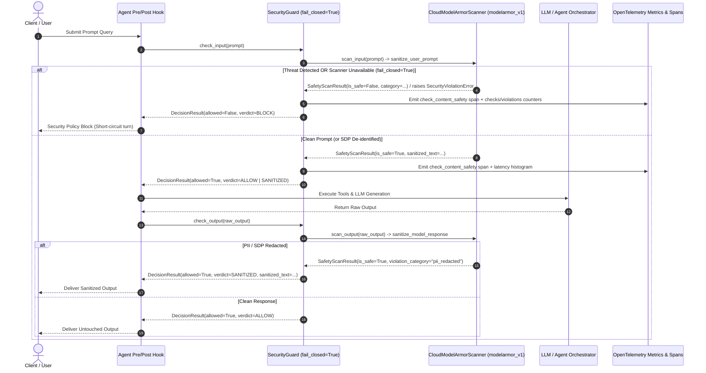

<!--
Copyright 2026 Google. This software is provided as-is, without
warranty or representation for any use or purpose. Your use of it is
subject to your agreement with Google.
-->

# Model Armor Security Layer Guide (`agentops_sdk` v1.0.0)

This guide covers the **Cloud Model Armor & Safety Guardrail Layer** in `agentops_sdk.security` (`SecurityGuard`, `CloudModelArmorScanner`, `LocalRuleSafetyScanner`, `check_input`, and `check_output`), including fail-closed enforcement, regional endpoints, SDP/DLP scrubbing, multi-framework integration, OpenTelemetry instrumentation, and offline/GCP E2E verification.

---

## 1. System Architecture & Lifecycle Flow

In `v1.0.0`, the safety perimeter is implemented via the `SafetyScannerPort` protocol ([`sdk/src/agentops_sdk/ports/security.py`](../sdk/src/agentops_sdk/ports/security.py)) with two concrete adapters ([`model_armor.py`](../sdk/src/agentops_sdk/security/model_armor.py) and [`guard.py`](../sdk/src/agentops_sdk/security/guard.py)):

*   **`CloudModelArmorScanner`**: Production adapter backed by the official `google-cloud-modelarmor` (`modelarmor_v1.ModelArmorClient`) GAPIC client using regional endpoints (`modelarmor.{location}.rep.googleapis.com`, or `modelarmor.googleapis.com` for `location="global"`).
*   **`LocalRuleSafetyScanner`**: Deterministic, zero-network scanner for hermetic unit tests, local demos, or explicit non-strict offline usage.
*   **`SecurityGuard`**: Policy orchestrator wrapping a `SafetyScannerPort` with **`fail_closed=True` by default** (`MODEL_ARMOR_FAIL_CLOSED=true`).



---

## 2. Key `v1.0.0` Security & API Guarantees

| Capability | Behavior in `agentops_sdk` `v1.0.0` | Implementation (`sdk/src/agentops_sdk/security/`) |
| :--- | :--- | :--- |
| **Native GAPIC v1 Client & Endpoint Pooling** | Pools thread-safe `modelarmor_v1.ModelArmorClient` instances per region (`modelarmor.{location}.rep.googleapis.com` or `modelarmor.googleapis.com` for `global`) with `timeout=10` and `SanitizeUserPromptRequest` / `SanitizeModelResponseRequest`. | [`model_armor.py`](../sdk/src/agentops_sdk/security/model_armor.py) |
| **5 Threat Filters + SDP Handling** | Evaluates `pi_and_jailbreak_filter_result` (`prompt_injection`), `rai_filter_result` (`rai_violation`), `malicious_uri_filter_result` (`malicious_uri`), `csam_filter_filter_result` (`csam_violation`), and `virus_scan_filter_result` (`virus_detected`) prior to `sdp_filter_result` (`pii_redacted`). If SDP reports an `inspect_result` match without transformed text, `RegexPrivacyScrubber` scrubs the text automatically. | [`model_armor.py`](../sdk/src/agentops_sdk/security/model_armor.py) |
| **Strict Fail-Closed Default (`CWE-636`)** | `SecurityGuard` defaults to `fail_closed=True`. Network/auth errors, `InvocationResult.FAILURE`, or `InvocationResult.PARTIAL` (when `fail_closed=True`) return `DecisionResult(allowed=False, verdict=SecurityVerdict.BLOCK, violation_category="scanner_unavailable")`. | [`guard.py`](../sdk/src/agentops_sdk/security/guard.py) |
| **Explicit Offline Scanner (Zero Hidden Mocks)** | Offline tests and local demos inject `LocalRuleSafetyScanner()` explicitly (`SecurityGuard(scanner=LocalRuleSafetyScanner())`). `LocalRuleSafetyScanner` only activates on error when `fail_closed=False` is passed explicitly, recording `agentops.sdk.fallback_count` via `record_fallback_metric("model_armor", ...)`. | [`guard.py`](../sdk/src/agentops_sdk/security/guard.py) |
| **Deterministic PII Scrubbing in Local Scanner** | `LocalRuleSafetyScanner.scan_output()` rejects prompt injection patterns first (`BLOCK` precedence) and then delegates PII scrubbing to `RegexPrivacyScrubber` (`[EMAIL_ADDRESS]`, `[CREDIT_CARD_NUMBER]`, `[IBAN_CODE]`, `[US_SOCIAL_SECURITY_NUMBER]`, `[PHONE_NUMBER]`, `[IP_ADDRESS]`), returning `SecurityVerdict.SANITIZED`. | [`guard.py`](../sdk/src/agentops_sdk/security/guard.py), [`dlp.py`](../sdk/src/agentops_sdk/security/dlp.py) |
| **Verdict Classification (`SecurityVerdict`)** | Three canonical `StrEnum` outcomes: `ALLOW`, `SANITIZED`, and `BLOCK`. | [`domain/models.py`](../sdk/src/agentops_sdk/domain/models.py) |

---

## 3. Multi-Framework Integration Recipes

### A. Google ADK Agent Integration

Use `SecurityGuard` (with `CloudModelArmorScanner` in GCP or `LocalRuleSafetyScanner` in offline tests) and scan untrusted tool/database outputs through `guard.check_input(...)` before injecting them into LLM context:

```python
from agentops_sdk.domain.models import SecurityVerdict
from agentops_sdk.security import (
    CloudModelArmorScanner,
    SecurityGuard,
)

guard = SecurityGuard(
    scanner=CloudModelArmorScanner(
        project_id="my-gcp-project-id",
        location="europe-west4",
    ),
    fail_closed=True,
)


def before_agent_turn_callback(turn_context) -> None:
    prompt_text = turn_context.user_content.text
    decision = guard.check_input(prompt_text)
    if not decision.allowed or decision.verdict == SecurityVerdict.BLOCK:
        turn_context.state["_security_blocked"] = True
        turn_context.abort(reason=decision.reason)


def on_tool_data_retrieved(data_payload: object) -> str:
    # Scan untrusted database rows or file contents for indirect injection
    decision = guard.check_input(str(data_payload))
    if not decision.allowed:
        raise PermissionError(f"Untrusted context blocked: {decision.reason}")
    return decision.sanitized_text


def after_agent_turn_callback(turn_context) -> None:
    raw_response = turn_context.response.text
    decision = guard.check_output(raw_response)
    if not decision.allowed:
        turn_context.abort(reason=decision.reason)
        return
    if decision.verdict == SecurityVerdict.SANITIZED:
        turn_context.response.text = decision.sanitized_text
```

### B. LangChain & LangGraph Integration

```python
from langchain_core.callbacks import BaseCallbackHandler

from agentops_sdk.security import SecurityGuard


class ModelArmorLangChainHandler(BaseCallbackHandler):
    def __init__(self, guard: SecurityGuard | None = None) -> None:
        self._guard = guard or SecurityGuard(fail_closed=True)

    def on_llm_start(self, serialized, prompts, **kwargs) -> None:
        del serialized, kwargs
        for prompt in prompts:
            decision = self._guard.check_input(prompt)
            if not decision.allowed:
                raise ValueError(f"Security Block: {decision.reason}")

    def on_llm_end(self, response, **kwargs) -> None:
        del kwargs
        for generation_list in response.generations:
            for gen in generation_list:
                decision = self._guard.check_output(gen.text)
                if not decision.allowed:
                    raise ValueError(f"Output Security Block: {decision.reason}")
                gen.text = decision.sanitized_text or gen.text
```

### C. FastAPI Security Middleware

```python
from fastapi import FastAPI, HTTPException, Request

from agentops_sdk.security import SecurityGuard

app = FastAPI()
guard = SecurityGuard(fail_closed=True)


@app.middleware("http")
async def model_armor_security_middleware(request: Request, call_next):
    if request.method in {"POST", "PUT"}:
        body = await request.json()
        prompt = body.get("prompt") or body.get("query", "")
        if prompt:
            decision = guard.check_input(prompt)
            if not decision.allowed:
                raise HTTPException(status_code=400, detail=decision.reason)
    return await call_next(request)
```

---

## 4. Configuration & Environment Variables (`SecuritySettings`)

Settings are loaded lazily via [`sdk/src/agentops_sdk/config/_schemas.py`](../sdk/src/agentops_sdk/config/_schemas.py) (`get_security_settings()`):

| Environment Variable (Primary / Aliases) | `SecuritySettings` Field | Default | Description |
| :--- | :--- | :--- | :--- |
| `MODEL_ARMOR_PROJECT_ID`, `SECURITY_PROJECT_ID`, `GOOGLE_CLOUD_PROJECT`, `GCP_PROJECT`, `AGENTOPS_PROJECT_ID` | `project_id` | `None` (falls back to ADC quota project) | GCP project hosting Model Armor templates. |
| `MODEL_ARMOR_LOCATION`, `MODEL_ARMOR_REGION`, `SECURITY_LOCATION`, `SECURITY_REGION`, `GOOGLE_CLOUD_LOCATION`, `GCP_REGION`, `AGENTOPS_LOCATION` | `location` | `"europe-west4"` | GCP region/location (`global` maps to `modelarmor.googleapis.com`; regional values map to `modelarmor.{location}.rep.googleapis.com`). |
| `MODEL_ARMOR_INPUT_TEMPLATE`, `MODEL_ARMOR_TEMPLATE_ID`, `SECURITY_TEMPLATE_ID` | `input_template_id` | `"agentops-input-guard"` | Model Armor template ID for `sanitize_user_prompt`. |
| `MODEL_ARMOR_OUTPUT_TEMPLATE`, `SECURITY_OUTPUT_TEMPLATE_ID` | `output_template_id` | `"agentops-output-guard"` | Model Armor template ID for `sanitize_model_response`. |
| `MODEL_ARMOR_FAIL_CLOSED`, `MODEL_ARMOR_STRICT_CLOUD`, `SECURITY_FAIL_CLOSED` | `fail_closed` | `True` | Fail closed (`BLOCK` / `scanner_unavailable`) on Model Armor transport, auth, or `PARTIAL` errors. |
| `SECURITY_PII_MASKING_ENABLED` | `pii_masking_enabled` | `True` | Flag toggling PII masking policy in security configuration. |
| `SECURITY_JAILBREAK_THRESHOLD` | `jailbreak_threshold` | `0.80` | Configured jailbreak confidence threshold (`0.0`–`1.0`). |

---

## 5. Observability & OpenTelemetry Instrumentation

Every `SecurityGuard.check_input()` and `SecurityGuard.check_output()` call emits a span and OTel metrics via `CachedMeterTracker` ([`sdk/src/agentops_sdk/security/guard.py`](../sdk/src/agentops_sdk/security/guard.py)):

*   **Span (`check_content_safety`)**:
    *   `safety.is_safe` (`bool`): `decision.allowed`
    *   `safety.verdict` (`str`): `"ALLOW"`, `"SANITIZED"`, or `"BLOCK"`
*   **Metrics (`agentops.security.*`)**:
    *   `agentops.security.checks.total` (Counter): attributes `{"direction": "input" | "output", "verdict": ...}`
    *   `agentops.security.violations.total` (Counter, emitted when `not decision.allowed`): attributes `{"direction": ..., "verdict": "BLOCK", "category": ...}`
    *   `agentops.security.check.latency` (Histogram, `ms`): attributes `{"direction": ..., "verdict": ...}`
*   **Fallback Metric (only when `fail_closed=False`)**:
    *   `agentops.sdk.fallback_count` (Counter via `record_fallback_metric("model_armor", f"{direction}_error")`)
*   **Structured Warning Logs**: Uses `logger = logging.getLogger(__name__)` (`agentops_sdk.security.guard`), emitting sanitized warnings without leaking user prompts or PII.

---

## 6. Verification & Automated Test Suites

### Standalone Demo
```bash
# Offline deterministic demo using LocalRuleSafetyScanner
python examples/demo_model_armor/demo_model_armor_safety.py --mode offline

# Live GCP Cloud Model Armor demo
GOOGLE_CLOUD_PROJECT=<your-gcp-project-id> \
MODEL_ARMOR_INPUT_TEMPLATE=agentops-input-guard \
MODEL_ARMOR_OUTPUT_TEMPLATE=agentops-output-guard \
python examples/demo_model_armor/demo_model_armor_safety.py --mode gcp
```

### Unit & Contract Tests
```bash
pytest -v tests/unit/test_security_guards.py tests/contract/test_security_contract.py --eval-mode=in_memory
```

### Automated E2E Shell Suite (`tests/e2e_model_armor/`)

| Test Script | Coverage |
| :--- | :--- |
| `test_1_prompt_injection_defense.sh` | Fail-closed blocking on unreachable cloud scanner + inbound prompt injection blocking. |
| `test_2_pii_redaction_and_masking.sh` | Outbound PII redaction and `SecurityVerdict.SANITIZED` classification. |
| `test_3_opentelemetry_metrics_and_unified_logging.sh` | `check_content_safety` spans, `agentops.security.*` counters/histograms, and warning logs. |
| `test_4_adk_agent_model_armor_integration.sh` | Google ADK agent execution with Model Armor callbacks (offline or live GCP). |
| `run_all_model_armor_tests.sh` | Master test runner supporting `--offline` or live GCP project/region execution. |

```bash
# Offline hermetic E2E suite
./tests/e2e_model_armor/run_all_model_armor_tests.sh --offline

# Live GCP E2E verification
./tests/e2e_model_armor/run_all_model_armor_tests.sh <your-gcp-project-id> europe-west4
```
