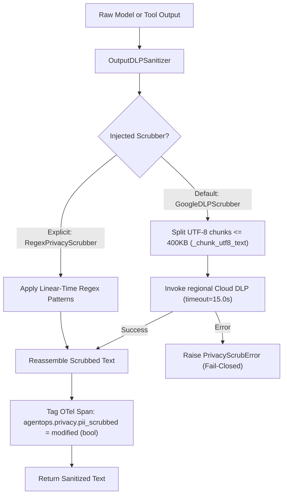

<!--
Copyright 2026 Google. This software is provided as-is, without
warranty or representation for any use or purpose. Your use of it is
subject to your agreement with Google.
-->

# Output GDPR & Cloud DLP Sanitization Design (`v1.0.0`)

This document specifies the technical design, regional endpoint pooling, UTF-8 byte-boundary chunking, fail-closed error semantics, and OpenTelemetry span tagging for the PII scrubbing subsystem in [`sdk/src/agentops_sdk/security/dlp.py`](../sdk/src/agentops_sdk/security/dlp.py).

---

## 1. Hexagonal Port & Fail-Closed Privacy Flow

In `v1.0.0`, PII scrubbing implements the `PrivacyScrubberPort` protocol ([`sdk/src/agentops_sdk/ports/security.py`](../sdk/src/agentops_sdk/ports/security.py)):

*   **`OutputDLPSanitizer`**: High-level facade exposing `scrub(text: str) -> str` and `async scrub_text(text: str) -> str`. Defaults to `GoogleDLPScrubber(project_id=..., location=...)` when no explicit `scrubber` is injected.
*   **`GoogleDLPScrubber`**: Production Cloud DLP adapter (`dlp_v2.DlpServiceClient`) that pools clients per region (`dlp.{location}.rep.googleapis.com`, or `dlp.googleapis.com` for `location="global"`), targets `parent=f"projects/{project_id}/locations/{location}"`, splits payloads on safe UTF-8 codepoint/newline/whitespace boundaries (`_MAX_CHUNK_BYTES = 400_000`), enforces `timeout=15.0`, and **fails closed** by raising `PrivacyScrubError` on API errors (zero silent fallback to regex).
*   **`RegexPrivacyScrubber`**: Linear-time offline adapter injected explicitly for hermetic unit tests, local demos, or offline `LocalRuleSafetyScanner.scan_output()` scans.



---

## 2. Supported InfoTypes & Placeholders

### Cloud DLP (`GoogleDLPScrubber`)
By default (when `inspect_template_name` is not supplied), `GoogleDLPScrubber` inspects and de-identifies with `ReplaceWithInfoTypeConfig` across these InfoTypes:
*   `EMAIL_ADDRESS`
*   `PHONE_NUMBER`
*   `PERSON_NAME`
*   `CREDIT_CARD_NUMBER`
*   `IBAN_CODE`

Custom Cloud DLP templates (`inspect_template_name`, `deidentify_template_name`) or custom `info_types` sequences can also be passed to `GoogleDLPScrubber(...)`.

### Offline Regex Adapter (`RegexPrivacyScrubber`)
`RegexPrivacyScrubber` detects structured sensitive tokens using linear-time regular expressions without false-positive stripping on capitalized prose (`PERSON_NAME` is handled by Cloud DLP in production):

| Sensitive Token | Offline Regex Target | Redacted Tag Placeholder |
| :--- | :--- | :--- |
| Email Address | Standard email address (`[A-Za-z0-9._%+-]+@[A-Za-z0-9.-]+\.[A-Za-z]{2,}`) | `[EMAIL_ADDRESS]` |
| Credit Card Number | 13–16 digit card sequences | `[CREDIT_CARD_NUMBER]` |
| IBAN Code | `^[A-Z]{2}\d{2}[A-Z0-9]{11,30}$` | `[IBAN_CODE]` |
| US Social Security Number | `\b\d{3}-\d{2}-\d{4}\b` | `[US_SOCIAL_SECURITY_NUMBER]` |
| Phone Number | North American / international `+1` phone formats | `[PHONE_NUMBER]` |
| IPv4 Address | Bounded `0–255` dotted quad octets | `[IP_ADDRESS]` |

---

## 3. OpenTelemetry Integration & Usage Example

To ensure auditability without logging sensitive PII values, `OutputDLPSanitizer` sets a single boolean attribute on the currently recording OpenTelemetry span:
*   **`agentops.privacy.pii_scrubbed`** (`bool`): `True` when `scrubbed != original_text`, otherwise `False`.

```python
from agentops_sdk.security import (
    GoogleDLPScrubber,
    OutputDLPSanitizer,
    RegexPrivacyScrubber,
)

# Production GCP usage (regional Cloud DLP endpoint + fail-closed PrivacyScrubError)
prod_sanitizer = OutputDLPSanitizer(
    scrubber=GoogleDLPScrubber(
        project_id="my-gcp-project",
        location="europe-west4",
    )
)

# Hermetic offline testing / local demo usage
local_sanitizer = OutputDLPSanitizer(scrubber=RegexPrivacyScrubber())
clean_text = local_sanitizer.scrub("Contact john.doe@example.com or 192.168.1.10.")
```
