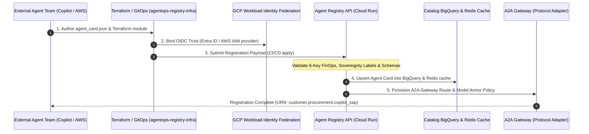
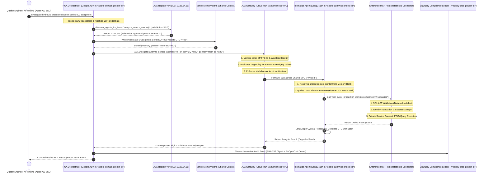
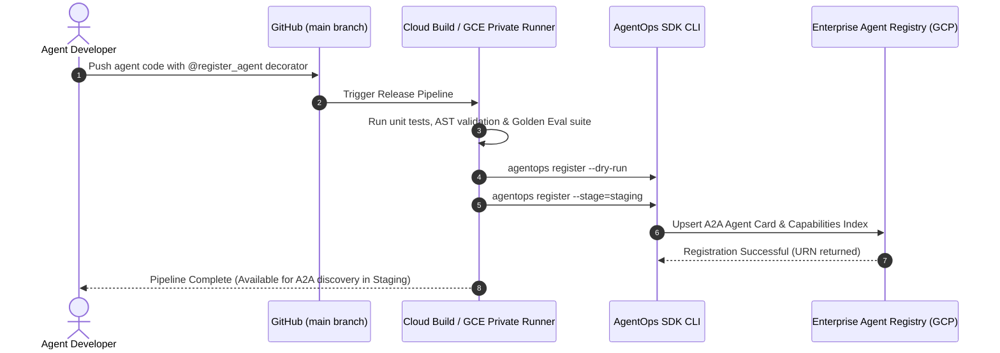

<!--
Copyright 2026 Google. This software is provided as-is, without
warranty or representation for any use or purpose. Your use of it is
subject to your agreement with Google.
-->

# Architecture Design: Enterprise Agent Registry & A2A Sharing Catalog
## Multi-Framework Agent Catalog, Delegation Contracts, and GCP Landing Zone Implementation

> [!NOTE]
> **Document Status — Proposed `v1.x+` Subpackage (`agentops_sdk.registry`) on `v1.0.0`**: Telemetry, security, memory, and audit primitives integrated into this architecture (`agentops_sdk.{telemetry,security,memory,audit}`) are **shipped in `v1.0.0`**. The `agentops_sdk.registry` subpackage (`EnterpriseAgentRegistryClient`, `@register_agent`) and the Landing Zone Registry control-plane APIs described below are a **proposed future platform extension** not yet shipped in `v1.0.0`.

This document establishes the architectural design, GCP Landing Zone implementation specifications, data contracts, and governance models for the **Enterprise Agent Registry** powered natively by the **Enterprise Agent Platform**, **Vertex AI Agent Registry**, and the **Agent2Agent (A2A) Protocol**.

This design is strictly aligned with the **Google Customer Google Cloud Platform Landing Zone Technical Implementation Document (Low-Level Design / LLD)**, incorporating Google Customer's Cloud Foundation Toolkit (CFT) resource hierarchy, Hub-and-Spoke Shared VPC networking, Palo Alto Next-Gen Firewall egress routing, Azure Active Directory (AAD) federation, Workload Identity Federation (WIF), and enterprise organization policy guardrails.

---

## 1. Executive Summary & Paradigm Shift

### 1.1 The Challenge of Siloed Agents & Ad-Hoc Delegation
In a decentralized enterprise manufacturing ecosystem like Google Customer, individual business units (Manufacturing Quality, Connected Operations, Supply Chain, Customer Experience, Corporate Finance) build specialized autonomous agents. Without a unified control plane grounded in enterprise cloud foundations, this leads to fragmentation:
* **Operational & Runtime Disconnect**: Agents are deployed as isolated containers or scripts without standardized lifecycle stages (`@dev`, `@staging`, `@canary`, `@prod`) or automated quality evaluation gates.
* **P2P Point-to-Point Coupling**: Teams hardcode downstream API endpoints when one agent calls another, creating brittle architectures unable to adapt as agent models, schemas, or locations evolve.
* **Token & Context Explosion**: Inter-agent calls retransmit entire conversational transcripts across the network, causing massive latency and token cost bloat.
* **Identity & Blast Radius Vulnerabilities**: Using static, downloadable service account JSON keys across agent workflows means a compromised sub-agent can escalate privileges across the enterprise.
* **Territorial & Regulatory Blindspots**: Unregulated delegation chains risk exfiltrating plant-level operational data (e.g., European manufacturing telematics from Plant-EU-01 or Plant-EU-02) outside sovereign boundaries.
* **Perimeter & Policy Violations**: Shadow compute and public IP endpoints violate Landing Zone organizational guardrails.

### 1.2 The Enterprise Agent Registry & A2A Federation Foundation
By anchoring Google Customer's agent sharing on **Enterprise Agent Platform**, **Vertex AI Agent Registry**, and the **Agent2Agent (A2A)** standard within Google Customer's **Google Cloud Platform Landing Zone**, Google Customer establishes an enterprise-grade catalog, secure delegation mesh, and lifecycle orchestration platform:

| Platform Layer | Core Capabilities | Google Customer Landing Zone Alignment |
| :--- | :--- | :--- |
| **Catalog & Discovery** | Multi-Framework Packaging (ADK, LangGraph, Copilot), A2A Agent Cards, SemVer Stages | Central BigQuery catalog dataset in `<registry-[p/s/t]-project-id>` |
| **Identity & Security** | Cryptographic SPIFFE IDs, Workload Identity, Downscoped Tokens | Zero SA keys (`iam.disableServiceAccountKeyCreation`), WIF authentication |
| **Sovereignty & Governance** | GDPR / Territorial Boundary Labels, Destination Local Plant Veto | Pinned to `europe-west3`, fail-closed cross-border delegation checks |
| **Runtime & Gateway** | Serverless VPC Ingress, Internal Load Balancing, A2A Task Routing | Shared VPC `vpc-shared-prod`, Serverless VPC Access connector |
| **Context & Memory** | Context by Reference via Shared Memory Pointers ($\le 2$ KB payloads) | Vertex Memory Bank and Enterprise Agent Platform Sessions, eliminating token bloat |
| **Storage & CMEK** | Immutable Artifact Storage, Container Images, Compliance Audit Ledger | Customer-managed keys (`krg01`), Uniform Bucket-Level Access, PAP |

---

## 2. GCP Cloud Foundations & Landing Zone Architecture Alignment

The Enterprise Agent Registry is built strictly according to Google Customer's **Google Cloud Platform Landing Zone Technical Implementation Document**.

### 2.1 Google Customer Resource Hierarchy & Folder Placement
Following Google Customer's Cloud Foundation Toolkit (CFT) hierarchy under the verified Google Cloud Organization `customer.example.com` (Org ID: `123456789012`), all resources reside under the tactical root folder `fldr-customer` (Folder ID: `987654321098`):

```
customer.example.com (Organization ID: 123456789012)
└── fldr-customer (Tactical Root Folder ID: 987654321098)
    ├── fldr-mgt (Infrastructure Management)
    │   ├── <cicd-project-id>          # CI/CD Workload Identity & GitHub Actions
    │   ├── <seed-project-id>                 # Terraform State GCS Backend & Bootstrap SAs
    │   ├── <kms-project-id>                  # Organization-wide Cloud KMS (CMEK)
    │   ├── <logging-project-id>         # Centralized Log Sinks & Central Metrics Scope
    │   ├── <secrets-project-id>              # Enterprise Secret Manager
    │   ├── <artifact-project-id>                   # Common Artifact Registry (Shared Wheels)
    │   └── <billing-project-id>       # BigQuery Billing Export & FinOps
    │
    ├── fldr-networks (Shared VPC Hub & Connectivity)
    │   ├── <transit-project-id>            # Transit Hub (customer-transit-vpc1) + Palo Alto
    │   ├── <svpc-prod-project-id>                 # Prod Shared VPC (vpc-shared-prod)
    │   ├── <svpc-staging-project-id>                 # Staging Shared VPC (vpc-shared-staging)
    │   └── <svpc-test-project-id>                 # Test Shared VPC (vpc-shared-test)
    │
    ├── fldr-biz (Business Workloads & AI Platforms)
    │   ├── fldr-agentops (Agent Platform & Control Plane)
    │   │   ├── <registry-prod-project-id>    # Production Agent Registry & Gateway
    │   │   ├── <registry-staging-project-id>    # Staging Agent Registry & Gateway
    │   │   └── <registry-test-project-id>    # Test Agent Registry & Gateway
    │   │
    │   ├── fldr-manufacturing-quality (Spoke Business Application)
    │   │   └── <spoke-[p/s/t]-domain-project-id> # Quality RCA & Telematics Agents
    │   │
    │   └── fldr-connected-ops (Spoke Business Application)
    │       └── <spoke-[p/s/t]-analytics-project-id> # Fleet Telematics & Field Operations Agents
    │
    └── fldr-sandbox (Experimental Playground)
        └── <sandbox-project-id>     # Ephemeral agent experimentation
```

#### Hierarchy Design Principles:
1. **Control vs. Data Plane Segregation**: The central catalog plane, discovery indices, and A2A routing endpoints reside in `<registry-[env]-project-id>`. Business domain agents execute within their respective spoke projects (`<spoke-[env]-domain-project-id>`) and register their capabilities into the central catalog.
2. **Environment Parity**: Production (`p`), Pre-Production/Staging (`s`), and Test/Dev (`t`) are strictly segregated, with an isolated ephemeral `sandbox` folder for unconstrained engineering prototyping.
3. **Single Project per Application Tier**: Adheres to the Landing Zone thumb rule: one project for one application tier per environment, ensuring clear IAM boundaries, audit logging isolation, and granular billing attribution.

---

### 2.2 Google Customer Standard Naming & Tagging Conventions Compliance

Every cloud resource instantiated for the Enterprise Agent Registry strictly abides by Google Customer's Landing Zone naming patterns (Section 4.2):

* **BigQuery Resources**: `{organization}_{region}_{env}_{folder&project}_{function}_{service}_{incr.numeric}` (underscores enforced).
* **All Other Cloud Resources**: `{organization}-{region}-{env}-{folder & project}-{function}-{service}-{incr.numeric}` (hyphen-delimited).

| Service / Resource | Code | Production Resource Name (`europe-west3`) | Purpose / Description |
| :--- | :--- | :--- | :--- |
| **BigQuery Catalog Dataset** | `bq` | `customer_euw3_p_agentops_prj01_registry_bq01` | Central A2A agent catalog and capabilities index |
| **BigQuery Audit Ledger** | `bq` | `customer_euw3_p_sec_prj01_agent_audit_ledger_tbl01` | Append-only tamper-evident audit ledger |
| **Cloud Storage Staging** | `gcs` | `bkt-customer-euw3-p-agentops-staging01` | Staging bucket for agent wheels and prompt cards |
| **Cloud Storage Artifacts**| `gcs` | `bkt-customer-euw3-p-agentops-artifacts01`| Immutable build artifacts with retention locks |
| **Artifact Registry** | `ar` | `customer-euw3-p-agentops-pkg-ar01` | Private Docker container and wheel repository |
| **Cloud Run A2A Gateway** | `cr` | `customer-euw3-p-agentops-gateway-cr01` | High-concurrency serverless A2A router |
| **Cloud Run Registry API** | `cr` | `customer-euw3-p-agentops-registry-api-cr01`| Fast discovery, CRUD, and stage promotion API |
| **VPC Shared Host** | `svpc`| `vpc-shared-prod` | Production Shared VPC across spoke workloads |
| **VPC Compute Subnet** | `sbn` | `customer-p-eu-west3-sb-01` | Compute Subnet (`10.88.34.0/23`) for Serverless VPC |
| **VPC Proxy-Only Subnet** | `sbn` | `customer-p-eu-west3-sb-03` | Proxy-only subnet (`10.88.16.128/26`) for Internal LB |
| **KMS Key Ring** | `krg` | `customer-euw3-p-cre-prj-inf-krg01` | Central CMEK key ring in `<kms-project-id>` |
| **KMS Crypto Key** | `key` | `customer-euw3-p-agentops-registry-key01` | Dedicated CMEK key for agent datasets & buckets |
| **Service Account (API)** | `sa` | `sa-agentops-registry-api@...` | Least-privilege identity for registry control plane |
| **Cloud Monitoring Dashboard**| `mon` | `customer-euw3-p-mon-prj01-agentops-bq01` | Unified A2A observability and token dashboard |

#### Mandatory 6-Key Labeling Framework:
All resources provisioned for the Agent Registry carry mandatory metadata tags:

```hcl
locals {
  agentops_registry_labels = {
    environment              = "prod"
    department               = "IT"
    application              = "agentops-registry"
    primary_contact          = "platform_lead_customer_example_com"
    secondary_contact        = "secondary_lead_customer_example_com"
    billing_code_cost_centre = "CC-OPS-QA-4402"
  }
}
```

---

### 2.3 Hub-and-Spoke Networking, Shared VPCs & Zero-Trust Connectivity

The Agent Registry adheres strictly to Google Customer's enterprise network topology defined in Landing Zone Section 6:

| Network Domain | VPC / Subnet Identifier | CIDR / IP Range | Security Enforcement & Purpose |
| :--- | :--- | :--- | :--- |
| **Connectivity Hub** | `customer-transit-vpc1` | `10.82.0.0/24` | Palo Alto NGFW (`10.82.0.49`), Priority 999 egress route |
| **Shared VPC (Prod)** | `vpc-shared-prod` | Host Network | Cross-project private network for all spoke workloads |
| **Core Compute Subnet**| `customer-p-eu-west3-sb-01` | `10.88.34.0/23` | Serverless VPC Access connector (`connector-p-euw3-cr01`) |
| **Proxy-Only Subnet** | `customer-p-eu-west3-sb-03` | `10.88.16.128/26`| Internal Application Load Balancer (ILB) VIP routing |
| **Private DNS Zone** | `priv.gcp.customer.example.com` | Internal DNS | `registry.agentops.priv.gcp.customer.example.com` $\rightarrow$ `10.88.34.50` |
| **Private Service Connect**| `psc-agentops-endpoint` | Service Attachment| Spoke-to-spoke private A2A task delegation mesh |

#### Key Networking Parameters:
1. **Zero Public Ingress & Egress**: Under Org Policy `compute.vmExternalIpAccess`, no virtual machine, container, or serverless service carries an external IP. All traffic terminates at internal endpoints.
2. **Serverless VPC Access**: Cloud Run instances host the Registry API and A2A Gateway. Under Org Policy `cloudfunctions.requireVPCConnector`, each service attaches to a Serverless VPC Access connector configured in subnet `customer-p-eu-west3-sb-01`.
3. **Private Google Access (PGA)**: Communication to BigQuery, Cloud Storage, Artifact Registry, and Vertex AI utilizes Google Cloud's private IP fabric (`restricted.googleapis.com`), eliminating internet routing.
4. **Internal DNS Resolution**: Ingress to the Agent Registry resolves privately via Google Customer's Cloud DNS private zone `priv.gcp.customer.example.com`. A record `registry.agentops.priv.gcp.customer.example.com` points directly to the Internal Application Load Balancer (ILB) in `customer-p-eu-west3-sb-03`.
5. **Egress Firewall Inspection**: Any outbound external calls (e.g., querying external vendor SaaS APIs or partner foundation models) route across Shared VPC routes with priority 999 to the Palo Alto NextGen Firewall cluster (`10.82.0.49`) in transit VPC `customer-transit-vpc1` for deep packet and DLP inspection.

---

### 2.4 Zero-Trust Security, Identity & Organization Policy Guardrails

The Agent Registry enforces Google Customer's Zero-Trust Architecture and complies with all 31 mandatory Google Cloud Organization Policies specified in Landing Zone Section 8.6:

| # | Constraint Identifier | Landing Zone Enforcement | Architectural Application in AgentOps Registry |
| :-: | :--- | :--- | :--- |
| **2** | `iam.disableServiceAccountKeyCreation` | **Hard Deny** | Zero downloadable JSON keys. All CI/CD and agents use WIF or IAM Workload Identity. |
| **7** | `storage.uniformBucketLevelAccess` | **Enforced** | Disables object ACLs on all registry staging and artifact buckets. |
| **8** | `gcp.resourceLocations` | **Restricted** | All resources pinned to `europe-west3` (primary) and `us-central1` (secondary). |
| **15**| `compute.restrictSharedVpcHostProjects`| **Restricted** | Only `<svpc-*-project-id>` can act as Shared VPC hosts. |
| **17**| `compute.restrictSharedVpcSubnetworks` | **Restricted** | Workloads strictly confined to designated subnets (`sb-01`, `sb-03`). |
| **20**| `compute.skipDefaultNetworkCreation` | **Enforced** | No default networks permitted in any project. |
| **24**| `iam.allowedPolicyMemberDomains` | **Restricted** | Only identities within `customer.example.com` directory allowed in IAM bindings. |
| **25**| `storage.publicAccessPrevention` | **Enforced** | Hard deny on public internet access to any Cloud Storage bucket. |
| **27**| `cloudfunctions.requireVPCConnector` | **Enforced** | Cloud Run & Functions must attach to a Serverless VPC Access connector. |
| **29**| `compute.vmExternalIpAccess` | **Hard Deny** | No external IP addresses on any compute or container instance. |
| **30**| `compute.trustedImageProjects` | **Restricted** | Container images allowed only from `<artifact-project-id>` (internal Artifact Registry). |
| **31**| `iam.automaticIamGrantsForDefaultServiceAccounts`| **Enforced** | Disables automatic editor roles on default Compute/App Engine service accounts. |

#### Azure Active Directory (AAD) Federation & Persona IAM Roles:
Authentication integrates with Microsoft Entra ID (Azure AD). Users belong to domain security groups (`@customer.example.com`), which are mapped to custom IAM roles defined at the `fldr-customer` folder level:

| Google Group Identifier | Google Customer Persona | Custom IAM Role | Primary Permissions & Scopes |
| :--- | :--- | :--- | :--- |
| `grp-customer-agentops-admins@customer.example.com` | Agent Platform Lead | `org_agent_platform_admin` | Full control over catalog schema, stage promotion, and tenant onboarding |
| `grp-customer-agent-devs@customer.example.com` | AI & Agent Engineers | `org_agent_developer` | Register agents, update `@dev` / `@staging` cards, view logs & traces |
| `grp-customer-agent-consumers@customer.example.com`| Quality/Finance Users| `org_agent_invoker` | Discover catalog agents, initiate A2A delegations via gateway |
| `grp-customer-secops-auditors@customer.example.com`| Security & Compliance| `org_agent_compliance_auditor`| Read-only audit access to BigQuery ledger, XSIAM sinks, and CMEK status |

#### Keyless Automation via Workload Identity Federation (WIF):
To guarantee zero credentials leakage, all GitHub Actions CI/CD pipelines authenticate to GCP keylessly:
* **WIF Pool**: `projects/987654321098/locations/global/workloadIdentityPools/foundation-pool`
* **WIF Provider**: `foundation-gh-provider` (validating GitHub repository OIDC tokens).
* **Service Account**: `sa-terraform-proj@<seed-project-id>.iam.gserviceaccount.com` for infrastructure, and `sa-agentops-cicd@<registry-prod-project-id>.iam.gserviceaccount.com` for application packages.

---

## 3. Core Architecture: Multi-Framework & A2A Interoperability

### 3.1 A2A vs. MCP: Complementary Layers in the Mesh
* **Model Context Protocol (MCP)**: Governs **Agent-to-Tool** communication. Standardizes how an agent connects to data sources, SQL warehouses, vector stores, and action triggers (e.g., querying Databricks SQL, Databricks Genie spaces, Vertex AI Search RAG, or Cloud Run trigger functions).
* **Agent2Agent Protocol (A2A)**: Governs **Agent-to-Agent** collaboration. Enables autonomous agents to discover one another, negotiate task intent, pass operational constraints, and delegate workflows across organizational boundaries without knowing each other's internal framework or prompt architecture.

### 3.2 Framework Flexibility: Google ADK and LangGraph / LangChain
Google Customer development teams are not locked into a single agent framework. The Agent Registry treats both **Google ADK** and **LangGraph** as first-class citizens:

| Architectural Layer | Google ADK (Agent Development Kit) | LangGraph / LangChain |
| :--- | :--- | :--- |
| **Core Paradigm** | Modular, opinionated agent loops with native sub-agents | Stateful, cyclical directed graphs with checkpointing |
| **Runtime Target** | Vertex AI Reasoning Engine / Cloud Run | Cloud Run container / FastAPI |
| **Memory Sync** | Native Enterprise Agent Platform Sessions & Vertex Memory Bank | LangGraph Checkpointer + Cloud Memorystore Redis |
| **A2A Ingress** | Built-in ADK A2A Server & Client | FastAPI A2A JSON-RPC / SSE Wrapper |
| **Tool Binding** | Standard FastMCP Client / Built-in Tools | LangChain MCP Client / Tool Bindings |

### 3.3 The A2A Agent Card Standard (`agent_card.json`)
To participate in the A2A mesh, every registered agent exposes an immutable, machine-readable **Agent Card**:

```json
{
  "$schema": "https://customer.internal/schemas/a2a/v1/agent-card.json",
  "a2a_version": "1.0",
  "agent_id": "customer.quality.telematics_analyzer",
  "version": "2.1.0",
  "display_name": "Telematics Defect Correlation Agent",
  "description": "Analyzes real-time CAN bus telemetry and DTC codes.",
  "framework": "LANGGRAPH",
  "capabilities": [
    {
      "intent": "analyze_sensor_anomaly",
      "description": "Correlates pressure drops with component batches.",
      "input_schema": {
        "type": "object",
        "properties": {
          "vin_or_pin": {"type": "string"},
          "fault_code": {"type": "string"}
        },
        "required": ["vin_or_pin", "fault_code"]
      },
      "output_schema": {
        "type": "object",
        "properties": {
          "anomaly_detected": {"type": "boolean"},
          "suspected_batch": {"type": "string"}
        }
      }
    }
  ],
  "endpoints": {
    "a2a_transport": "SSE",
    "url": "https://registry.agentops.priv.gcp.customer.example.com/telematics/v2"
  },
  "identity": {
    "spiffe_id": "spiffe://customer.internal/ns/quality/sa/telematics-agent",
    "service_account": "sa-telematics@<spoke-domain-project-id>.iam.gserviceaccount.com"
  },
  "sovereignty": {
    "jurisdiction": "EU",
    "plant_id": "plant-eu-01",
    "data_classification": "CONFIDENTIAL"
  },
  "finops": {
    "cost_center": "CC-OPS-QA-4402",
    "business_kpi": "warranty-reduction-r12",
    "pl_impact_line": "cogs-quality-claims"
  }
}
```

### 3.4 Cryptographic SPIFFE Identity & Delegation Blast Radius Bounding
1. **Workload Identity & SPIFFE Attestation**: Every agent runs under a dedicated Google Cloud Service Account bound to an attested SPIFFE ID.
2. **Constrained Delegation Tokens**: When an Orchestrator delegates a subtask to a domain agent via A2A, it generates a downscoped OAuth / SPIFFE token containing only the specific permissions needed for that operation.
3. **Bounded Blast Radius**: If a sub-agent is compromised, its access is cryptographically confined to its specific domain tools (e.g., read-only Databricks defect tables) and cannot traverse into financial or HR data planes.

### 3.5 Shared Memory Pointers: Eliminating Context Bloat
Retransmitting dozens of chat turns across A2A calls causes latency and token cost inflation. Google Customer enforces **Context by Reference**:
* The calling agent transmits **Memory Pointers** (`session_id`, `memory_anchor_id`) backed by **Enterprise Agent Platform Sessions** and **Vertex Memory Bank**.
* The receiving sub-agent retrieves only the required conversational facts and entity states on demand, keeping A2A network payloads lightweight ($\le 2$ KB).

### 3.6 Digital & Data Sovereignty: Attested Label Gates & Local Veto
* **Attested Boundary Labels**: Every agent card registers territorial and classification labels (`jurisdiction=EU`, `plant_id=plant-eu-01`, `data_classification=CONFIDENTIAL`).
* **Fail-Closed Ingress/Egress**: When an agent initiates an A2A delegation, the Enterprise Agent Gateway verifies that the target agent satisfies the caller's required sovereignty labels (`VerifyPeerLabels`). Cross-jurisdictional calls are blocked fail-closed unless explicitly signed off by a cross-border policy grant.
* **Destination-Side Local Attenuation (Local Veto)**: Local plant agents enforce destination-side Datalog policies *before* accepting delegated tasks, ensuring local operational veto over central orchestrator commands.

---

## 4. GCP Technical Implementation Architecture

### 4.1 Component Architecture Overview

| Architectural Layer | Target GCP Service | Landing Zone Resource Name | Key Configuration Parameters |
| :--- | :--- | :--- | :--- |
| **Ingress & DNS** | Internal HTTPS LB + Cloud DNS | `registry.agentops.priv.gcp.customer.example.com` | Private VIP: `10.88.34.50`, Subnet: `sb-03` (`10.88.16.128/26`) |
| **API Control Plane** | Cloud Run (Serverless) | `customer-euw3-p-agentops-registry-api-cr01` | Ingress: Internal LB only; Serverless VPC Connector: `connector-p-euw3-cr01` |
| **A2A Task Router** | Cloud Run (Serverless) | `customer-euw3-p-agentops-gateway-cr01` | A2A JSON-RPC/SSE proxy, Model Armor input sanitizer, SPIFFE gatekeeper |
| **Metadata Catalog**| BigQuery (Partitioned) | `customer_euw3_p_agentops_prj01_registry_bq01` | CMEK encrypted (`krg01`), partitioned by `registered_at`, clustered by `domain, stage` |
| **Cache Layer** | Cloud Memorystore Redis | `redis-p-euw3-reg01` | Subnet: `sb-01` (`10.88.34.15`), sub-5ms agent card discovery & routing cache |
| **Package Storage** | Artifact Registry | `customer-euw3-p-agentops-pkg-ar01` | Docker images & Python wheels; CMEK encrypted |
| **Staging Storage** | Cloud Storage Bucket | `bkt-customer-euw3-p-agentops-staging01` | UBLA=True, PAP=Enforced, CMEK encrypted, Object Versioning enabled |
| **Audit Ledger** | BigQuery (Append-Only) | `customer_euw3_p_sec_prj01_agent_audit_ledger_tbl01` | Append-only partition, 365-day retention linked to XSIAM SIEM sink |

### 4.2 Catalog Plane Schema & Data Contracts
The catalog plane maintains immutable specifications, SemVer stage pointers, and capabilities indexing:

| Column Name | BigQuery Data Type | Required? | Partition / Cluster Role | Description & Compliance Mapping |
| :--- | :--- | :--- | :--- | :--- |
| `agent_id` | `STRING` | YES | Clustered (Col 4) | Unique agent identifier (e.g. `telematics-agent`) |
| `version` | `STRING` | YES | Clustered | SemVer string (e.g. `2.1.0`) |
| `framework` | `STRING` | YES | - | `GOOGLE_ADK`, `LANGGRAPH`, `COPILOT_STUDIO` |
| `domain` | `STRING` | YES | Clustered (Col 1) | `manufacturing_quality`, `connected_ops`, etc. |
| `stage` | `STRING` | YES | Clustered (Col 2) | `@dev`, `@staging`, `@canary`, `@prod`, `@deprecated` |
| `a2a_endpoint_url`| `STRING` | YES | - | Private ILB VIP or PSC endpoint URL |
| `spiffe_id` | `STRING` | YES | - | Attested SPIFFE ID for mTLS / Workload Identity |
| `jurisdiction` | `STRING` | YES | Clustered (Col 3) | `EU`, `NA`, `LATAM`, `APAC` (SAM boundary gate) |
| `plant_id` | `STRING` | YES | - | `plant-eu-01`, `plant-eu-02`, `plant-us-01`, `plant-us-02` |
| `data_classification`| `STRING`| YES | - | `PUBLIC`, `INTERNAL`, `CONFIDENTIAL`, `RESTRICTED` |
| `cost_center` | `STRING` | YES | - | Corporate SAP Cost Center ID (e.g. `CC-OPS-QA-4402`) |
| `artifact_sha256` | `STRING` | YES | - | Cryptographic digest of container / wheel package |
| `registered_at` | `TIMESTAMP` | YES | Partition (Daily) | Timestamp of registration event |

### 4.3 Distributed A2A Mesh via Private Service Connect (PSC)
1. Spoke domain projects (e.g., `<spoke-domain-project-id>`) expose their internal A2A worker services behind Internal Application Load Balancers.
2. A **Private Service Connect (PSC) Service Attachment** is configured on each spoke A2A service.
3. The central A2A Gateway (`customer-euw3-p-agentops-gateway-cr01`) in `<registry-prod-project-id>` or calling orchestrators connect to target agents through **PSC Endpoints** registered in Cloud DNS (`priv.gcp.customer.example.com`).
4. Traffic travels entirely across Google's private software-defined Andromeda network, adhering strictly to Org Policy `compute.vmExternalIpAccess`.

---

## 5. Infrastructure as Code (IaC) & CI/CD Pipeline Automation

### 5.1 Foundation Repositories Alignment
In accordance with Google Customer Landing Zone Section 5, all infrastructure is automated via Terraform across the 5 foundation repositories:

```
Foundation Repositories (<ORG>):
├── enterprise-gcp-foundation-0-bootstrap   # Remote state bucket (bkt-<seed-project-id>-tfstate), WIF pool
├── enterprise-gcp-foundation-1-org         # 31 Org Policies, custom IAM roles (org_agent_platform_admin, etc.)
├── enterprise-gcp-foundation-2-envs        # Folders: fldr-agentops, fldr-manufacturing-quality, fldr-sandbox
├── enterprise-gcp-foundation-3-networks    # Shared VPC subnets (sb-01, sb-03), firewall rules, IAP rules
└── enterprise-gcp-foundation-4-projects    # Project provisioning: <registry-[p/s/t]-project-id>, API enablement

Application Infrastructure Repository:
└── agentops-registry-infra       # Terraform code deploying Cloud Run, BigQuery, Redis, Artifact Reg
```

### 5.2 Application IaC Topology Matrix (`agentops-registry-infra`)
Instead of monolithic script blocks, the application IaC module defines parameterized resources:

| Terraform Resource Type | Resource Name | Target Project | Subnet / Network | Security & Compliance Binding |
| :--- | :--- | :--- | :--- | :--- |
| `google_bigquery_dataset` | `customer_euw3_p_agentops_prj01_registry_bq01` | `<registry-prod-project-id>` | N/A (Private Access) | CMEK encrypted (`krg01`), 6-Key Labels |
| `google_storage_bucket` | `bkt-customer-euw3-p-agentops-staging01` | `<registry-prod-project-id>` | N/A (PGA) | UBLA=True, PAP=Enforced, CMEK encrypted |
| `google_artifact_registry_repository` | `customer-euw3-p-agentops-pkg-ar01` | `<registry-prod-project-id>` | N/A (PGA) | Format: DOCKER, CMEK encrypted |
| `google_cloud_run_v2_service` | `customer-euw3-p-agentops-registry-api-cr01` | `<registry-prod-project-id>` | `customer-p-eu-west3-sb-01` | Serverless VPC Access, Internal LB Ingress Only |
| `google_redis_instance` | `redis-p-euw3-reg01` | `<registry-prod-project-id>` | `customer-p-eu-west3-sb-01` | Private IP only, Transit Encryption enabled |

### 5.3 CI/CD Security Tollgate Matrix
Application deployments and infrastructure changes follow a strictly controlled GitOps lifecycle:

| Pipeline Stage | Trigger Event | Execution Runner | Identity & Auth | Quality & Security Tollgates |
| :--- | :--- | :--- | :--- | :--- |
| **Speculative Plan** | Code Commit / Push | Private GCE Runner (Seed VPC) | WIF (`foundation-pool`) | Linter, AST Syntax Check, Golden Eval validation |
| **PR Validation** | PR Creation / Update | Private GCE Runner (Seed VPC) | WIF (`foundation-pool`) | Terraform speculative plan, Org Policy compliance scan |
| **Controlled Apply** | Merge to `production` branch | Private GCE Runner (Seed VPC) | WIF (`sa-terraform-proj`) | Peer Approval Gate, Change Management ticket sync |

---

## 6. Proposed SDK Architecture & Developer Experience (`agentops_sdk.registry`, Planned `v1.x+`)

### 6.1 Proposed Enterprise Agent Data Contract Specification
A future `agentops_sdk.registry` subpackage would expose strongly-typed contracts enforcing Landing Zone compliance:

| Contract Model | Field Name | Type | Constraint / Description |
| :--- | :--- | :--- | :--- |
| **`EnterpriseAgentSpec`** | `agent_id` | `str` | `^[a-z0-9\-]{3,64}$` (Unique slug) |
| **`EnterpriseAgentSpec`** | `version` | `str` | SemVer format: `^\d+\.\d+\.\d+$` |
| **`EnterpriseAgentSpec`** | `framework` | `Enum` | `GOOGLE_ADK`, `LANGGRAPH`, `LANGCHAIN`, `COPILOT_STUDIO` |
| **`EnterpriseAgentSpec`** | `domain` | `str` | `manufacturing_quality`, `connected_ops`, `supply_chain` |
| **`EnterpriseAgentSpec`** | `finops` | `AgentFinOpsMetadata` | Mandatory 6-Key metadata (Cost Center, KPI, Impact Line) |
| **`EnterpriseAgentSpec`** | `a2a_card` | `A2AAgentCardSpec` | Endpoint, transport, capabilities, and sovereignty policy |
| **`AgentSovereigntyPolicy`**| `jurisdiction` | `str` | `EU`, `NA`, `LATAM`, `APAC` (SAM boundary gate) |
| **`AgentSovereigntyPolicy`**| `plant_id` | `str` | `plant-eu-01`, `plant-eu-02`, `plant-us-01`, `plant-us-02` |
| **`AgentSovereigntyPolicy`**| `data_classification`| `str` | `PUBLIC`, `INTERNAL`, `CONFIDENTIAL`, `RESTRICTED` |
| **`AgentSovereigntyPolicy`**| `enforce_local_veto` | `bool` | Local plant destination-side veto enforcement |

### 6.2 Core Client API Interface
The client library provides three high-level asynchronous primitives:

```python
class EnterpriseAgentRegistryClient:
    """Enterprise client for multi-framework agent catalog operations."""

    async def register_agent(
        self,
        spec: EnterpriseAgentSpec,
        artifact_path: Optional[str] = None,
        stage: AgentStage = AgentStage.DEV,
    ) -> Dict[str, Any]:
        """Validates sovereignty constraints, indexes metadata, and emits audit event."""
        ...

    async def discover_agents_for_intent(
        self, intent: str, caller_jurisdiction: str = "EU"
    ) -> List[Dict[str, Any]]:
        """Queries Redis/BigQuery, enforcing fail-closed boundary filtering."""
        ...

    async def delegate_task_a2a(
        self,
        target_endpoint: str,
        intent: str,
        payload: Dict[str, Any],
        session_pointer: str,
        caller_token: str,
    ) -> Dict[str, Any]:
        """Dispatches inter-agent task over A2A passing context memory pointers."""
        ...
```

### 6.3 Proposed Zero-Friction Developer Experience (Decorator Pattern)
*(Proposed `v1.x+` Extension)* Developers would annotate their agent entry points without manual boilerplate:

```python
# Proposed future extension: agentops_sdk.registry (not yet shipped in v1.0.0)
from agentops_sdk.registry import register_agent


@register_agent(
    agent_id="quality-telematics-analyzer",
    version="2.1.0",
    domain="manufacturing_quality",
    stage="dev",
    capabilities=["analyze_sensor_anomaly"],
    cost_center="CC-OPS-QA-4402",
    business_kpi="warranty-reduction-r12",
    pl_impact_line="cogs-quality-claims",
)
def run_telematics_agent(event, context):
    """Telematics defect correlation agent loop."""
    pass
```

### 6.4 External Agent Ingestion, A2A Protocol Adoption & Multi-Cloud Federation

While internal agents developed with Google ADK or LangGraph register directly via the Python SDK decorator (`@register_agent`) during CI/CD, Google Customer's enterprise application footprint encompasses autonomous agents deployed across heterogeneous ecosystems:
* **Microsoft Copilot Studio & Azure OpenAI / Semantic Kernel**: Enterprise bots embedded in Microsoft 365, Teams, Power Platform, and SAP procurement workflows.
* **AWS-Hosted AI Agents**: Microservices and reasoning agents running in Google Customer's Amazon Web Services (AWS) environments (e.g., AWS Bedrock Agents, Amazon SageMaker endpoints, or LangGraph workloads running on Amazon ECS/EKS).
* **Third-Party SaaS Agents**: Autonomous vendor platforms such as Salesforce Agentforce or specialized supply-chain optimization bots.

To provide unified governance, security, and discoverability without forcing all enterprise teams to migrate their execution runtimes to GCP, the Enterprise Agent Registry ingests and manages external agents as first-class catalog citizens.

#### 6.4.1 Dual Ingestion Pathways for External Agents
External agents enter the Google Customer Agent Registry through two complementary mechanisms based on operational maturity:

1. **Declarative GitOps Pathway (Infrastructure as Code via Terraform)**:
   * **Target**: Production (`@prod`) and Pre-Production (`@staging`) agents requiring formal change approval and auditable versioning.
   * **Mechanism**: Platform teams declare the external agent's metadata, capability contracts, and network routing in Terraform modules located in repository `agentops-registry-infra`. 
   * **Execution**: During CI/CD apply via private GCE runners, the Terraform Google provider compiles the module attributes into an immutable A2A Agent Card, indexes the record into the BigQuery catalog table (`customer_euw3_p_agentops_prj01_registry_bq01.agent_catalog_index_tbl01`), warms the Redis cache (`redis-p-euw3-reg01`), and registers the A2A Gateway routing rules.
   * **Governance**: Guarantees peer review via GitHub pull requests, automated Org Policy validation, and direct association with Google Customer's SAP Cost Centers.

2. **Programmatic Catalog API / Ingestion Gateway Pathway**:
   * **Target**: Rapid iterative development (`@dev`) and automated registration from external CI/CD pipelines (e.g., GitHub Actions in AWS or Azure DevOps pipelines).
   * **Mechanism**: External platforms issue an authenticated HTTP `POST` request to the Registry API endpoint:
     `https://registry.agentops.priv.gcp.customer.example.com/api/v1/agents/external/register`
   * **Payload**: A cryptographically signed `agent_card.json` payload containing semantic intents, input/output schemas, and sovereignty labels.
   * **Validation**: The Registry API verifies caller identity via Workload Identity Federation (WIF), validates JSON schemas against Draft-07 standards, checks digital sovereignty boundary labels, and assigns the agent to the `@dev` stage.

```
┌────────────────────────────────────────────────────────────────────────────────────────────────────────┐
│                                   EXTERNAL AGENT INGESTION CONTROL PLANE                                │
│                                                                                                        │
│   ┌──────────────────────────┐         ┌──────────────────────────┐                                    │
│   │  Microsoft Copilot       │         │  AWS Bedrock / ECS       │                                    │
│   │  Studio & Semantic       │         │  Agent Workloads         │                                    │
│   │  Kernel (Azure / M365)   │         │  (Customer AWS Env.)     │                                    │
│   └────────────┬─────────────┘         └────────────┬─────────────┘                                    │
│                │                                    │                                                  │
│   Entra ID     │ OIDC Token             AWS IAM     │ OIDC Token                                       │
│   Federation   │ (Keyless)              Federation  │ (Keyless)                                        │
│                ▼                                    ▼                                                  │
│   ┌───────────────────────────────────────────────────────────────┐                                    │
│   │         GCP Workload Identity Federation (foundation-pool)    │                                    │
│   └───────────────────────────────┬───────────────────────────────┘                                    │
│                                   │ Attested Identity                                                  │
│                                   ▼                                                                    │
│   ┌───────────────────────────────────────────────────────────────┐                                    │
│   │   GCP Ingestion Plane (<registry-prod-project-id>)            │                                    │
│   │                                                               │                                    │
│   │   [Pathway A: Terraform GitOps]     [Pathway B: Registry API]  │                                    │
│   │   agentops-registry-infra         POST /api/v1/external    │                                    │
│   │                 │                               │             │                                    │
│   │                 └───────────────┬───────────────┘             │                                    │
│   │                                 ▼                             │                                    │
│   │               BigQuery Catalog & Cloud Memorystore Redis       │                                    │
│   └───────────────────────────────┬───────────────────────────────┘                                    │
│                                   │ Routes & Policy                                                    │
│                                   ▼                                                                    │
│   ┌───────────────────────────────────────────────────────────────┐                                    │
│   │    A2A Gateway (Cloud Run) + Model Armor Sanitization Mesh    │                                    │
│   └───────────────────────────────────────────────────────────────┘                                    │
└────────────────────────────────────────────────────────────────────────────────────────────────────────┘
```

#### 6.4.2 Industry Adoption of the Google A2A Protocol & Microsoft Copilot Interoperability
The **Agent2Agent (A2A) Protocol**, conceived and open-sourced by Google, has rapidly become an industry standard for cross-organizational and cross-platform agent collaboration. Rather than forcing proprietary runtime lock-in, A2A defines a lightweight, vendor-neutral protocol based on open web standards:
* **Standard Web Envelopes**: Inter-agent communication is governed via JSON-RPC 2.0 / REST task envelopes over HTTP/2 and HTTP/3.
* **Streaming Transports**: Real-time reasoning traces, sub-steps, and progressive tool responses stream via Server-Sent Events (SSE) or WebSockets.
* **Self-Describing Agent Cards**: Every agent publishes an immutable, machine-readable manifest (`agent_card.json`) declaring its capabilities, input/output JSON schemas, and governance constraints.

##### Microsoft Adoption & Copilot Studio Native Alignment
The broader enterprise AI industry—most prominently **Microsoft** with its Copilot Studio, Semantic Kernel, and AutoGen initiatives—is actively adopting the A2A protocol and interoperable agent card patterns. This industry convergence makes integrating Microsoft Copilot agents into Google Customer's GCP Agent Registry natural, standard-compliant, and technically direct:
1. **Protocol Symmetry**: Because Microsoft Copilot Studio supports OpenAPI-driven action extensions, standard REST/JSON endpoints, and SSE streaming, a Copilot bot's capabilities map 1:1 into the A2A specification. Copilot Studio bots do not require proprietary bridging code; they expose an A2A-compliant interface directly or via an API management facade.
2. **A2A Gateway Protocol Translation**: For Copilot Studio bots deployed prior to native A2A support, Google Customer's Cloud Run A2A Gateway (`customer-euw3-p-agentops-gateway-cr01`) provides transparent protocol normalization. It encapsulates Copilot's Direct Line / Bot Framework / REST endpoints, converting incoming A2A JSON-RPC delegation calls into Copilot action payloads, streaming back SSE updates, and logging the complete interaction into the BigQuery Compliance Audit Ledger.
3. **Keyless Authentication via Azure Active Directory (Microsoft Entra ID) & WIF**:
   * Google Customer's corporate identity foundation already runs on Azure Active Directory (AAD / Entra ID).
   * External Copilot Studio bots authenticate to the GCP A2A Gateway using Entra ID OIDC tokens.
   * GCP Workload Identity Federation (WIF) in `<cicd-project-id>` validates these tokens against Google Customer's tenant, mapping the bot identity to the custom IAM role `org_agent_invoker`.
   * This completely satisfies Google Customer Landing Zone Org Policy Constraint 2 (`iam.disableServiceAccountKeyCreation`): **zero service account JSON keys are ever created or exchanged**.
4. **Bidirectional Delegation Use Cases**:
   * **GCP Orchestrator $\rightarrow$ Microsoft Copilot**: A Google ADK Quality RCA Orchestrator in GCP investigates an engine anomaly and delegates a purchase order check to `procurement-copilot-bot` in Copilot Studio. Copilot queries SAP, inspects Microsoft 365 purchase requisitions, and returns verified supplier invoice data over A2A SSE.
   * **Microsoft Copilot $\rightarrow$ GCP Specialist Agent**: A plant manager chatting in Microsoft Teams asks Microsoft 365 Copilot for a hydraulic failure diagnosis. Copilot queries the GCP Agent Registry via A2A, discovers the `quality-telematics-analyzer` agent, delegates the sensor correlation task, and renders the result directly in Teams.

#### 6.4.3 Multi-Cloud Interoperability via Existing Google Customer AWS-GCP Cloud Interconnects
A strategic advantage for Google Customer is the presence of **established enterprise Cloud Interconnects linking Google Customer's AWS and GCP environments**. Google Customer maintains dedicated, private cross-cloud connectivity (AWS Direct Connect to Google Cloud Interconnect / Cross-Cloud Interconnect) terminating in Google Customer's Transit Hub (`<transit-project-id>` / `customer-transit-vpc1`):

```
┌──────────────────────────────────────────────┐        ┌──────────────────────────────────────────────┐
│                  AWS VPC                     │        │            GCP Shared VPC Host               │
│                                              │        │              (vpc-shared-prod)               │
│  ┌────────────────────────────────────────┐  │        │  ┌────────────────────────────────────────┐  │
│  │   AWS Bedrock / ECS Agent Workloads    │  │        │  │   Cloud Run A2A Gateway & Registry API │  │
│  │   (e.g., Supply Chain Inventory Agent) │  │        │  │(customer-euw3-p-agentops-gateway-cr01)│  │
│  │   Private IP: 10.120.x.x               │  │        │  │   Internal VIP: 10.88.34.50 (sb-03)    │  │
│  └──────────────────┬─────────────────────┘  │        │  └───────────────────▲────────────────────┘  │
│                     │                        │        │                      │                        │
│                     ▼                        │        │                      │                        │
│             AWS Direct Connect               │        │               Serverless VPC                  │
│                     │                        │        │             Access Connector                  │
│                     │                        │        │             (10.88.34.0/23)                   │
└─────────────────────┼────────────────────────┘        └──────────────────────┼────────────────────────┘
                      │                                                        │
                      │       Dedicated Cross-Cloud Interconnect               │
                      └──────────────────► (Private RFC 1918) ◄────────────────┘
                                           Transit Hub VPC
                                         (customer-transit-vpc1)
```

Even without requiring low-level packet routing specs, the availability of these interconnects delivers decisive architectural capabilities for the Agent Registry:
1. **Strict Zero-Public-IP Adherence (Org Policy 29 Compliance)**:
   * Google Customer Landing Zone Org Policy constraint `compute.vmExternalIpAccess` strictly forbids public IPs on compute and container resources.
   * Because AWS and GCP are linked via private interconnects over internal RFC 1918 address space, all communication between AWS-resident agents and GCP's Agent Registry traverses private networking.
   * Traffic never touches the public internet, eliminating internet-facing attack surfaces, DDoS vulnerabilities, and egress transit costs.
2. **Private Agent Import & Dynamic Discovery**:
   * Agents hosted on AWS (such as AWS Bedrock Agents, Amazon SageMaker endpoints, or LangGraph services in Amazon ECS/EKS) can register their capabilities directly into the GCP Agent Registry via Google Customer's Private DNS (`registry.agentops.priv.gcp.customer.example.com` $\rightarrow$ `10.88.34.50`).
   * GCP orchestrators query the BigQuery catalog and discover AWS-hosted agents as seamless peers, invoking them through private RFC 1918 endpoints across the interconnect.
3. **Deterministic Low-Latency Subtask Delegation**:
   * Inter-agent reasoning across clouds requires low jitter. The dedicated cross-cloud interconnect provides deterministic, single-digit millisecond latency between AWS and GCP regions (e.g., AWS `eu-central-1` to GCP `europe-west3`).
   * When delegating tasks across clouds, agents transmit **Shared Memory Pointers** and lightweight A2A task envelopes ($\le 2$ KB), ensuring that cross-cloud bandwidth utilization is minimal and execution is near-instantaneous.
4. **Multi-Cloud Keyless Identity Federation**:
   * AWS agents authenticate to the GCP Registry and A2A Gateway using AWS IAM OIDC tokens through GCP Workload Identity Federation (`foundation-pool/providers/aws-provider`).
   * No AWS access keys or GCP service account credentials are stored, exchanged, or rotated, preserving end-to-end zero-trust hygiene.

#### 6.4.4 Step-by-Step External Agent Registration Workflow
To onboard any external agent (Copilot Studio, AWS Bedrock, or custom SaaS container) into the Enterprise Agent Registry, teams execute a five-step lifecycle:



1. **Step 1: Author the A2A Agent Card Manifest (`agent_card.json`)**:
   The external team authors a standard A2A Agent Card declaring the agent's unique ID, framework (`COPILOT_STUDIO`, `AWS_BEDROCK`), private endpoint URL, input/output JSON schemas, supported intents, and mandatory 6-key FinOps metadata.
2. **Step 2: Establish Keyless Identity Federation (WIF)**:
   The team binds the external identity (Microsoft Entra Application ID or AWS IAM Role ARN) to the GCP WIF pool (`foundation-pool`). The external bot identity is granted the custom role `org_agent_invoker` to interact with the A2A Gateway.
3. **Step 3: Submit Catalog Registration via IaC or API**:
   The registration is declared in Terraform within `agentops-registry-infra` (for production) or submitted via `POST /api/v1/agents/external/register`. The Registry API validates that the input schema conforms to JSON Schema Draft-07, verifies that the cost center matches SAP financial master data, and evaluates digital sovereignty labels (`jurisdiction`, `plant_id`).
4. **Step 4: A2A Gateway Route Provisioning & Protocol Normalization**:
   The A2A Gateway configures a dynamic route and protocol adapter for the external bot:
   * Sets up private DNS routing via Google Customer Private DNS (`priv.gcp.customer.example.com`) across the Shared VPC or AWS Interconnect.
   * Enforces Google Cloud Model Armor filtering on all inter-agent messages directed to or from the external agent to prevent prompt injection or sensitive data leakage.
   * Caches the agent's capability card in Cloud Memorystore Redis for sub-5ms discovery.
5. **Step 5: Automated Contract Validation & Stage Progression**:
   The CI/CD pipeline triggers a synthetic canary ping across the private network path (Interconnect or Shared VPC) to verify health. Upon successful validation, the external agent is indexed in BigQuery at `@staging`, ready for promotion to `@prod` via change approval.

#### 6.4.5 Declarative Registration Artifacts & Concrete Data Contracts

##### A. Declarative Terraform Registration Module (`agentops-registry-infra`)
The following Terraform module illustrates how a Microsoft Copilot Studio agent and an AWS-hosted agent are declaratively registered into the GCP Agent Registry with network routing, WIF identity, and FinOps metadata:

```hcl
# Registration of Microsoft Copilot Studio Agent (Azure / M365)
module "copilot_procurement_agent" {
  source  = "enterprise-terraform/agent-registry/google"
  version = "~> 1.0"

  agent_id        = "customer.procurement.copilot_sap"
  display_name    = "SAP Procurement & PO Reconciliation Copilot"
  version         = "1.4.0"
  framework       = "COPILOT_STUDIO"
  stage           = "prod"
  network_path    = "azure_expressroute_transit"  # Routed via Palo Alto NGFW / Transit Hub

  # A2A Ingress Endpoint exposed via A2A Gateway adapter
  a2a_endpoint    = "https://registry.agentops.priv.gcp.customer.example.com/gateway/v1/copilot/sap-po"
  transport       = "SSE"

  # Keyless Identity Federation via Microsoft Entra ID
  identity = {
    auth_type         = "WORKLOAD_IDENTITY_FEDERATION"
    wif_pool          = "projects/987654321098/locations/global/workloadIdentityPools/foundation-pool"
    wif_provider      = "azure-entra-provider"
    external_identity = "api://customer-m365-copilot-procurement-prod"
  }

  # Digital Sovereignty & Compliance
  sovereignty = {
    jurisdiction        = "EU"
    plant_id            = "plant-eu-01"
    data_classification = "CONFIDENTIAL"
    enforce_local_veto  = true
  }

  # Mandatory 6-Key FinOps Attribution
  finops = {
    cost_center              = "CC-OPS-PROC-8801"
    department               = "IT-SupplyChain"
    business_kpi             = "po-reconciliation-cycle-time"
    pl_impact_line           = "cogs-procurement-efficiency"
    billing_code_cost_centre = "CC-OPS-PROC-8801"
  }

  capabilities = [
    {
      intent      = "check_po_status"
      description = "Queries SAP for Purchase Order statuses and line-item fulfillment."
      input_schema = jsonencode({
        type = "object"
        properties = {
          po_number   = { type = "string", pattern = "^PO-[0-9]{8}$" }
          supplier_id = { type = "string" }
        }
        required = ["po_number"]
      })
      output_schema = jsonencode({
        type = "object"
        properties = {
          status          = { type = "string", enum = ["APPROVED", "PENDING", "FULFILLED", "BLOCKED"] }
          estimated_date  = { type = "string", format = "date" }
          line_item_count = { type = "integer" }
        }
      })
    }
  ]
}

# Registration of AWS-Hosted Bedrock / ECS Agent via AWS-GCP Interconnect
module "aws_supply_chain_agent" {
  source  = "enterprise-terraform/agent-registry/google"
  version = "~> 1.0"

  agent_id        = "customer.supplychain.aws_inventory_planner"
  display_name    = "AWS Bedrock Real-Time Spare Parts Inventory Planner"
  version         = "2.0.1"
  framework       = "AWS_BEDROCK"
  stage           = "prod"
  
  # Network Routing across existing Google Customer AWS-GCP Dedicated Interconnect (RFC 1918 Private IP)
  network_path    = "aws_gcp_interconnect"
  a2a_endpoint    = "http://10.120.45.18:8080/a2a/v1/tasks"  # Private AWS VPC IP across interconnect
  transport       = "JSON_RPC"

  # Keyless Identity Federation via AWS IAM OIDC
  identity = {
    auth_type         = "WORKLOAD_IDENTITY_FEDERATION"
    wif_pool          = "projects/987654321098/locations/global/workloadIdentityPools/foundation-pool"
    wif_provider      = "aws-iam-provider"
    external_identity = "arn:aws:iam::123456789012:role/customer-supplychain-bedrock-agent-role"
  }

  sovereignty = {
    jurisdiction        = "EU"
    plant_id            = "plant-eu-02"
    data_classification = "CONFIDENTIAL"
    enforce_local_veto  = false
  }

  finops = {
    cost_center              = "CC-OPS-SC-5520"
    department               = "SupplyChain"
    business_kpi             = "inventory-turnover-ratio"
    pl_impact_line           = "working-capital-optimization"
    billing_code_cost_centre = "CC-OPS-SC-5520"
  }

  capabilities = [
    {
      intent      = "calculate_part_lead_time"
      description = "Computes multi-echelon replenishment lead time based on warehouse inventory."
      input_schema = jsonencode({
        type = "object"
        properties = {
          part_number  = { type = "string" }
          warehouse_id = { type = "string" }
        }
        required = ["part_number", "warehouse_id"]
      })
      output_schema = jsonencode({
        type = "object"
        properties = {
          lead_time_days = { type = "integer" }
          stock_level    = { type = "integer" }
          reorder_urgent = { type = "boolean" }
        }
      })
    }
  ]
}
```

##### B. External A2A Agent Card Manifest (`agent_card.json`)
The underlying data contract compiled and indexed in BigQuery for external agents follows this standard:

```json
{
  "$schema": "https://customer.internal/schemas/a2a/v1/agent-card.json",
  "a2a_version": "1.0",
  "agent_id": "customer.procurement.copilot_sap",
  "version": "1.4.0",
  "display_name": "SAP Procurement & PO Reconciliation Copilot",
  "description": "Enterprise Copilot Studio bot for automated SAP purchase order reconciliation and supplier inquiries.",
  "framework": "COPILOT_STUDIO",
  "stage": "prod",
  "endpoints": {
    "a2a_transport": "SSE",
    "url": "https://registry.agentops.priv.gcp.customer.example.com/gateway/v1/copilot/sap-po",
    "network_ingress": "PRIVATE_SHARED_VPC_AND_INTERCONNECT"
  },
  "identity": {
    "auth_type": "WIF_OIDC",
    "wif_pool": "projects/987654321098/locations/global/workloadIdentityPools/foundation-pool",
    "issuer": "https://login.microsoftonline.com/customer.example.com/v2.0",
    "subject": "api://customer-m365-copilot-procurement-prod",
    "service_account": "sa-agentops-gateway@<registry-prod-project-id>.iam.gserviceaccount.com"
  },
  "sovereignty": {
    "jurisdiction": "EU",
    "plant_id": "plant-eu-01",
    "data_classification": "CONFIDENTIAL",
    "enforce_local_veto": true
  },
  "finops": {
    "cost_center": "CC-OPS-PROC-8801",
    "department": "IT-SupplyChain",
    "business_kpi": "po-reconciliation-cycle-time",
    "pl_impact_line": "cogs-procurement-efficiency"
  },
  "capabilities": [
    {
      "intent": "check_po_status",
      "description": "Queries SAP for Purchase Order statuses and line-item fulfillment.",
      "input_schema": {
        "type": "object",
        "properties": {
          "po_number": {
            "type": "string",
            "pattern": "^PO-[0-9]{8}$"
          },
          "supplier_id": {
            "type": "string"
          }
        },
        "required": ["po_number"]
      },
      "output_schema": {
        "type": "object",
        "properties": {
          "status": {
            "type": "string",
            "enum": ["APPROVED", "PENDING", "FULFILLED", "BLOCKED"]
          },
          "estimated_date": {
            "type": "string",
            "format": "date"
          },
          "line_item_count": {
            "type": "integer"
          }
        }
      }
    }
  ]
}
```

---

## 7. Central Observability, Logging & FinOps Governance

### 7.1 Central Metrics Scope & Dashboard Specifications
In compliance with Landing Zone Section 7.2, project `<registry-prod-project-id>` links to the central Metrics Scope hosted in `<logging-project-id>`:

| Dashboard Name | Monitored Metric | Resource Type | Operational Purpose |
| :--- | :--- | :--- | :--- |
| `customer-euw3-p-mon-prj01-agentops-bq01` | `run.googleapis.com/request_count` | `cloud_run_revision` | A2A request volume, error rates, and response latency |
| `customer-euw3-p-mon-prj02-agentops-tokens` | Custom Log-Based Token Metric | `gce_instance` / `cloud_run` | Input/Output/Thinking token consumption by Cost Center |
| `customer-euw3-p-mon-prj03-agentops-veto` | `firewall_deny_count` & Veto logs | `gce_subnetwork` | Digital sovereignty boundary violation attempts |

### 7.2 Central Logging & XSIAM SIEM Integration
* **Organization Log Sink**: Audit records stream via `sk-c-logging-prj-la` to `logging.googleapis.com/projects/<logging-project-id>/locations/europe-west3/buckets/AggregatedLogs`.
* **XSIAM Integration**: Security telemetry forwards directly into Palo Alto Cortex XSIAM SIEM with a 365-day retention guarantee.

### 7.3 Multi-Dimensional FinOps Cost Attribution
GCP resource billing data in `<billing-project-id>` is joined with agent-level token metrics:

```sql
SELECT 
    b.invoice.month AS billing_month,
    b.labels.value AS cost_center,
    r.agent_id,
    r.business_kpi,
    r.pl_impact_line,
    SUM(b.cost) AS gcp_infrastructure_cost,
    SUM(CAST(JSON_VALUE(a.details, '$.total_tokens') AS INT64)) AS total_tokens,
    SUM(CAST(JSON_VALUE(a.details, '$.token_cost_usd') AS FLOAT64)) AS direct_llm_cost,
    (SUM(b.cost) + SUM(CAST(JSON_VALUE(a.details, '$.token_cost_usd') AS FLOAT64))) 
        AS total_enterprise_spend
FROM `<billing-project-id>.billing_data.gcp_billing_export_resource_v1_*` b
JOIN `<registry-prod-project-id>.customer_euw3_p_agentops_prj01_registry_bq01.agent_catalog_index_tbl01` r
  ON b.project.id = '<registry-prod-project-id>'
JOIN `<registry-prod-project-id>.customer_euw3_p_agentops_prj01_registry_bq01.customer_euw3_p_sec_prj01_agent_audit_ledger_tbl01` a
  ON r.agent_id = a.agent_id
WHERE b.usage_start_time >= TIMESTAMP_SUB(CURRENT_TIMESTAMP(), INTERVAL 30 DAY)
GROUP BY 1, 2, 3, 4, 5
ORDER BY total_enterprise_spend DESC;
```

#### Automated Budget Alerting:
Programmatic budget thresholds fire at **20%, 50%, 90%, and 100%**, dispatching alerts to `grp-customer-agentops-admins@customer.example.com` and triggering Pub/Sub rate-limiting hooks.

---

## 8. End-to-End Orchestration: A2A Inter-Agent Flow

The following flow illustrates an end-to-end multi-agent workflow where a **Quality RCA Orchestrator** (Google ADK) resolves an equipment defect by delegating via A2A to a **Telematics Agent** (LangGraph) across Google Customer's Shared VPC and Private Service Connect infrastructure:



#### Orchestration Step Summary (Google Docs Friendly):

| Step # | Caller / Source | Target Service | Network / Security Path | Action & Payload Summary |
| :-: | :--- | :--- | :--- | :--- |
| **1** | Quality Engineer | RCA Orchestrator | Azure AD SSO | Requests hydraulic anomaly investigation on Series-800 equipment |
| **2** | RCA Orchestrator | A2A Registry API | Internal LB (`10.88.34.50`) | Discovers active agent for intent `analyze_sensor_anomaly` (EU) |
| **3** | RCA Orchestrator | Vertex Memory Bank | Private Google Access | Writes initial finding; receives reference pointer `mem-eq-4920` |
| **4** | RCA Orchestrator | A2A Gateway | Serverless VPC Connector | Delegates task passing memory pointer (lightweight payload $\le 2$ KB) |
| **5** | A2A Gateway | Telematics Agent | Shared VPC Private IP | Verifies SPIFFE ID, attestation labels, and local plant veto rules |
| **6** | Telematics Agent | Enterprise MCP Hub | Private Service Connect | Queries Databricks defect tables with SQL AST guardrails |
| **7** | Telematics Agent | RCA Orchestrator | Shared VPC Private IP | Returns root cause correlation (Batch #4402 degraded seal) |
| **8** | RCA Orchestrator | BigQuery Audit Ledger| Private Google Access | Emits immutable audit event with SHA-256 digest & FinOps tags |

---

## 9. Minimum Viable Environment (MVE) & SDLC Integration

### 9.1 Day-1 Minimum Viable Environment (MVE)
To establish the baseline registry and controls rapidly, the architecture supports a staged implementation:

| Architectural Capability | Phase 1: Minimum Viable Environment (MVE) | Phase 2: Full Enterprise Target |
| :--- | :--- | :--- |
| **Catalog Plane** | BigQuery Dataset + Cloud Run Registry API | BigQuery + Cloud Memorystore Redis cache |
| **Networking** | Shared VPC + Serverless VPC Access Connector | Shared VPC + Private Service Connect (PSC) Mesh |
| **Authentication** | Google Cloud IAM Service Accounts (Keyless) | Cryptographic SPIFFE / Downscoped Workload Identity |
| **Sovereignty Veto** | BigQuery Metadata Label Filtering | Destination-Side Datalog Rule Evaluation |
| **External Bots** | Manual JSON Manifest Upload to GCS Bucket | Automated Terraform Sync Module & Webhooks |
| **Observability** | Cloud Logging & BigQuery Audit Table | Central Metrics Scope + Cortex XSIAM SIEM |

### 9.2 AI Development Lifecycle Integration (CI/CD Tollgates)
The Agent Registry integrates natively into the enterprise GitOps workflow:



---

## 10. Architectural Comparison: Legacy vs. Modernized Google Customer Registry

| Dimension | Legacy Homegrown GCS + SQL Table | Enterprise Agent Registry + Google Customer Landing Zone |
| :--- | :--- | :--- |
| **Cloud Hierarchy** | Ad-hoc isolated GCP projects | Integrated under `fldr-customer` (CFT modular folder hierarchy) |
| **Framework Support**| Monolithic single-framework scripts | Native support for **Google ADK**, **LangGraph**, and **External Bots** |
| **Inter-Agent Sharing**| Custom point-to-point REST APIs | Standardized **A2A Agent Cards** & semantic intent discovery |
| **Context Transmission**| Transmitting full conversational history | **Shared Memory Pointers** via Vertex Memory Bank ($\le 2$ KB payload) |
| **Network Security**| Direct public IPs or unmanaged VPNs | **Shared VPC**, **Private Service Connect**, and **Palo Alto NGFW** |
| **Identity & Keys** | Static, downloadable service account JSON keys| **Zero SA keys**: Workload Identity Federation (WIF) & SPIFFE IDs |
| **Org Policies** | Unmanaged exceptions & potential leaks | Strict compliance with **31 Landing Zone Org Policies** (PAP, UBLA) |
| **Digital Sovereignty**| None (data flows unconstrained) | **Attested Boundary Labels** (`VerifyPeerLabels`) and Local Plant Veto |
| **Observability** | Disjointed application text logs | **Central Metrics Scope**, **Aggregated Log Sink**, and **XSIAM SIEM** |
| **FinOps Attribution** | Coarse VM-level project billing | **Granular 6-Key Labeling** joined with BigQuery Billing Export |

---

## 11. Security & Landing Zone Verification Checklist

- [x] **CFT Hierarchy Aligned**: Dedicated `<registry-[p/s/t]-project-id>` spoke projects under `fldr-customer/fldr-biz/fldr-agentops`.
- [x] **Google Customer Naming Standard Enforced**: All BigQuery datasets (`customer_euw3_p_...`) and GCP resources follow exact Landing Zone conventions.
- [x] **Mandatory 6-Key Labels**: All resources tagged with `environment`, `department`, `application`, `primary_contact`, `secondary_contact`, and `billing_code_cost_centre`.
- [x] **Zero Service Account Keys**: Enforced via Org Policy `iam.disableServiceAccountKeyCreation`; keyless CI/CD via WIF `foundation-pool`.
- [x] **Zero Public IPs**: Enforced via Org Policy `compute.vmExternalIpAccess`; all ingress routed via Internal Application Load Balancer.
- [x] **Serverless VPC Access**: Cloud Run services connected via Serverless VPC Access connector to Shared VPC subnet `customer-p-eu-west3-sb-01`.
- [x] **Central Egress Inspection**: Outbound external traffic routed via priority 999 to Palo Alto NGFW at `10.82.0.49` in `customer-transit-vpc1`.
- [x] **Storage Hardening**: Enforce `storage.uniformBucketLevelAccess = True` and `storage.publicAccessPrevention = "enforced"` on all buckets.
- [x] **Regional Boundary Pinned**: Pinned to `europe-west3` (primary) and `us-central1` via Org Policy `gcp.resourceLocations`.
- [x] **CMEK Envelope Encryption**: All BigQuery datasets, Cloud Storage buckets, and Artifact Registries encrypted with `customer-euw3-p-cre-prj-inf-krg01`.
- [x] **Central Observability Linked**: Linked to Central Metrics Scope in `<logging-project-id>` and organization log sink `sk-c-logging-prj-la`.
- [x] **Multi-Dimensional FinOps**: BigQuery billing export joined with agent metadata; automated budget threshold alerts at 20%, 50%, 90%, 100%.
