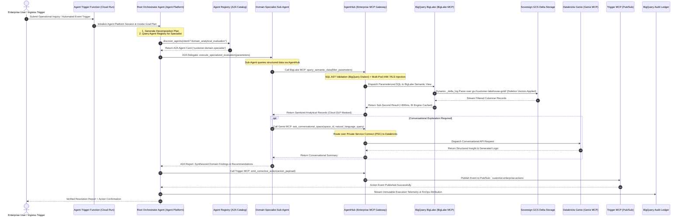
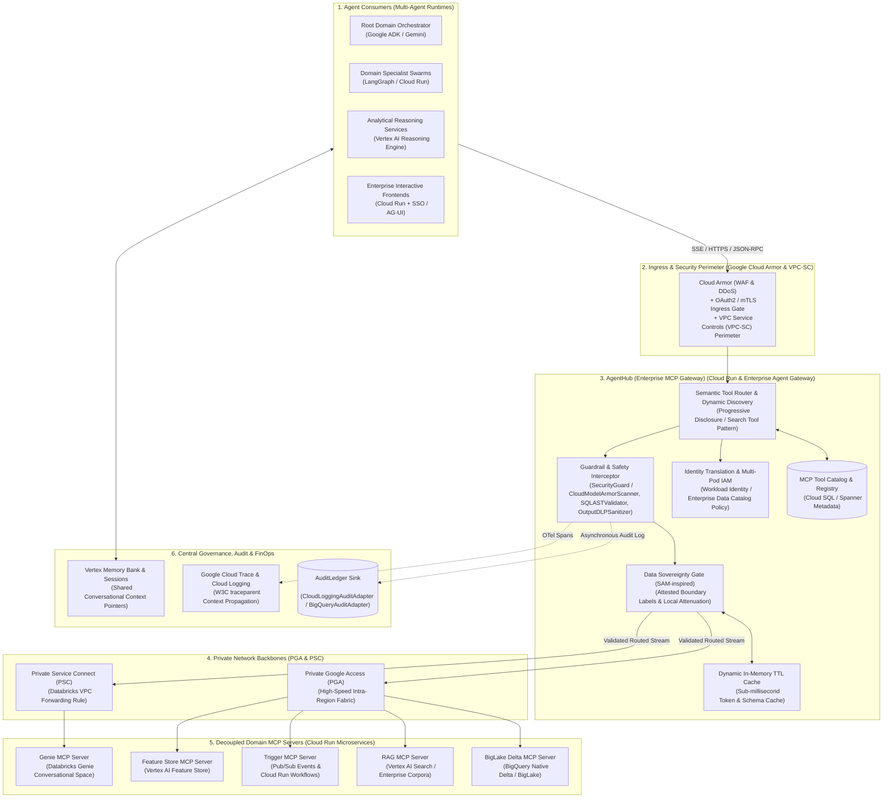
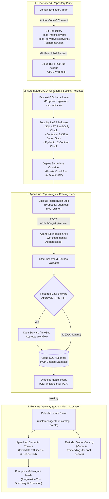

<!--
Copyright 2026 Google. This software is provided as-is, without
warranty or representation for any use or purpose. Your use of it is
subject to your agreement with Google.
-->

# Architecture Design: Enterprise MCP Golden Path, Centralized AgentHub & Lakehouse Orchestration Blueprint
## Decoupled Tool Control Plane, BigLake Native Delta Serving & Multi-Agent Mesh on Google Cloud

> [!NOTE]
> **Implementation Status (`v1.0.0` vs. Proposed AgentHub Extensions)**: In **`agentops-sdk==1.0.0`**, the foundational FastMCP governance gateway ([`mcp_servers/src/server.py`](../../mcp_servers/src/server.py), `_http.py`, `auth_guard.py`) and all security/SQL SDK primitives (`agentops_sdk.sql`, `agentops_sdk.security`, `agentops_sdk.audit`) are **shipped**. The centralized **AgentHub Portal, `agentops mcp ...` CLI (`create`, `validate`, `register`, `search`, `describe`), and SAM Sovereignty Gate** represent a **proposed platform control-plane roadmap** built on top of this gateway baseline.

This document establishes the definitive enterprise architectural blueprint for the **Enterprise Model Context Protocol (MCP) Golden Path**, the **Centralized AgentHub / Gateway**, and the **Decoupled Lakehouse Data Access Architecture** on Google Cloud. It establishes a domain-agnostic platform standard for all autonomous AI agents across Google Customer—synthesizing developer lifecycles, zero-trust security perimeters, semantic tool routing, identity translation, tool bloat mitigation, digital sovereignty attestation, and governance-as-code.

---

## 1. Executive Summary, Business Drivers & Architectural Paradigm

### 1.1 The Operational Context: Producer-Consumer Decoupling in Enterprise AI
Across Google Customer's diverse operating business units (Manufacturing, After Sales, Connected Operations, Supply Chain, Engineering, Finance, and Sustainability), autonomous AI applications require reliable, secure, and low-latency access to enterprise data assets. These assets span structured lakehouse data products, conversational analytical spaces, unstructured technical documentation, and real-time operational APIs.

In an enterprise environment, data architecture must enforce a clean operational decoupling between **Upstream Data Producers** and **Downstream AI Consumers**:
1. **Upstream Data Platform (Producer Tier)**: The Data Platform Team maintains Databricks as the enterprise engine for heavy batch ingestion, complex multi-hop transformations, and Medallion (Bronze $\rightarrow$ Silver $\rightarrow$ Gold) pipelines, writing Delta Lake tables directly into sovereign **Google Cloud Storage (`gs://...`)**.
2. **Downstream AI & Agent Platform (Consumer Tier)**: Autonomous multi-agent systems, interactive frontends, and microservices execute on **Google Cloud (Vertex AI, Cloud Run, Enterprise Agent Platform)**.

Relying directly on upstream lakehouse compute clusters (e.g., active Databricks SQL Warehouses) during runtime agent tool calls creates severe architectural friction:
*   **Runtime Availability & Maintenance Dependencies**: Upstream cluster maintenance windows, resizing operations, or scheduled shutdowns must never disrupt 24/7 AI agent reasoning loops.
*   **Compute Cold-Start Latency Penalties**: Cluster spin-up delays (2 to 5 minutes) when serverless or classic clusters auto-suspend cause immediate HTTP gateway timeouts in synchronous agent frameworks (e.g., Copilot Studio, LangGraph, Google ADK).
*   **High-Concurrency Queue Saturation**: Multi-agent swarms issuing parallel tool invocations rapidly saturate fixed cluster concurrency queues, driving up cloud infrastructure costs.
*   **Credential Proliferation**: Direct database connections lead to sprawling distributions of static Personal Access Tokens (PATs) across disparate container images.

```
+---------------------------------------------------------------------------------------------------------------+
|                                 ENTERPRISE AGENTIC PLATFORM ARCHITECTURAL OVERVIEW                            |
+-------------------+-------------------------------+-----------------------------------+-----------------------+
| 1. DATA SOURCES   | 2. LAKEHOUSE PRODUCER PLANE   | 3. INGRESS & TRIGGERS (GCP)       | 4. AGENTIC MESH       |
+-------------------+-------------------------------+-----------------------------------+-----------------------+
| Enterprise Feeds: | Databricks Medallion ETL      | - Cloud Scheduler (Crons)         | - Multi-Agent Runtime |
| - ERP & Finance   | writes Delta Lake directly to | - Pub/Sub Event Bus               |   (Google ADK /       |
| - MES & Telemetry | sovereign Google Cloud Storage| - Cloud Run Functions (Triggers)  |    LangGraph)         |
| - CRM & Claims    | + Databricks Genie Spaces     | - Domain Frontends (SSO / AG-UI)  | - Agent Registry      |
| - Doc Repositories|   (Conversational Analytics)  | - AgentOps Gateway (/v1/query)    | - Central AgentHub    |
+-------------------+-------------------------------+-----------------------------------+-----------------------+
```

### 1.2 The Challenge of Peer-to-Peer (P2P) MCP Sprawl
Without a centralized architectural standard, autonomous multi-agent systems inevitably degenerate into an unmanaged Peer-to-Peer (P2P) mesh where individual agent runtimes establish direct connections to disparate data sources and tools:

```
+---------------------------------------------------------------------------------------------------+
|                                  THE P2P MCP SPRAWL ANTI-PATTERN                                  |
+---------------------------------------------------------------------------------------------------+
|  [Agent: Domain Orchestrator]  ----(Direct Credentials)----> [Upstream SQL Warehouse]             |
|  [Agent: Analytics Sub-Agent]  ----(Hardcoded Token)-------> [Conversational Data Space]          |
|  [Agent: Operations Sub-Agent] ----(No AST Guardrail)-------> [Enterprise ERP / Legacy DB]        |
|  [Agent: Automation Sub-Agent] ----(Direct Webhook)---------> [Cloud Run Action Webhooks]         |
|                                                                                                   |
|  ENTERPRISE RISKS:                                                                                |
|  1. Credential Proliferation: Static database PATs & service keys scattered across agent pods.    |
|  2. Blind-Spot Auditing: Inability to correlate agent reasoning spans with underlying data queries|
|  3. Inconsistent Guardrails: No unified SQL injection defense, DLP scrubbing, or RLS enforcement. |
|  4. Tool Duplication: Multiple teams building redundant, unstandardized connectors for same data. |
|  5. Tool Bloat & Context Dilution: Monolithic toolsets overwhelm LLM context windows (>5 tools).  |
|  6. Sovereignty Violations: Unchecked egress of plant or regional data across sovereign borders.  |
+---------------------------------------------------------------------------------------------------+
```

### 1.3 The Solution: Tiered Lakehouse Model & Centralized AgentHub
To resolve P2P sprawl while eliminating compute cluster bottlenecks, Google Customer adopts a cohesive three-pillar foundation:
1. **The Tiered Lakehouse Model (Option C Synergy)**:
   - **Producer Tier (Databricks)**: Sole authoritative writer for heavy ETL and Medallion pipelines, writing Parquet and Delta transaction logs to sovereign GCS buckets (`gs://customer-lakehouse-gold/`).
   - **Physical Storage Sovereignty (GCS)**: Sovereign cloud storage hosts the single source of physical truth.
   - **High-Speed Decoupled Serving Tier (Google BigQuery & BigLake Native Delta Engine)**: BigQuery queries Delta Lake tables in-place on GCS with zero data duplication, zero manifest generation, native Deletion Vectors, and sub-second latency ($< 800\text{ms}$) via BigQuery BI Engine in-memory acceleration.
   - **Online Feature Serving Tier (Vertex AI Feature Store)**: Materialized key-value lookups ($< 25\text{ms}$ P95) for real-time agent reasoning.
2. **The MCP Golden Path**: A standardized developer lifecycle (Scaffold $\rightarrow$ Test $\rightarrow$ Secure $\rightarrow$ Register $\rightarrow$ Deploy $\rightarrow$ Monitor) ensuring every MCP tool is hardened by design using the `mcp_servers/` canonical baseline.
3. **The AgentHub (Enterprise MCP Gateway)**: A centralized, intelligent API and semantic tool routing gateway deployed on **Google Cloud Run** and **Enterprise Agent Platform Agent Gateway**, acting as the single control plane for all agent-to-tool communications.

### 1.4 The Agentic Mesh: Complementary Roles of A2A and MCP
In enterprise AI architecture, coordination and integration operate at two distinct, complementary protocol layers:
*   **Model Context Protocol (MCP)**: Handles **Agent-to-Tool** integration. Standardizes how an agent connects to data sources, analytical engines, external APIs, and action triggers (e.g., querying BigLake Native Delta, conversational queries via Databricks Genie, searching RAG vector stores, or firing Cloud Run webhook triggers).
*   **Agent2Agent Protocol (A2A)**: Handles **Agent-to-Agent** delegation and workflow coordination across organizational boundaries. Standardizes how a root orchestrator delegates specialized tasks to domain sub-agents, passing operational intent, constraints, and contextual memory references without coupling runtime implementations.

```
+---------------------------------------------------------------------------------------------------+
|                           A2A AND MCP AS COMPLEMENTARY PROTOCOL LAYERS                            |
+---------------------------------------------------------------------------------------------------+
|                                                                                                   |
|   +---------------------------------------+                                                       |
|   |    Root Domain Orchestrator Agent     |  <-- Built with Google ADK or LangGraph               |
|   +-------------------|-------------------+                                                       |
|                       |                                                                           |
|                       | Agent2Agent (A2A) Protocol                                                |
|                       | [Intent, Constraints, Shared Memory Pointers, W3C Traceparent]            |
|                       v                                                                           |
|   +---------------------------------------+                                                       |
|   |      Domain Specialist Sub-Agent      |  <-- Specialized Reasoning Runtime                    |
|   +-------------------|-------------------+                                                       |
|                       |                                                                           |
|                       | Model Context Protocol (MCP)                                              |
|                       | [JSON-RPC / SSE: Tools, Resources, Prompts]                               |
|                       v                                                                           |
|   +---------------------------------------+                                                       |
|   |   AgentHub (Enterprise MCP Gateway)   |  <-- Cloud Run / Enterprise Agent Gateway             |
|   +-------------------+-------------------+                                                       |
|                       |                                                                           |
|        +--------------+--------------+---------------+--------------+                             |
|        v                             v               v              v                             |
|  [ BigLake MCP ]              [ Genie MCP ]    [ RAG MCP ]    [ Trigger MCP ]                     |
|  BigQuery BigLake Native      Conversational   Enterprise     Pub/Sub Events &                    |
|  Delta Engine (GCS In-Place)  Data Spaces      Documents/RAG  Action Workflows                    |
|                                                                                                   |
+---------------------------------------------------------------------------------------------------+
```

---

## 2. End-to-End System Architecture & Orchestration Flow

### 2.1 Complete 5-Plane System Topology

```mermaid
flowchart TD
    subgraph DataSourcesPlane ["1. Enterprise Ingestion & Source Systems"]
        S1["Enterprise ERP Systems (Transactions & Costing)"]
        S2["Manufacturing Execution Systems (Factory Operations)"]
        S3["Telemetry & IoT Streams (Field Sensor Logs)"]
        S4["CRM & Dealer Diagnostic Networks"]
        S5["Enterprise Document Repositories (Bulletins & Manuals)"]
        S6["Quality Gate, Inspection & Operational Logs"]
    end

    subgraph LakehousePlane ["2. Lakehouse Producer & Sovereign Storage Plane"]
        ETL["Databricks Medallion ETL & DLT
        (Batch & Streaming Pipelines)"]
        GCS_Gold[("Sovereign GCS Delta Buckets
        gs://customer-lakehouse-gold/
        (Parquet + _delta_log + Deletion Vectors)")]
        GenieSpace["Databricks Genie Spaces
        (Curated Conversational Spaces)"]

        S1 & S2 & S3 & S4 & S5 & S6 --> ETL
        ETL --> GCS_Gold
        ETL -.-> GenieSpace
    end

    subgraph GCPIngressPlane ["3. Ingress, Orchestration & Frontend Plane (Google Cloud)"]
        Scheduler["Cloud Scheduler (Periodic Batch Sweeps)"]
        PubSub["Pub/Sub (Enterprise Event Bus)"]
        TriggerFn["Agent Trigger (Cloud Run Function)"]
        
        subgraph CloudRunApp ["Interactive Services"]
            Frontend["Enterprise AI Frontend (SSO / AG-UI)"]
            Backend["Session Manager & API Service"]
        end

        User(["Enterprise User / Knowledge Worker"])
        User <-->|SSO / HTTPS| Frontend
        Frontend <--> Backend
        Backend --> TriggerFn
        Scheduler --> TriggerFn
        PubSub --> TriggerFn
    end

    subgraph AgentPlatformPlane ["4. Enterprise Agent Platform & Mesh"]
        subgraph AgentRuntimeArea ["Agent Runtime (Serverless Reasoning Engine / Cloud Run)"]
            Orchestrator["Root Domain Orchestrator Agent
            (Google ADK / Gemini)"]
            SubAgent_Analytic["Analytical Specialist Sub-Agent
            (LangGraph Cyclical Graph)"]
            SubAgent_Ops["Operations Specialist Sub-Agent
            (Google ADK Sub-Agent)"]
            SubAgent_Compliance["Compliance & Policy Sub-Agent
            (Google ADK Sub-Agent)"]

            Orchestrator <-->|A2A Protocol| SubAgent_Analytic
            Orchestrator <-->|A2A Protocol| SubAgent_Ops
            Orchestrator <-->|A2A Protocol| SubAgent_Compliance
        end

        subgraph GuardrailsArea ["Active Guardrails"]
            Guard["Model Armor (Prompt Defense)
            + SQL AST Guardrail (BigQuery Dialect)
            + Cloud DLP (PII Redaction)
            + Attested Boundary Labels (SAM)"]
        end

        subgraph ObservabilityArea ["Agent Observability & FinOps"]
            Trace["Cloud Trace (W3C traceparent)
            + BigQuery Compliance Audit Ledger"]
        end

        subgraph MemoryArea ["Shared State & Context"]
            MemBank["Vertex Memory Bank (Long-Term Facts)
            + Enterprise Agent Platform Sessions (Short-Term Pointers)"]
        end

        AgentRuntimeArea <--> GuardrailsArea
        AgentRuntimeArea <--> ObservabilityArea
        AgentRuntimeArea <--> MemoryArea
    end

    subgraph MCPGatewayPlane ["5. Centralized AgentHub (Enterprise MCP Gateway)"]
        MCP_Router["Semantic Tool Router & Discovery
        (Anti-Tool-Bloat Progressive Search)"]
        MCP_Auth["Identity Translation & Multi-Pod IAM
        (Workload Identity / Enterprise Data Catalog Policy)"]

        MCP_BigLake["BigLake Delta MCP Server
        (BigQuery BigLake Native Delta Engine)"]
        MCP_Genie["Genie MCP Server
        (Databricks Conversational Spaces)"]
        MCP_Trigger["Trigger MCP Server
        (Pub/Sub Events & Corrective Actions)"]
        MCP_RAG["RAG MCP Server
        (Vertex AI Search & Enterprise Knowledge)"]
        MCP_Features["Feature Store MCP Server
        (Vertex AI Feature Store <25ms Serving)"]

        MCP_Router --> MCP_Auth
        MCP_Auth --> MCP_BigLake
        MCP_Auth --> MCP_Genie
        MCP_Auth --> MCP_Trigger
        MCP_Auth --> MCP_RAG
        MCP_Auth --> MCP_Features
    end

    TriggerFn -->|Dispatches Task| Orchestrator
    Backend -->|Dispatches Query| Orchestrator

    AgentRuntimeArea -->|MCP JSON-RPC / SSE| MCP_Router
    MCP_BigLake <-->|Private Google Access / Manifest-Free| GCS_Gold
    MCP_Genie <-->|Private Service Connect (PSC)| GenieSpace
    MCP_RAG <-->|Semantic Search| S5
    MCP_Trigger -->|Publish Action Event| PubSub
```

---

### 2.2 Lakehouse Producer & Sovereign Storage Plane
The enterprise data architecture strictly separates producer pipeline authority from downstream consumer queries:
1. **Authoritative Ingestion & Processing (Databricks)**: Databricks remains the authoritative producer engine for heavy raw ingestion, data cleansing, and Medallion transformations, cataloged centrally in Unity Catalog.
2. **Physical Storage Sovereignty (Google Cloud Storage)**: Gold tables are written directly to sovereign GCS buckets (`gs://customer-lakehouse-gold/`) in open Apache Parquet and Delta Lake transaction log format (`_delta_log/*.json`).
3. **Decoupled Serving via BigQuery BigLake**: BigQuery parses the Delta transaction log dynamically at query time:
   - **Zero Manifest Overhead**: Manifest-free dynamic resolution eliminates batch sync delays and read staleness.
   - **Advanced Delta Features**: Native pushdown for **Deletion Vectors**, **Column Mapping**, and **Liquid Clustering**.
   - **Zero Physical Data Duplication**: BigQuery stores **0 bytes** of physical table data. External BigLake tables point directly to GCS, eliminating data replication costs.
   - **Sub-Second Performance**: Accelerated by BigQuery BI Engine in-memory caching and a deterministic **24-hour free query result cache**.

---

### 2.3 Ingress Plane: Event-Driven & Interactive Triggers
The platform supports two distinct triggering modalities deployed serverless on **Google Cloud Run**:
1. **Interactive User Ingress**: Enterprise users authenticate via Corporate Single Sign-On (Entra ID / Google Identity) into domain web frontends adhering to the AG-UI protocol. Calls flow through session-managed backends to initialize stateful agent reasoning.
2. **Asynchronous Event Ingress**:
   - **Cloud Scheduler**: Dispatches cron-based periodic audits (e.g., nightly reconciliation or compliance sweeps).
   - **Pub/Sub Event Bus**: Ingests real-time threshold notifications, operational telemetry anomalies, or upstream pipeline completion events.
   - **Agent Trigger Functions**: Lightweight Cloud Run functions that extract payloads, initialize Enterprise Agent Platform Sessions, downscope caller permissions, and dispatch tasks to the root orchestrator.

---

### 2.4 Enterprise Agent Platform & Multi-Agent Mesh
Rather than relying on a fragile, monolithic prompt, complex enterprise workflows decompose across specialized agent runtimes:
*   **Root Domain Orchestrator Agent**: Formulates multi-step execution plans, dynamically discovers specialist sub-agents in the Agent Registry, delegates tasks over the **Agent2Agent (A2A)** protocol, synthesizes findings, and coordinates final action execution.
*   **Domain Specialist Sub-Agents**: Modular, bounded reasoning runtimes (built with Google ADK or LangGraph cyclical graphs) tailored for distinct analytical, operational, or diagnostic disciplines.
*   **Shared Memory Management**: Agents exchange lightweight **Enterprise Agent Platform Session pointers** and **Vertex Memory Bank** entity keys across A2A delegation boundaries, avoiding transmitting bulky conversational histories and context payloads.

---

### 2.5 End-to-End Orchestration Sequence Flow



---

## 3. Centralized AgentHub Control Plane & Subsystem Architecture

### 3.1 Google Cloud Reference Architecture: The Tool Control Plane



---

### 3.2 Subsystem 1: Semantic Tool Router & Protocol Negotiator
The Hub acts as an intelligent proxy supporting both **Server-Sent Events (SSE)** and **Stream-based HTTP**:
- **Dynamic Tool Discovery**: When an agent connects, the Hub queries the tool catalog and returns only the subset of tools the caller's identity is authorized to execute.
- **Semantic Dispatch**: When an agent invokes a tool, the Hub parses the JSON-RPC request, verifies schema contracts, injects caller credentials, and forwards the invocation over private networks to downstream MCP microservices.

---

### 3.3 Subsystem 2: Mitigating Tool Bloat (Progressive Disclosure)
Exposing dozens of raw database tables and endpoints directly to an agent causes context dilution, latency spikes, and reasoning hallucinations. The Hub enforces three anti-bloat patterns:
1. **Granular Toolsets**: Monolithic tool collections are unbundled into task-oriented toolsets bounded to specific analytical domains.
2. **Search Tool Pattern**: Rather than loading 50+ tool schemas into the agent prompt, the agent receives a single discovery tool (`search_available_tools(query="domain inquiry")`). The Hub returns only the 2 to 3 relevant tool schemas dynamically on demand.
3. **Multi-Agent Delegation**: Large tasks decompose across specialized sub-agents via A2A, ensuring each sub-agent maintains fewer than 5 active tools at any turn.

---

### 3.4 Subsystem 3: Identity Translation, Multi-Pod Governance & Token Vault
The platform eliminates brittle, static database Personal Access Tokens (PATs) in favor of centralized, short-lived identity management:
*   **Human Ingress Authentication**: Users authenticate via Microsoft Entra ID (Azure AD) SSO or Google Identity with enterprise Multi-Factor Authentication.
*   **Machine & Agent Workload Identity**: Autonomous AI agents authenticate using **Google Cloud Workload Identity Federation** and dedicated IAM service accounts (`sa-agentops-runner@...`).
*   **Multi-Pod Data Access Governance Architecture**: To grant data access across multiple distinct AI development teams (Pods) without creating unmanageable administrative overhead or high-risk superuser service accounts:
    - Each AI Pod operates under a dedicated service account identity (e.g., `sa-pod-finance@...`, `sa-pod-operations@...`).
    - Access is granted via Google Cloud IAM `roles/bigquery.dataViewer` strictly at the **Authorized View or Dataset level** in the BigQuery Semantic Layer.
    - Physical storage access is managed exclusively by the BigLake Cloud Resource Connection service account (`roles/storage.objectViewer` on `gs://customer-lakehouse-gold/`). Individual AI Pod service accounts have **zero direct GCS permissions**, preventing bucket-level credential leakage.
*   **Enterprise Data Catalog & Policy Alignment**: Table, column, and business classifications registered in **Enterprise Data Catalog** map directly to Google Cloud IAM and BigQuery Policy Tags for automated policy enforcement.
*   **Secret Manager Dynamic Vault**: Any sensitive third-party API keys or signing secrets are staged in **Google Cloud Secret Manager** with in-memory TTL caching to prevent quota exhaustion.

---

### 3.5 Subsystem 4: SQL AST Guardrail & Unidirectional Read-Only Contract
For analytical and data tools, the Hub enforces a strict **Unidirectional Read-Only Contract** ensuring AI agents cannot corrupt or mutate enterprise lakehouse assets:
*   **Pre-Execution AST Validation**: The `SQLASTValidator` parses incoming queries using `sqlglot` with `dialect="bigquery"`. Single-pass AST parsing verifies pure read-only `SELECT` statements, disambiguates Common Table Expressions (CTEs), and validates tables against an allowlist.
*   **Three-Layer Defense-in-Depth Write-Back Blocking Perimeter**:
    1.  *Layer 1 (IAM Perimeter)*: BigLake service account is granted strictly read-only GCS permissions (`roles/storage.objectViewer`). Even an explicit write attempt fails at the storage API layer.
    2.  *Layer 2 (Engine Perimeter)*: BigLake external tables pointing to Delta Lake are inherently read-only external references within BigQuery.
    3.  *Layer 3 (Gateway Perimeter)*: The SQL AST Guardrail intercepts and rejects any destructive SQL (`INSERT`, `UPDATE`, `DELETE`, `MERGE`, `DROP`, `ALTER`, `TRUNCATE`) fail-closed before network dispatch.
*   **Post-Execution DLP Sanitization**: Output payloads are intercepted by high-speed regex and **Google Cloud DLP** to mask Personally Identifiable Information (PII) before returning data to the agent context.

---

### 3.6 Subsystem 5: Enterprise Domain MCP Adapter Specifications

```
+-----------------------------------------------------------------------------------------------+
|                       ENTERPRISE DOMAIN MCP ADAPTER SPECIFICATIONS                            |
+-------------------+-------------------------------+-------------------------------------------+
| Adapter Name      | Target Backend Service        | Functional Capability & Data Access       |
+-------------------+-------------------------------+-------------------------------------------+
| **BigLake Delta   | Google BigQuery / BigLake     | Manifest-free sub-second SQL queries over |
| MCP**             | Native Delta Engine           | Delta tables on GCS; BI Engine cached;    |
|                   | (Private Google Access - PGA) | Deletion Vectors and Column Mapping.      |
+-------------------+-------------------------------+-------------------------------------------+
| **Genie MCP**     | Databricks Genie Spaces       | Conversational natural-language-to-data   |
|                   | (Private Service Connect- PSC)| queries over curated domain data spaces.  |
+-------------------+-------------------------------+-------------------------------------------+
| **RAG MCP**       | Vertex AI Search / RAG Engine | Semantic vector retrieval over enterprise |
|                   | (Enterprise Search Corpora)   | technical documentation, manuals, specs.  |
+-------------------+-------------------------------+-------------------------------------------+
| **Feature Store   | Vertex AI Feature Store       | Low-latency (<25ms P95) online point      |
| MCP**             | (Online Serving Service)      | lookups for entity feature vectors.       |
+-------------------+-------------------------------+-------------------------------------------+
| **Trigger MCP**   | Cloud Run Functions & Pub/Sub | Emits structured events to initiate action|
|                   | (Eventarc / Pub/Sub Topics)   | workflows, ERP updates, and notifications.|
+-------------------+-------------------------------+-------------------------------------------+
```

---

### 3.7 Subsystem 6: Digital & Data Sovereignty Engine (Inspired by SAM)
To comply with global data privacy regulations and protect proprietary assets across multinational operations:
*   **Attested Boundary Labels (`VerifyPeerLabels`)**: Tool invocations carry cryptographic label constraints (e.g., `jurisdiction=eu`, `region=emea`, `classification=confidential`). The Hub cryptographically verifies that downstream MCP servers satisfy these constraints *before* routing data payloads.
*   **Destination-Side Local Attenuation (Local Veto)**: Domain MCP servers enforce local access policies *before* accepting central Hub grants. Even if a central authority grants access, local policy engines can unilaterally deny execution based on local shift, network segment, or sensitivity rules.
*   **Customer-Managed Encryption Keys (CMEK)**: All storage buckets, metadata catalogs, and audit logs are encrypted using keys managed in **Google Cloud KMS**.

### 3.8 Subsystem 7: MCP Registration, Catalog Ingestion & Lifecycle Management
The Central AgentHub Control Plane serves not only as a runtime routing gateway but also as the authoritative enterprise registry for all domain MCP servers and tools across Google Customer:
*   **Declarative Catalog Ingestion API**: Provides an authenticated, schema-validated control plane API (`POST /v1/hub/registry/servers`, `PUT /v1/hub/registry/tools`, etc.) hosted within the AgentHub Management Plane. Domain teams and automated CI/CD pipelines register servers declaratively using standardized manifest specifications (`mcp_manifest.yaml`).
*   **Multi-Environment Stage Aliasing**: Supports immutable semantic versioning (`1.0.0`, `1.1.0`) combined with mutable stage aliases (`@dev`, `@staging`, `@prod`). Agent consumers can bind either to specific pinned versions for absolute determinism or to stage aliases to track verified enterprise releases.
*   **Automated Lifecycle State Machine**: Enforces a strict promotion progression:
    $$\text{DRAFT} \longrightarrow \text{IN\_REVIEW} \longrightarrow \text{APPROVED} \longrightarrow \text{ACTIVE} \longrightarrow \text{DEPRECATED} \longrightarrow \text{RETIRED}$$
    Transitions between states require automated security gating (SAST, AST read-only verification) and human-in-the-loop sign-off from designated Data Stewards or Platform Engineers for production promotion.
*   **Event-Driven Gateway Synchronization**: The Registry emits change notifications to Google Cloud Pub/Sub topic `customer.agenthub.catalog-events` upon any server registration, update, or retirement. Distributed AgentHub Semantic Routers subscribe to this topic to invalidate local in-memory caches and re-index vector embeddings without requiring gateway restarts.
*   **Active Health Probing & Synthetic Canary**: The Hub periodically executes synthetic health check probes (`GET /healthz`) and tool contract verifications against registered Cloud Run endpoints over Private Google Access (PGA). If a downstream MCP container fails health checks, it is automatically marked `UNHEALTHY` and excluded from dynamic tool discovery until recovered.

---

### 3.9 Enterprise Access Control & Governance Matrix

| Security Layer | Technical Mechanism | Responsibility / Policy Enforcement |
|---|---|---|
| **Network Perimeter** | Google Cloud Armor + VPC Service Controls | Restricts ingress to authorized corporate CIDR blocks; enforces VPC-SC data perimeter. |
| **Ingress Auth** | OAuth 2.0 / Entra ID Bearer Token (JWT) | Authenticates user/client; validates required RBAC and tenant scopes. |
| **Tool Catalog Access** | Dynamic RBAC in AgentHub Catalog | Agents only discover tools permitted for their authorized identity. |
| **Tool Bloat Prevention**| Progressive Disclosure & Search Tools | Restricts active tools to $\le 5$ per interaction turn; dynamic schema hydration. |
| **Data Access Guard** | `SQLASTValidator` + Multi-Pod IAM | Strictly enforces read-only BigQuery SQL; injects tenant Row-Level Security. |
| **Data Sovereignty** | Attested Boundary Labels (`VerifyPeerLabels`) | Prevents data from leaving authorized territorial jurisdictions (GDPR/SAM). |
| **Local Veto** | Destination-Side Policy Attenuation | Local domain servers evaluate local constraints before honoring central Hub grants. |
| **Privacy & Compliance** | Google Cloud DLP Sanitizer | Masks PII and proprietary attributes before returning data to LLM context. |
| **Audit Ledger** | Append-only BigQuery Table | Records `traceparent`, `agent_id`, `tool_name`, `status`, and `latency_ms`. |

---

## 4. The MCP Developer Golden Path, Reference Implementation & Rollout Roadmap

### 4.1 The MCP Golden Path: End-to-End Developer Lifecycle
The **MCP Golden Path** provides engineering teams across Google Customer with an opinionated, repeatable process to scaffold, test, secure, publish, deploy, and monitor domain MCP tools:

```
+---------------------------------------------------------------------------------------------------------------+
|                                      THE MCP GOLDEN PATH LIFECYCLE                                            |
+---------------+---------------+---------------+---------------+---------------+-------------------------------+
|  1. SCAFFOLD  |    2. TEST    |   3. SECURE   |  4. REGISTER  |   5. DEPLOY   |     6. MONITOR & FINOPS       |
+---------------+---------------+---------------+---------------+---------------+-------------------------------+
| Scaffold from | Contract tests| - BigQuery AST| Semantic tool | Serverless on | - OTel Trace Parent           |
| `mcp_servers/`| & Local mock  |   Guardrail   | catalog entry | Cloud Run     | - BigQuery Ledger             |
| template with | SSE transport | - Multi-Pod   | with semver   | with VPC-SC & | - Token Cost & Latency        |
| typed schemas | verification  |   IAM & RLS   | & RBAC scopes | Zero Trust    | - Anti-Tool-Bloat Verification|
+---------------+---------------+---------------+---------------+---------------+-------------------------------+
```

#### Stage 1: Standardized Scaffolding (`mcp_servers/` as the Baseline)
AI Platform Engineering maintains the canonical Enterprise MCP starter implementation within `mcp_servers/`:
- `mcp_servers/src/server.py`: Hardened FastMCP governance gateway with AST-guarded database tools (`MCP_REQUIRE_AUTH=true`).
- `mcp_servers/Dockerfile`: Hardened container built from repository root (`docker build -f mcp_servers/Dockerfile .`).
- Root `pyproject.toml`: Unified packaging installing `[mcp]` optional extras alongside curated core SDK dependencies.

*(Proposed CLI Extension)* A future `agentops mcp` scaffolding CLI could generate domain servers from `mcp_servers/`:
```bash
# Proposed AgentHub CLI (roadmap — not yet shipped in v1.0.0)
agentops mcp create mcp-domain-server --template=mcp_servers/
```

#### Stage 2: Contract Testing & Local Simulation Harness
Before deployment, tools must pass automated contract validation:
- Input parameters defined via strict **Pydantic v2** models with field descriptions and bounds (`ge`, `le`), with zero LLM-exposed `auth_token` parameters (Bearer auth binds via `HeaderBindingMiddleware`).
- Output serialization conforms to MCP `TextContent` or structured JSON dicts.
- Local verification using `@modelcontextprotocol/inspector` against the shipped `v1.0.0` entrypoint:
  ```bash
  npx -y @modelcontextprotocol/inspector python3 -m mcp_servers.src.server --transport stdio
  ```

#### Stage 3: Security Hardening & Guardrail Attachment
Every tool exposed via the Golden Path inherits the `v1.0.0` AgentOps SDK security stack (`agentops_sdk.sql` & `agentops_sdk.security`):
- `SQLASTValidator` / `validate_sql_query` (and `@validate_sql_query_decorator` for SQL string arguments): Semantic AST validation using `dialect="bigquery"`, blocking DDL/DML and non-`UNNEST` TVFs, and enforcing table allowlists.
- `@pass_user_identity` + `HeaderBindingMiddleware`: Propagates incoming HTTP Bearer tokens via `ExecutionScope` (`current_execution_scope()`) for downstream Row-Level Security (RLS).
- `@inject_secret` (`SecretManagerStore`): Injects credentials dynamically from Google Cloud Secret Manager with 256-stripe in-memory TTL caching and signature-based anti-spoofing.
- `RowLevelPolicyEngine` (`apply_row_level_policy`): Automatically rewrites SQL ASTs to enforce tenant, plant, and regional boundaries.

#### Stage 4: Centralized AgentHub Catalog Publication & Registration Process
*(Proposed Control Plane)* Registering an MCP server and its constituent tools into the centralized AgentHub is envisioned as an automated, GitOps-driven workflow integrated into CI/CD:

##### 4.1 End-to-End MCP Registration Workflow



---

##### 4.2 The Declarative Standard: Enterprise MCP Manifest Specification (`mcp_manifest.yaml`)
Domain engineering teams declare their server capabilities, network endpoints, security policies, and granular tool schemas in an authoritative `mcp_manifest.yaml` committed at the root of the server repository:

```yaml
# =============================================================================
# Enterprise MCP Manifest Specification
# Canonical Schema for Centralized AgentHub Catalog Ingestion
# =============================================================================
apiVersion: agentops.example.com/v1alpha1
kind: MCPServerRegistration
metadata:
  serverId: "customer.domain.lakehouse-analytics"
  version: "1.2.0"
  stageAlias: "@staging"
  displayName: "Enterprise Lakehouse Analytics Domain MCP"
  description: "High-speed read-only analytical query tools over BigLake Delta tables and Genie conversational spaces."
  ownerTeam: "Enterprise Data & AI Core"
  contactSlack: "#agentops-platform"
  environment: "staging"

network:
  transport: "sse"
  baseUrl: "https://mcp-lakehouse-analytics-staging-xyz.a.run.app"
  vpcNetwork: "projects/<network-host-project-id>/global/networks/vpc-shared-prod"
  vpcSubnet: "projects/<network-host-project-id>/regions/europe-west3/subnetworks/snet-mcp-eu"
  healthCheckPath: "/healthz"
  privateGoogleAccess: true

governance:
  dataClassification: "CONFIDENTIAL"
  sovereigntyLabels:
    jurisdiction: "eu"
    region: "emea"
    manufacturingPlant: "plant-eu-01"
  allowedCallerRoles:
    - "customer:role:domain-analyst"
    - "customer:role:operations-lead"
    - "customer:role:root-orchestrator"
  iamServiceAccount: "sa-mcp-lakehouse@<your-gcp-project-id>.iam.gserviceaccount.com"
  readOnlyEnforced: true
  astDialect: "bigquery"

toolsets:
  - id: "lakehouse_analytical_queries"
    displayName: "Lakehouse Analytical Toolset"
    description: "Granular tools for querying equipment telemetry and production metrics."
    tools:
      - name: "query_semantic_data"
        description: "Executes parameterized read-only analytical SQL against BigLake Delta views."
        inputSchema:
          type: "object"
          properties:
            category_id:
              type: "string"
              description: "Business category or entity identifier"
            status_filter:
              type: "string"
              default: "ACTIVE"
              description: "Status code filter"
            limit:
              type: "integer"
              default: 100
              maximum: 1000
              description: "Maximum records to return"
          required: ["category_id"]
        outputSchema:
          type: "object"
          properties:
            status:
              type: "string"
            records:
              type: "array"
            total_records:
              type: "integer"
        rateLimitRpm: 120
        timeoutSeconds: 30
      - name: "ask_conversational_space"
        description: "Dispatches natural-language inquiry to Databricks Genie conversational space."
        inputSchema:
          type: "object"
          properties:
            space_id:
              type: "string"
              description: "Curated Databricks Genie space identifier"
            natural_language_query:
              type: "string"
              description: "Natural language analytical question"
          required: ["space_id", "natural_language_query"]
        outputSchema:
          type: "object"
          properties:
            status:
              type: "string"
            insight_summary:
              type: "string"
        rateLimitRpm: 60
        timeoutSeconds: 45
```

---

##### 4.3 Step-by-Step Registration & Publishing Process

The onboarding lifecycle progresses through six concrete operational phases:

###### Step 1: Local Contract Verification & Manifest Linting *(Proposed AgentHub CLI)*
Before opening a Pull Request, developers validate the proposed manifest locally against the canonical AgentOps schema:
```bash
# Proposed AgentHub CLI command (roadmap)
agentops mcp validate --manifest=mcp_manifest.yaml --strict
```
This check verifies:
- YAML syntax and JSON schema compliance against `agentops.example.com/v1alpha1`.
- Pydantic v2 input/output schema compatibility.
- Presence of required sovereignty labels (`jurisdiction`, `region`) and owner metadata.
- Verification that all declared tool names match function identifiers implemented in `mcp_servers/src/server.py`.

###### Step 2: CI/CD Pipeline Automation & Security Tollgates
When code is committed, Cloud Build / GitHub Actions executes automated security tollgates:
1. **Static AST Analysis**: Verifies that database query tools import `agentops_sdk.sql` (`validate_sql_query` / `@validate_sql_query_decorator(dialect="bigquery")`) and lack destructive SQL statements.
2. **Container Security Scanning**: Scans container images for CVEs using Artifact Analysis / Trivy.
3. **IAM Least Privilege Verification**: Verifies that the designated service account has only read permissions on target data assets.

###### Step 3: Serverless Deployment to Private Google Cloud Run
The CI/CD pipeline packages the container and deploys it to Cloud Run with:
- Ingress restricted to `Internal and Cloud Load Balancing` (no public IP).
- Direct VPC Egress configured to route internal traffic through the shared VPC network.
- Dedicated runtime service account attached (`sa-mcp-lakehouse@...`).

###### Step 4: Catalog Ingestion via Proposed CLI & Control Plane REST API
Once the Cloud Run microservice is deployed and healthy, the CI/CD pipeline would issue the registration command using keyless authentication (Workload Identity Federation):
```bash
# Proposed AgentHub CLI command (roadmap)
agentops mcp register \
  --manifest=mcp_manifest.yaml \
  --target-env=staging \
  --wif-provider="projects/123456789/locations/global/workloadIdentityPools/github-pool/providers/github-provider"
```

Under the hood, the CLI executes an authenticated HTTP request to the AgentHub Management Plane:
```http
POST /v1/hub/registry/servers HTTP/1.1
Host: agenthub-admin.customer.internal
Authorization: Bearer <GCP_WIF_ID_TOKEN>
Content-Type: application/yaml

<mcp_manifest.yaml content>
```

**Control Plane Validation Logic**:
- Authenticates caller identity and confirms deployment ownership permissions.
- Verifies that `serverId` conforms to naming standards (`customer.<domain>.<service>`).
- Enforces semantic versioning rules (prevents overwriting previously published immutable versions).
- Performs a synthetic probe to `<baseUrl>/healthz` over the private network to ensure the container is responsive before accepting the registration.

###### Step 5: Registry Persistence & Database Schema (Cloud SQL / Spanner)
The Hub stores validated registration metadata in the normalized MCP Catalog Database:

| Table | Key Columns | Purpose |
|---|---|---|
| `mcp_servers` | `server_id`, `version`, `display_name`, `transport`, `base_url`, `vpc_network`, `owner_team`, `status` | Authoritative server endpoints, version history, and operational status (`ACTIVE`, `IN_REVIEW`, `DEPRECATED`). |
| `mcp_tools` | `tool_id`, `server_id`, `version`, `tool_name`, `description`, `input_schema_json`, `output_schema_json`, `toolset_id` | Granular tool definitions and Pydantic schemas used for LLM hydration. |
| `mcp_governance` | `server_id`, `version`, `data_classification`, `sovereignty_labels_json`, `allowed_roles_json`, `ast_dialect` | Attested boundary labels, access control scopes, and SQL safety rules. |
| `mcp_stage_aliases` | `alias_name` (e.g. `@prod`), `server_id`, `pinned_version`, `updated_at`, `updated_by` | Points mutable stage aliases (`@dev`, `@staging`, `@prod`) to immutable semver releases. |
| `mcp_health_history` | `server_id`, `timestamp`, `status`, `latency_ms`, `error_code` | Audit trail of synthetic health probes and uptime records. |

###### Step 6: Dynamic Gateway Synchronization & Zero-Downtime Activation
Once committed to the catalog database:
1. **Pub/Sub Event Broadcast**: The Registry publishes a message to `projects/<your-gcp-project-id>/topics/customer.agenthub.catalog-events`:
   ```json
   {
     "event": "SERVER_REGISTERED",
     "serverId": "customer.domain.lakehouse-analytics",
     "version": "1.2.0",
     "stageAlias": "@staging",
     "status": "ACTIVE",
     "timestamp": "2026-10-15T12:00:00Z"
   }
   ```
2. **In-Memory Cache Invalidation**: Distributed AgentHub Semantic Routers running across Cloud Run listen to the Pub/Sub topic and immediately flush stale routing entries.
3. **Vector Catalog Embedding**: The Hub embeds the tool descriptions and toolset metadata into the **Semantic Tool Discovery Index** (backed by Vertex AI Vector Search), enabling autonomous agents to find newly published tools instantly via progressive disclosure (`search_available_tools`).

---

#### Stage 5: Production Deployment on Google Cloud Run
- Deployed as a serverless container on **Cloud Run** with autoscaling (0 to 100+ instances).
- Connected to private corporate subnets via **Direct VPC Egress** with Private Google Access (PGA).
- Ingress restricted to `Internal and Cloud Load Balancing` (zero public internet exposure).

#### Stage 6: Observability, Telemetry & FinOps Attribution
- Automatic OpenTelemetry span export to **Google Cloud Trace** via W3C `traceparent`.
- Structured audit logs streamed asynchronously to the **BigQuery Audit Ledger**: records `trace_id`, `agent_id`, `tool_name`, `execution_latency_ms`, `tokens_consumed`, and business cost-center metadata.

---

### 4.2 Reference Implementation: Production FastMCP Domain Server

```python
# Copyright 2026 Google. Enterprise Golden Path MCP Server Template.
"""Production FastMCP Domain Server for Decoupled Lakehouse Analytics on Google Cloud."""

from typing import Any, Dict, Optional
from google.cloud import bigquery
from mcp.server.fastmcp import FastMCP
from pydantic import BaseModel, Field

from agentops_sdk.domain.context import current_execution_scope
from agentops_sdk.security import JWTAuthEngine, pass_user_identity
from agentops_sdk.sql import apply_row_level_policy, validate_sql_query

# Initialize FastMCP Server
mcp = FastMCP(
    name="Enterprise Lakehouse Analytics MCP Server",
    instructions="Provides high-speed read-only analytical query tools over BigLake Delta tables and Genie conversational spaces.",
)

# Initialize BigQuery Client & Auth Engine using Google Cloud Workload Identity / ADC
bq_client = bigquery.Client()
auth_engine = JWTAuthEngine()


# -----------------------------------------------------------------------------
# Input Contracts (No LLM-exposed token or claim fields!)
# -----------------------------------------------------------------------------
class AnalyticalQueryInput(BaseModel):
    category_id: str = Field(
        ..., description="Business category or entity identifier"
    )
    status_filter: Optional[str] = Field(
        default="ACTIVE", description="Status code filter"
    )
    limit: int = Field(
        default=25,
        ge=1,
        le=100,
        description="Maximum records to return (anti-bloat bounded)",
    )


class ConversationalQueryInput(BaseModel):
    space_id: str = Field(
        ..., description="Databricks Genie Space identifier for conversational analytics"
    )
    natural_language_query: str = Field(
        ..., description="Natural language question regarding domain trends"
    )


# -----------------------------------------------------------------------------
# BigLake MCP Tool: Parameterized SQL with AST Guardrail & RLS (BigQuery Dialect)
# (Note: Use @validate_sql_query_decorator directly when tools accept a raw `sql`
# or `query_template` string argument; here we validate the internal template.)
# -----------------------------------------------------------------------------
@mcp.tool()
@pass_user_identity()
async def query_semantic_data(params: AnalyticalQueryInput) -> Dict[str, Any]:
    """Queries BigLake external Delta tables via the Enterprise Semantic Layer.

    Security & Architecture:
    - Binds caller Bearer token out-of-band via HeaderBindingMiddleware / ExecutionScope.
    - Enforces BigQuery SQL AST validation (strictly pure read-only SELECT).
    - Rewrites SQL AST via apply_row_level_policy using verified JWT tenant claims.
    - Queries sovereign GCS Delta Lake storage directly in-place via BigLake.
    """
    raw_query = """
        SELECT entity_id, category_id, metric_value, status, updated_timestamp
        FROM `<your-gcp-project-id>.customer_semantic_layer.v_domain_metrics`
        WHERE category_id = @category_id
          AND status = @status_filter
        ORDER BY updated_timestamp DESC
        LIMIT @limit
    """

    validation = validate_sql_query(
        raw_query,
        dialect="bigquery",
        allowed_tables=[
            "<your-gcp-project-id>.customer_semantic_layer.*",
            "<your-gcp-project-id>.customer_lakehouse_gold.*",
        ],
    )
    if not validation.is_safe:
        raise ValueError(f"Blocked SQL query: {validation.violation_reason}")

    # Enforce Row-Level Security from verified Bearer claims (never trust LLM args)
    token = current_execution_scope().identity_token
    if not token:
        raise PermissionError("Missing caller identity token in ExecutionScope.")
    claims = auth_engine.decode_token(token)
    secured_query = apply_row_level_policy(
        validation.sanitized_sql or raw_query,
        claims=claims,
        dialect="bigquery",
    )

    job_config = bigquery.QueryJobConfig(
        query_parameters=[
            bigquery.ScalarQueryParameter("category_id", "STRING", params.category_id),
            bigquery.ScalarQueryParameter("status_filter", "STRING", params.status_filter),
            bigquery.ScalarQueryParameter("limit", "INT64", params.limit),
        ]
    )

    query_job = bq_client.query(secured_query, job_config=job_config)
    results = [dict(row) for row in query_job.result()]

    return {
        "status": "success",
        "source_engine": "BIGLAKE_NATIVE_DELTA",
        "cached_by_bi_engine": True,
        "records_returned": len(results),
        "results": results,
    }


# -----------------------------------------------------------------------------
# Genie MCP Tool: Conversational Data Intelligence (Databricks Genie Space)
# -----------------------------------------------------------------------------
@mcp.tool()
async def ask_conversational_space(
    params: ConversationalQueryInput,
) -> Dict[str, Any]:
    """Queries a curated Databricks Genie Space using natural language.

    Dispatches request over Private Service Connect (PSC) to the Databricks
    Genie Conversations API for conversational data product exploration.
    """
    # In production, dispatches request over Private Service Connect (PSC)
    return {
        "status": "success",
        "space_id": params.space_id,
        "query": params.natural_language_query,
        "insight_summary": "Natural language query successfully resolved by conversational data product.",
    }


if __name__ == "__main__":
    mcp.run(transport="sse")
```

---

### 4.3 Consolidated Technical Implementation & Rollout Roadmap

```
Phase 1: Ingestion, BigLake Native Delta & AgentHub Core Foundation (Weeks 1-3)
  ├── Configure BigLake Cloud Resource Connection to Sovereign GCS Delta Buckets (gs://customer-lakehouse-gold/)
  ├── Provision BigLake Native Delta External Tables & Semantic Views with BI Engine Acceleration
  ├── Deploy Centralized AgentHub / Gateway on Cloud Run with Secret Manager dynamic cache & VPC-SC
  ├── Modernize `mcp_servers/` as the standard Golden Path developer scaffold
  ├── Implement BigLake Delta MCP Server with SQL AST parser (BigQuery dialect) & Strict Read-Only Guard
  ├── Configure Private Service Connect (PSC) for Databricks Genie Conversational Spaces
  └── Implement Genie MCP Server for Databricks conversational spaces

Phase 2: Agent Registry, A2A Protocol & Domain Multi-Agent Mesh (Weeks 4-6)
  ├── Deploy Enterprise Agent Registry with BigQuery metadata catalog and stage aliasing (@dev, @staging, @prod)
  ├── Implement A2A Agent Card specification and dynamic intent discovery
  ├── Scaffold Root Domain Orchestrator in Google ADK
  ├── Scaffold Domain Specialist sub-agents in LangGraph and Vertex AI Reasoning Engine
  └── Wire shared memory pointers using Enterprise Agent Platform Sessions & Vertex Memory Bank

Phase 3: Ingress Triggers, Specialized Tool Adapters & Enterprise UI Integration (Weeks 7-8)
  ├── Deploy Enterprise AI Frontends (SSO) and Session Management Backends on Cloud Run adhering to AG-UI
  ├── Wire Cloud Scheduler and Pub/Sub event consumers to Agent Trigger Functions
  ├── Deploy RAG MCP connected to Enterprise Documentation Corpora via Vertex AI Search
  ├── Deploy Vertex AI Feature Store MCP for ultra-low-latency (<25ms) online feature vector lookups
  └── Deploy Trigger MCP for automated Pub/Sub corrective action workflows

Phase 4: Digital Sovereignty, FinOps Attribution & Enterprise Production Launch (Weeks 9+)
  ├── Implement SAM-inspired attested boundary label gates across all domain endpoints
  ├── Enable destination-side local policy attenuation for on-prem and local facility MCP servers
  ├── Automate tool publishing via Cloud Build CI/CD with security scanning and container signing
  ├── Verify 100% end-to-end W3C traceparent propagation in Cloud Trace
  └── Validate automated quality gates and BigQuery FinOps cost-center reporting
```

---

## 5. Architectural Guidance & Frequently Asked Questions (FAQ)

This section provides concise, actionable architectural guidance addressing key operational, governance, and hybrid-cloud questions regarding the Centralized AgentHub and Golden Path architecture.

---

### FAQ 1 (Non-GCP Integration): How do we catalog and register existing non-GCP MCP servers into the Central AgentHub?

**Architectural Guidance:**
The Central AgentHub strictly decouples the **Control & Discovery Plane** from the **Physical Execution Plane**. An MCP server does not need to run inside Google Cloud to be cataloged, discovered, and secured by the Hub.

1. **Network Connectivity & Hybrid Ingress**:
   - **On-Premises / Factory Locations (e.g., Plant-EU-01, Plant-US-01)**: Routed through Google Customer's dedicated **Cloud Interconnect / Cloud VPN** backbones into the shared VPC.
   - **Cross-Cloud & Managed SaaS (AWS, Azure, Databricks, Enterprise SaaS, SAP)**: Connected via **Private Service Connect (PSC)** service endpoints or mutual-TLS (mTLS) HTTPS tunnels governed by Cloud Armor.
2. **Declarative Manifest Specification (`mcp_manifest.yaml`)**:
   Domain teams register non-GCP endpoints by setting the `endpointType` to `hybrid_network` or `psc_attachment`:
   ```yaml
   network:
     endpointType: "hybrid_network"
     baseUrl: "https://mcp-sap.plant-eu-01.customer.internal:8443"
     transport: "stream" # or "sse"
     vpcNetwork: "projects/<network-host-project-id>/global/networks/vpc-shared-prod"
     healthCheckPath: "/healthz"
     tlsClientCertSecret: "projects/<secrets-project-id>/secrets/mcp-onprem-mtls-cert/versions/latest"
   ```
3. **Cross-Platform Identity Translation**:
   - The Hub utilizes **Workload Identity Federation (WIF)** or the **Secret Manager Dynamic Vault** to exchange the caller agent's Google Cloud IAM token for target-environment credentials (e.g., AWS STS AssumeRole token, Azure AD Service Principal bearer token, or SAP OAuth client credentials).
4. **Attested Sovereignty & Local Veto**:
   - The manifest declares physical execution boundaries (e.g., `hosting_cloud: "on-prem"`, `plant: "plant-eu-01"`, `jurisdiction: "eu"`).
   - Local on-prem servers enforce destination-side policy attenuation (local veto) to safeguard local industrial equipment regardless of central Hub permissions.
5. **Catalog Publication** *(Proposed)*:
   - The team executes the proposed `agentops mcp register` command. The Hub executes a synthetic private ping to verify connectivity across the hybrid link before marking the server `ACTIVE` in the catalog.

---

### FAQ 2 (Tool Discovery Portal): Does GCP provide an out-of-the-box browsable tool catalog like the Agent Registry, and what are our plans for developers/admins?

**Architectural Guidance:**
While Google Cloud provides native Agent Registry capabilities in the Enterprise Agent Platform for multi-agent A2A discovery, raw MCP tools operate at the lower-level JSON-RPC protocol layer (`list_tools`). To empower enterprise developers, administrators, and business analysts without requiring raw GCP Console access, the architecture establishes a dedicated **AgentHub Tool Portal & Catalog UI**:

1. **Browsable Developer Portal (App Store for Enterprise Tools)**:
   - Built on a lightweight, serverless web architecture (Next.js / React adhering to the AG-UI design system) hosted on Cloud Run.
   - Authenticated via corporate Single Sign-On (Entra ID / Google Identity), avoiding the need to grant developers broad IAM permissions to the GCP Cloud Console.
2. **Key Capabilities of the Catalog UI**:
   - **Semantic & Vector Discovery**: Natural-language search ("find tools that query Series-700 equipment telemetry") powered by Vertex AI Vector Search embeddings.
   - **Interactive Schema & Contract Inspector**: Visual display of Pydantic input schemas, output contracts, rate limits, P95 latencies, and underlying SQL guardrail dialects.
   - **Live Sandbox / Interactive Runner**: Safe, read-only simulation harness enabling authorized developers to dry-run tool calls against `@staging` mock data directly from the browser.
   - **Dependency & Consumption Graph**: Visualizes which domain agents, orchestrators, and business processes are actively utilizing each tool.
3. **Multi-Modal Access Channels**:
   - **Web UI**: For business analysts, data stewards, and solution architects (`https://agenthub.customer.example.com`).
   - **Developer CLI** *(Proposed)*: Terminal-based querying via future `agentops mcp search <query>` and `agentops mcp describe <tool-id>` commands.
   - **IDE Extension**: Direct integration into developer workspaces (Antigravity IDE, VS Code, IntelliJ) via language-server plugins that autocomplete available tools in agent code.

---

### FAQ 3 (Governance & Approvals): What is the formal approval process for registering an MCP into the Hub, and who is responsible?

**Architectural Guidance:**
To prevent tool sprawl, security vulnerabilities, and unauthorized data exfiltration, the architecture enforces a **Risk-Tiered Approval Model** with clear RACI accountability:

#### Approval Tier Matrix:

| Risk Tier | Criteria | Required Approver(s) | Automation Level | SLA |
|---|---|---|---|---|
| **Tier 1: Low** | Read-only utility tools; staging/dev environments; synthetic/public data. | Automated CI/CD System (AST Validator & Linter) | 100% Automated; instant deployment upon passing automated tests. | < 5 minutes |
| **Tier 2: Medium** | Business analytical tools; read-only access to internal/confidential lakehouse views (`@prod`). | **Domain Data Steward** (Business Unit Lead) | Automated PR check + Single-Click Steward Sign-Off in ServiceNow / GitHub. | < 24 hours |
| **Tier 3: High** | Tools accessing Restricted/PII data; write-back action triggers (ERP/MES/PubSub); cross-border data transfer. | **Dual-Custody**: **Enterprise InfoSec** + **BU Lead Data Architect** | Multi-party cryptographic sign-off; manual security review of execution boundary. | < 48 hours |

#### Governance RACI Model:
*   **Responsible (R)**: Domain Engineering Team (scaffolds the code, defines `mcp_manifest.yaml`, runs local contract tests).
*   **Accountable (A)**: Business Unit Data Steward / Solution Architect (validates semantic correctness, schema definitions, and business necessity).
*   **Consulted (C)**: Enterprise InfoSec & Cloud Platform Team (verifies IAM least privilege, AST SQL guardrails, CMEK encryption, and VPC-SC perimeter).
*   **Informed (I)**: Consuming Agent Developers & Orchestrator Teams (notified via Pub/Sub and catalog release notes of new tool availability).

---

### FAQ 4 (Multi-Tenancy & Namespaces): Can we segregate MCPs by Business Unit into dedicated namespaces, and what customizations are possible at this level?

**Architectural Guidance:**
Yes. The architecture explicitly supports **Multi-Tenant Namespacing** to ensure complete logical and physical isolation across Google Customer's diverse brands and operating units (e.g., Series-700, Series-800, Series-900, Precision Ops, Storage Systems, Finance/Supply Chain).

1. **Hierarchical Naming Standard**:
   All registered tools and servers conform to a structured URI convention:
   $$\texttt{customer.<business\_unit>.<domain>.<service\_or\_tool>}$$
   *Examples:*
   - `customer.series700.telemetry.query_equipment_diagnostics`
   - `customer.storage.silo.get_temperature_metrics`
   - `customer.corporate.finance.calculate_plant_depreciation`

2. **Namespace-Level Customizations & Isolation Boundaries**:

| Isolation Dimension | Customization Scope & Mechanism |
|---|---|
| **Access Control (RBAC)** | Entitlement policies applied at the namespace root (e.g., `customer.series700.*` discoverable only by agents with `role:series700-agent-runner`). |
| **Infrastructure & Network** | Different namespaces can route to isolated Cloud Run microservices deployed in separate GCP projects, VPC subnets, or regions. |
| **FinOps Cost Attribution** | Granular billing labels (`cost_center`, `business_unit`) attached at the namespace level, providing 100% transparent cloud cost attribution in BigQuery FinOps reports. |
| **Custom AST Guardrails** | Tailored SQL dialect and security rules (e.g., Series-700 namespace restricts queries to 10 specific telemetry views; Finance restricts max row count to 500). |
| **Data Sovereignty & Plant Rules** | Automatic injection of territorial constraints (e.g., `customer.series700.*` automatically inherits `jurisdiction=eu`, `plant=plant-eu-01`). |
| **Rate Limiting & Noisy-Neighbor Protection** | Quotas, concurrency limits, and token budgets configured per namespace, preventing one business unit from exhausting shared gateway resources. |

3. **Federated Namespace Administration**:
   Each Business Unit is granted delegated administrative ownership over its namespace prefix. A Series-700 Lead can approve, publish, update, and deprecate Series-700 tools independently, eliminating centralized bottlenecks while adhering to enterprise security baselines.
