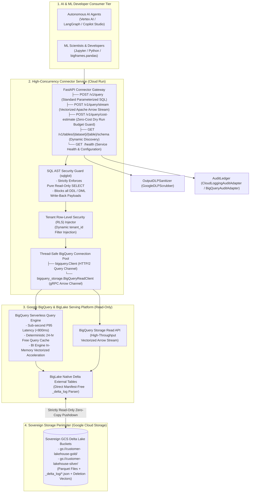

<!--
Copyright 2026 Google. This software is provided as-is, without
warranty or representation for any use or purpose. Your use of it is
subject to your agreement with Google.
-->

# Technical Implementation Plan: High-Concurrency BigQuery & BigLake Native Delta Connector Service for AI & ML Developers

**Document Version:** 1.0.0  
**Target Modules:** `sdk/src/agentops_sdk/`, `mcp_servers/src/` + Upstream BigQuery Connector Service (`CONNECTOR_API_URL`)  
**Status:** Shipped Governance & Gateway Layer (`v1.0.0`); Consumer Connector Reference Blueprint  
**Classification:** Enterprise Engineering Implementation Plan  

> [!NOTE]
> **Architecture Alignment (`v1.0.0`)**: In **`agentops-sdk==1.0.0`** (`ADR-3`), SQL AST validation, tenant Row-Level Security, DLP scrubbing, and compliance auditing live in `sdk/src/agentops_sdk/{sql,security,audit,feature_store}/`, fronted by the authenticated FastMCP gateway in `mcp_servers/src/server.py` (invoking `${CONNECTOR_API_URL}/v1/query`). Section 5 below provides the **Upstream BigQuery Connector Service Reference Blueprint** aligned with `v1.0.0` SDK APIs.

---

## 1. Executive Summary & Objective

This document provides the definitive engineering blueprint to replace legacy multi-database drivers (`databricks-sql-connector`, `hdbcli`, standalone SQLAlchemy connection pools) with the consolidated **High-Concurrency Google BigQuery & BigLake Native Delta Connector Service**.

### 1.1 Dedicated Strictly to AI & ML Developers and Autonomous Agents
This connector service is built **exclusively for AI and ML developers, notebooks, and autonomous AI agents** (AgentOps Gateway, Vertex AI, Copilot Studio, LangGraph). 

- **Decoupled BI Connectivity**: Enterprise Business Intelligence platforms (**Enterprise BI**) connect directly to Google BigQuery via native BigQuery drivers. The Data Connector service does **not** provide any special endpoints, metric mappings, or translation layers for BI tools.
- **Pure Analytical & Feature Serving Focus**: The service focuses exclusively on low-latency analytical queries, high-throughput feature vector streaming, schema introspection, and automated SQL AST security guardrails for AI runtimes.

### 1.2 Single Engine Architecture: 100% BigQuery & BigLake Native Delta
All data access operations executed by this connector route **exclusively through Google BigQuery and BigLake**:
1. **First-Party Native Delta Lake Support (Manifest-Free)**: BigQuery directly parses the Delta transaction log (`_delta_log/*.json`, checkpoint Parquet files) on sovereign Google Cloud Storage (`gs://...`) with **zero manifest generation**, **zero read staleness**, and native support for **Deletion Vectors**, **Column Mapping**, and **Liquid Clustering**.
2. **Zero Runtime Dependency on Upstream Compute**: The connector maintains zero direct connections to Databricks clusters, SQL Warehouses, or external JDBC endpoints. Upstream cluster resizing, maintenance windows, or warehouse idle suspensions have zero impact on downstream AI agents.
3. **Zero Cold Starts ($0\text{ms}$)**: BigQuery serverless slots allocate dynamically within milliseconds, eliminating the 2-to-5 minute cold-start penalties of spinning up dedicated clusters.
4. **Deterministic 24-Hour Free Query Caching**: BigQuery automatically caches query results for 24 hours. Repeated exploratory queries executed across AI agent tool loops or notebook experiments against unchanged Delta tables execute **at zero compute cost**.
5. **Strict Unidirectional Read-Only Contract**: Data flows strictly one-way: Upstream Lakehouse $\rightarrow$ Sovereign GCS Delta Storage $\rightarrow$ BigQuery/BigLake $\rightarrow$ AI/ML Developers. Downstream applications cannot mutate lakehouse storage.
6. **High-Throughput Vectorized Streaming**: Leverages the BigQuery Storage Read API (gRPC / Apache Arrow) to stream millions of feature records directly into pandas, Polars, and NumPy without serialization bottlenecks.

---

## 2. Current State vs. Target State Architecture

```
+-------------------------------------------------------------------------------------------------------------------------------+
|                                            CURRENT STATE VS. TARGET STATE COMPARISON                                          |
+-------------------------------------------------------------------------------------------------------------------------------+
| Architectural Dimension  | Legacy Multi-Driver Implementation            | Target High-Concurrency Connector (v1.0.0)          |
|--------------------------|-----------------------------------------------|-----------------------------------------------------|
| Backend Engine Support   | Fragmented: Databricks JDBC, SAP ODBC, etc.   | 100% Google BigQuery & BigLake Native Delta Engine  |
| Direct Cluster Coupling  | High: Direct connection to running warehouses | Zero: 100% Serverless (Decoupled GCS Delta read)   |
| Cold-Start Latency       | 2 – 5 minutes (Cluster spin-up / waking)      | 0 ms (Serverless immediate execution)               |
| Query Result Caching     | Transient session cache; billed per uptime    | Deterministic 24-hour free query cache              |
| Data Flow Directionality | Ambiguous (risk of ad-hoc warehouse writes)   | Strictly Unidirectional (One-Way: GCS -> BQ -> Dev) |
| Schema Evolution Handling| Manual DDL recreations & driver restarts      | Automated via Delta log parsing & autodetect_schema |
| High-Throughput Stream   | In-memory row iteration (OOM risk)            | Vectorized gRPC Apache Arrow (Storage Read API)     |
| Security & Governance    | Custom driver credentials & static PATs       | Google Cloud IAM, Workload Identity, AST Guard & RLS|
| FinOps Protection        | Uncontrolled running cluster compute spend    | Zero-cost dry run byte estimation & budget limits   |
| Target Consumer Scope    | Undifferentiated mixed workloads              | Dedicated strictly to AI & ML Developers & Agents   |
+-------------------------------------------------------------------------------------------------------------------------------+
```



---

## 3. Automated Upstream Schema Change Management

### 3.1 Seamless Schema Evolution Propagation
When upstream data platform pipelines modify Delta Lake schemas (adding columns, renaming columns via Delta Column Mapping, or updating data types), the connector handles changes dynamically without breaking downstream AI agents or client applications:

1. **Delta Transaction Log as Ground Truth**: BigQuery’s native Delta reader parses `_delta_log/*.json` transaction commits directly at query execution time, instantly recognizing additive columns and structural changes without requiring DDL alterations.
2. **Delta Column Mapping Support**: Upstream column renames or drops mapped in Delta metadata (`'delta.columnMapping.mode' = 'name'`) are automatically resolved by BigLake without rewriting underlying physical Parquet files.
3. **Automated Schema Synchronization via `autodetect_schema`**:
   Automatic schema synchronization is active on all BigLake Delta tables:
   ```bash
   bq update --autodetect_schema <your-gcp-project-id>:customer_lakehouse_gold.analytical_features
   ```
4. **Dynamic AST Security Validation**:
   The SQL AST Guard (`agentops_sdk.sql.SQLASTValidator` / `validate_sql_query`) parses query ASTs deterministically, allowing newly evolved schema columns on allowlisted views while maintaining tenant Row-Level Security (`RowLevelPolicyEngine`).
5. **Backward-Compatible Abstraction Views**:
   Downstream AI agents query stable analytical views. Upstream schema evolution is mapped and aliased inside SQL views, preventing breaking changes in agent prompt contracts.

---

## 4. Strict Unidirectional Data Flow & Write-Back Guardrails

### 4.1 Strict One-Way Architecture
Data synchronization between upstream lakehouse storage and the connector is **strictly unidirectional (One-Way: Lakehouse $\rightarrow$ GCS Delta $\rightarrow$ BigQuery $\rightarrow$ AI/ML Developers)**.

Downstream AI agents, microservices, and developers are **strictly analytical consumers** and **cannot write back to this database**.

```
+---------------------------------------------------------------------------------------------------+
|                        STRICT UNIDIRECTIONAL DATA SYNCHRONIZATION BOUNDARY                        |
+---------------------------------------------------------------------------------------------------+
|                                                                                                   |
|  [UPSTREAM LAKEHOUSE PIPELINE]                                                                    |
|  - Sole Authoritative Writer to GCS Delta Lake Storage                                            |
|                                 |                                                                 |
|                                 v (ONE-WAY WRITE / SYNC: gs://customer-lakehouse-*)               |
|  [SOVEREIGN GCS DELTA STORAGE]                                                                    |
|  - Parquet Files, _delta_log/*.json, Checkpoints, Deletion Vectors                                |
|                                 |                                                                 |
|                                 v (ONE-WAY ZERO-COPY READ-ONLY FEDERATION)                        |
|  [GOOGLE BIGQUERY / BIGLAKE SERVING TIER]                                                         |
|  - Read-Only External Tables                                                                      |
|                                 |                                                                 |
|                                 v (READ-ONLY ANALYTICAL SERVING)                                  |
|  [HIGH-CONCURRENCY CONNECTOR GATEWAY (/v1/query)]                                                 |
|  - CANNOT write back / mutate GCS Delta Lake files                                                |
|  - Blocks all DDL / DML statements at the AST layer                                               |
|                                                                                                   |
|  [OPERATIONAL ACTION EXCEPTION PATHWAY]                                                           |
|  If an AI Agent must execute an operational business action (e.g., Update Status / Create Order): |
|  --> Agent calls dedicated Operational REST / MCP Action APIs (ERP OData / Core REST APIs)        |
|  --> NEVER writes directly to the Lakehouse Database                                              |
|                                                                                                   |
+---------------------------------------------------------------------------------------------------+
```

### 4.2 Three-Layer Defense-in-Depth Write-Back Enforcement
1. **Cloud Storage IAM Perimeter**: The BigLake service account is strictly granted `roles/storage.objectViewer` on `gs://customer-lakehouse-*` buckets. Write, overwrite, and delete actions return `HTTP 403 Forbidden` at the storage layer.
2. **BigQuery Engine Perimeter**: BigLake external Delta Lake tables strictly reject all DML operations (`INSERT`, `UPDATE`, `DELETE`, `MERGE`).
3. **MCP & Upstream API AST Guard Perimeter**: `mcp_servers/src/auth_guard.py` (pre-execution Bearer auth check) and `agentops_sdk.sql.validate_sql_query` parse query ASTs with `sqlglot` (`UNNEST`-only TVFs, system schemas blocked) and deterministically reject any non-`SELECT` statement before it reaches BigQuery.

---

## 5. Reference Architecture & `v1.0.0` Upstream Connector Blueprint

In `v1.0.0`, governance and data access controls live in the **MCP Governance Gateway (`mcp_servers/src/`)** and the **12-subpackage SDK (`sdk/src/agentops_sdk/`)**, while teams hosting an upstream REST microservice behind `${CONNECTOR_API_URL}` implement the `/v1/query` blueprint below:

```text
+-------------------------------------------------------------------------------------------------------------------------------+
|                                       v1.0.0 CONSOLIDATED ARCHITECTURE MAPPING                                                 |
+-------------------------------------------------------------------------------------------------------------------------------+
| Capability Layer                   | Location / Implementation in v1.0.0                                                      |
|------------------------------------|-------------------------------------------------------------------------------------------|
| Governance Gateway & /v1/query Proxy| `mcp_servers/src/server.py`, `_http.py`, `auth_guard.py` -> `${CONNECTOR_API_URL}`      |
| Connector & SDK Configuration      | `agentops_sdk.config` (`GCPSettings`, `SecuritySettings`, `DatabaseSettings`) + consumer service `BigQueryConnectorSettings` |
| SQL AST Guard & Tenant RLS         | `agentops_sdk.sql` (`SQLASTValidator`, `RowLevelPolicyEngine`, `validate_sql_query`)      |
| Audit & Compliance Telemetry       | `agentops_sdk.audit` (`AuditLedger`, `CloudLoggingAuditAdapter`, `BigQueryAuditAdapter`)  |
| DLP Output Sanitization            | `agentops_sdk.security.dlp` (`OutputDLPSanitizer`, `GoogleDLPScrubber`)                   |
| Upstream BigQuery Service Blueprint| Downstream consumer FastAPI microservice implementing `/v1/query` (Steps 1–4 below)       |
+-------------------------------------------------------------------------------------------------------------------------------+
```

---

### Step 1: Consumer Connector Configuration (Upstream Microservice Reference)

```python
# Consumer upstream microservice: app/config.py
from pydantic import Field
from pydantic_settings import BaseSettings, SettingsConfigDict


class BigQueryConnectorSettings(BaseSettings):
    """Centralized configuration for the Sovereign BigQuery & BigLake Data Connector Service."""

    model_config = SettingsConfigDict(env_prefix="BQ_", env_file=".env", extra="ignore")

    project_id: str = Field(
        default="<your-gcp-project-id>",
        validation_alias="GCP_PROJECT",
        description="Google Cloud Project ID.",
    )
    dataset_id: str = Field(
        default="customer_lakehouse_gold",
        description="Default BigLake / BigQuery analytical dataset.",
    )
    location: str = Field(
        default="europe-west4",
        description="BigQuery dataset and BigLake connection location.",
    )
    biglake_connection_id: str = Field(
        default="customer-biglake-delta-connection",
        description="BigLake Cloud Resource Connection ID for GCS Delta Lake.",
    )
    max_results_limit: int = Field(
        default=1000,
        description="Maximum row limit returned for standard interactive queries.",
    )
    query_timeout_seconds: int = Field(
        default=30,
        description="BigQuery execution job timeout in seconds.",
    )
    max_bytes_billed_limit: int = Field(
        default=53687091200,  # 50 GB
        description="Maximum bytes billed threshold per query to prevent runaway spend.",
    )
    use_query_cache: bool = Field(
        default=True,
        description="Enable deterministic 24-hour free query result caching in BigQuery.",
    )
    storage_read_api_enabled: bool = Field(
        default=True,
        description="Enable BigQuery Storage Read API for high-throughput streaming.",
    )
    bi_engine_enabled: bool = Field(
        default=True,
        description="Enable BI Engine in-memory acceleration.",
    )


connector_config = BigQueryConnectorSettings()
```

---

### Step 2: Thread-Safe Connection Pool (Upstream Microservice Reference)

```python
# Consumer upstream microservice: app/database/pool.py
import logging
import threading
from typing import Optional
from google.cloud import bigquery
from google.cloud import bigquery_storage
from app.config import connector_config

logger = logging.getLogger("db-connectors")


class BigQueryConnectionPool:
    """Thread-safe connection pool manager for BigQuery and Storage Read API."""

    _instance: Optional["BigQueryConnectionPool"] = None
    _lock = threading.Lock()

    def __init__(self):
        self._bq_client: Optional[bigquery.Client] = None
        self._storage_client: Optional[bigquery_storage.BigQueryReadClient] = None
        self._client_lock = threading.Lock()

    @classmethod
    def get_instance(cls) -> "BigQueryConnectionPool":
        with cls._lock:
            if cls._instance is None:
                cls._instance = BigQueryConnectionPool()
            return cls._instance

    def get_bigquery_client(self, project_id: Optional[str] = None) -> bigquery.Client:
        """Retrieves or lazily initializes the shared BigQuery client channel."""
        target_project = project_id or connector_config.project_id
        with self._client_lock:
            if self._bq_client is None or self._bq_client.project != target_project:
                logger.info(
                    f"Initializing BigQuery Client channel for project '{target_project}'..."
                )
                self._bq_client = bigquery.Client(
                    project=target_project,
                    location=connector_config.location,
                )
            return self._bq_client

    def get_storage_read_client(self) -> bigquery_storage.BigQueryReadClient:
        """Retrieves or lazily initializes the shared BigQuery Storage Read gRPC client."""
        with self._client_lock:
            if self._storage_client is None:
                logger.info("Initializing BigQuery Storage Read API gRPC channel...")
                self._storage_client = bigquery_storage.BigQueryReadClient()
            return self._storage_client

    def close_all(self):
        """Gracefully closes all pooled client channels upon container shutdown."""
        with self._client_lock:
            if self._bq_client:
                self._bq_client.close()
                self._bq_client = None
            self._storage_client = None
            logger.info("All BigQuery connection channels gracefully closed.")


pool_manager = BigQueryConnectionPool.get_instance()
```

---

### Step 3: BigQuery & Native Delta Execution Engine (Upstream Microservice Reference)

```python
# Consumer upstream microservice: app/database/bigquery.py
import logging
from typing import Any, Dict, List, Optional, Tuple
from google.cloud import bigquery
from google.cloud import bigquery_storage
from app.config import connector_config
from app.database.pool import pool_manager

logger = logging.getLogger("db-connectors")


def _build_query_parameters(
    parameters: Dict[str, Any],
) -> List[bigquery.ScalarQueryParameter]:
    """Maps dictionary parameters into typed BigQuery Query Parameters."""
    query_params = []
    for key, val in parameters.items():
        if isinstance(val, int):
            param_type = "INT64"
        elif isinstance(val, float):
            param_type = "FLOAT64"
        elif isinstance(val, bool):
            param_type = "BOOL"
        elif isinstance(val, list):
            param_type = "ARRAY<STRING>"
        else:
            param_type = "STRING"
        query_params.append(bigquery.ScalarQueryParameter(key, param_type, val))
    return query_params


def execute_bigquery_query(
    query_template: str,
    parameters: Optional[Dict[str, Any]] = None,
    max_results: Optional[int] = None,
) -> Tuple[List[str], List[List[Any]]]:
    """Executes a SQL query against BigQuery / BigLake external Delta tables with free 24-hr cache."""
    parameters = parameters or {}
    max_rows = max_results or connector_config.max_results_limit

    client = pool_manager.get_bigquery_client()
    query_params = _build_query_parameters(parameters)

    job_config = bigquery.QueryJobConfig(
        query_parameters=query_params,
        maximum_bytes_billed=connector_config.max_bytes_billed_limit,
        use_query_cache=connector_config.use_query_cache,
    )

    logger.info(
        f"Executing BigQuery Query: {query_template[:120]}... with {len(query_params)} params."
    )
    query_job = client.query(query_template, job_config=job_config)
    results = query_job.result(max_results=max_rows)

    columns = [field.name for field in results.schema]
    rows = [list(row.values()) for row in results]
    return columns, rows


def estimate_query_cost(
    query_template: str,
    parameters: Optional[Dict[str, Any]] = None,
) -> Dict[str, Any]:
    """Performs a zero-cost dry run to compute estimated bytes scanned and USD costs."""
    parameters = parameters or {}
    client = pool_manager.get_bigquery_client()
    query_params = _build_query_parameters(parameters)

    job_config = bigquery.QueryJobConfig(
        query_parameters=query_params,
        dry_run=True,
        use_query_cache=False,
    )

    query_job = client.query(query_template, job_config=job_config)
    bytes_scanned = query_job.total_bytes_processed
    cost_usd = (bytes_scanned / (1024**4)) * 6.25  # $6.25 per TB on-demand

    return {
        "estimated_bytes_scanned": bytes_scanned,
        "estimated_cost_usd": round(cost_usd, 6),
        "is_within_budget": bytes_scanned <= connector_config.max_bytes_billed_limit,
        "max_bytes_threshold": connector_config.max_bytes_billed_limit,
    }


def get_table_schema(dataset_id: str, table_name: str) -> List[Dict[str, Any]]:
    """Inspects and returns column metadata for a BigLake Delta or native BigQuery table."""
    client = pool_manager.get_bigquery_client()
    table_ref = f"{connector_config.project_id}.{dataset_id}.{table_name}"
    table = client.get_table(table_ref)

    return [
        {
            "name": field.name,
            "type": field.field_type,
            "mode": field.mode,
            "description": field.description or "",
        }
        for field in table.schema
    ]
```

---

### Step 4: Hardened Upstream API Gateway Implementation (Consumer Microservice Reference)

In production, agents authenticate to `mcp_servers/src/server.py` (which enforces `MCP_REQUIRE_AUTH=true` and validates SQL ASTs before proxying to `${CONNECTOR_API_URL}/v1/query`). The upstream Cloud Run BigQuery connector verifies the forwarded Bearer JWT and performs defense-in-depth AST + RLS enforcement:

```python
# Consumer upstream microservice: app/main.py (Route Definitions)
from contextlib import asynccontextmanager
from typing import Any, Dict, List, Optional
from fastapi import FastAPI, Header, HTTPException, status
from pydantic import BaseModel, Field

from app.config import connector_config
from app.database.bigquery import (
    estimate_query_cost,
    execute_bigquery_query,
    get_table_schema,
)
from app.database.pool import pool_manager


@asynccontextmanager
async def lifespan(app: FastAPI):
    """Manages application lifecycle and gracefully closes pooled BigQuery client channels."""
    yield
    pool_manager.close_all()


app = FastAPI(
    title="Sovereign BigQuery & BigLake Data Connector API for AI/ML",
    version="1.0.0",
    lifespan=lifespan,
)


class QueryRequest(BaseModel):
    query_template: str = Field(..., description="SQL parameterized string.")
    parameters: Dict[str, Any] = Field(
        default_factory=dict, description="Named parameters to bind."
    )
    max_results: Optional[int] = Field(None, description="Optional maximum row limit.")


class QueryResponse(BaseModel):
    columns: List[str]
    rows: List[List[Any]]
    execution_tier: str = Field(default="BIGLAKE_NATIVE_DELTA")


class CostEstimateResponse(BaseModel):
    estimated_bytes_scanned: int
    estimated_cost_usd: float
    is_within_budget: bool
    max_bytes_threshold: int


@app.get("/health")
def health_check():
    return {
        "status": "healthy",
        "platform": "google_bigquery",
        "project_id": connector_config.project_id,
        "dataset_id": connector_config.dataset_id,
        "bi_engine_enabled": connector_config.bi_engine_enabled,
        "query_cache_enabled": connector_config.use_query_cache,
        "sync_mode": "READ_ONLY_ONE_WAY",
    }


@app.post("/v1/query", response_model=QueryResponse, status_code=status.HTTP_200_OK)
async def query_endpoint(
    payload: QueryRequest, authorization: Optional[str] = Header(None)
):
    """Executes parameterized SQL over BigLake Native Delta tables (Strict Read-Only)."""
    from agentops_sdk.security import JWTAuthEngine
    from agentops_sdk.sql import apply_row_level_policy, validate_sql_query

    if not authorization or not authorization.startswith("Bearer "):
        raise HTTPException(
            status_code=status.HTTP_401_UNAUTHORIZED,
            detail="Missing or invalid Bearer token",
        )

    try:
        # 1. Verify Bearer token and extract tenant/role claims
        auth_engine = JWTAuthEngine()
        claims = auth_engine.decode_token(authorization.removeprefix("Bearer ").strip())

        # 2. Enforce SQL AST Security Validation (Deterministic Non-SELECT / TVF Rejection)
        validation = validate_sql_query(payload.query_template, dialect="bigquery")
        if not validation.is_safe:
            raise HTTPException(
                status_code=status.HTTP_400_BAD_REQUEST,
                detail=f"SQL AST Security Violation: {validation.violation_reason}",
            )

        # 3. Apply tenant Row-Level Security rewrite
        secured_sql = apply_row_level_policy(
            validation.sanitized_sql or payload.query_template,
            claims=claims,
            dialect="bigquery",
        )

        # 4. Execute query directly on BigQuery / BigLake
        columns, rows = execute_bigquery_query(
            secured_sql, dict(payload.parameters), max_results=payload.max_results
        )
        return QueryResponse(
            columns=columns, rows=rows, execution_tier="BIGLAKE_NATIVE_DELTA"
        )

    except HTTPException:
        raise
    except Exception as e:
        raise HTTPException(
            status_code=status.HTTP_500_INTERNAL_SERVER_ERROR,
            detail=f"BigQuery execution error: {str(e)}",
        )


@app.post(
    "/v1/query/cost-estimate",
    response_model=CostEstimateResponse,
    status_code=status.HTTP_200_OK,
)
def cost_estimate_endpoint(payload: QueryRequest):
    """Performs a zero-cost BigQuery dry run to estimate scanned bytes and compute cost."""
    try:
        res = estimate_query_cost(payload.query_template, payload.parameters)
        return CostEstimateResponse(**res)
    except Exception as e:
        raise HTTPException(
            status_code=status.HTTP_500_INTERNAL_SERVER_ERROR,
            detail=f"Cost estimation error: {str(e)}",
        )


@app.get("/v1/tables/{dataset}/{table}/schema", status_code=status.HTTP_200_OK)
def table_schema_endpoint(dataset: str, table: str):
    """Retrieves column metadata and descriptions for BigLake Delta and BigQuery tables."""
    try:
        schema = get_table_schema(dataset, table)
        return {"dataset": dataset, "table": table, "schema": schema}
    except Exception as e:
        raise HTTPException(
            status_code=status.HTTP_404_NOT_FOUND,
            detail=f"Table '{dataset}.{table}' not found or inaccessible: {str(e)}",
        )
```

---

## 6. Generic AI/ML Query Verification Patterns

The connector provides unified access patterns for downstream autonomous agents, data scientists, and ML pipelines:

### 6.1 Generic Parameterized Analytical Feature Query
```http
POST /v1/query HTTP/1.1
Host: db-connectors-prod.run.app
Authorization: Bearer <GCP_OAUTH_BEARER_TOKEN>
Content-Type: application/json

{
  "query_template": "SELECT entity_id, feature_metric_1, feature_metric_2, feature_score, classification_tag FROM customer_lakehouse_gold.ml_feature_set WHERE entity_category = :category AND feature_score >= :threshold",
  "parameters": {
    "category": "HighPriority",
    "threshold": 0.85
  }
}
```

#### Generic Response Output:
```json
{
  "columns": [
    "entity_id", 
    "feature_metric_1", 
    "feature_metric_2", 
    "feature_score", 
    "classification_tag"
  ],
  "rows": [
    ["ENT-10024", 142.50, 0.942, 0.885, "FLAGGED_ANOMALY"],
    ["ENT-10089", 210.00, 0.881, 0.912, "FLAGGED_ANOMALY"]
  ],
  "execution_tier": "BIGLAKE_NATIVE_DELTA"
}
```

### 6.2 High-Throughput Vectorized Arrow Stream Pattern
For distributed training jobs ingesting millions of historical feature rows:
```python
from google.cloud import bigquery_storage

client = bigquery_storage.BigQueryReadClient()
table = "projects/<your-gcp-project-id>/datasets/customer_lakehouse_gold/tables/ml_feature_set"

read_session = client.create_read_session(
    parent="projects/<your-gcp-project-id>",
    read_session=bigquery_storage.types.ReadSession(
        table=table,
        data_format=bigquery_storage.types.DataFormat.ARROW,
    ),
    max_stream_count=4,
)

stream = client.read_rows(read_session.streams[0].name)
arrow_table = stream.to_arrow()
df = arrow_table.to_pandas()
```

---

## 7. Dependencies & Packaging (`pyproject.toml`)

SDK and MCP gateway dependencies are unified in root [`pyproject.toml`](../pyproject.toml) (replacing standalone requirements files):

```bash
# Install AgentOps SDK + MCP Governance Gateway + Feature Store extras
pip install -e ".[mcp,feature-store]"
```

Key runtime dependencies managed via root `pyproject.toml`:
- `pydantic>=2.7.0`, `pydantic-settings>=2.2.0`
- `sqlglot>=23.0.0`, `pyjwt[crypto]`, `httpx>=0.27.0`, `cryptography`
- `google-cloud-logging`, `google-cloud-dlp`, `google-cloud-secret-manager`, `google-cloud-modelarmor`
- Optional `[mcp]` (`fastmcp`, `mcp`, `uvicorn`, `starlette`), `[feature-store]` (`google-cloud-aiplatform`, `google-cloud-bigquery`), and `[cloudsql]` extras.

---

## 8. Verification & Testing Suite (`v1.0.0`)

```text
+--------------------------------------------------------------------------------------------------------+
|                                  VERIFIED v1.0.0 TEST SUITE COVERAGE                                   |
+--------------------------------------------------------------------------------------------------------+
| Test Module                                 | Coverage Objective                                       |
|---------------------------------------------|----------------------------------------------------------|
| `tests/unit/test_sql_governance.py`         | AST SELECT-only guard, UNNEST-only TVFs, system schemas, |
|                                             | CTE disambiguation, recursive RLS rewriting.             |
| `tests/unit/test_mcp_server.py`             | Pre-AST Bearer auth, `MCP_REQUIRE_AUTH=true`, HTTPS URL  |
|                                             | validation, tenant-scoped Feature Store authorization.   |
| `tests/unit/test_security_auth.py`          | `JWTAuthEngine`, `SafeJWKClient` SSRF guard, PBKDF2, and |
|                                             | `SecretManagerStore` 256-stripe eviction.                |
| `tests/unit/test_security_guards.py`        | Fail-closed `CloudModelArmorScanner`, `SecurityGuard`,   |
|                                             | `GoogleDLPScrubber` chunking & `RegexPrivacyScrubber`.   |
| `tests/unit/test_audit.py`                  | `AuditLedger` (`CloudLoggingAuditAdapter`, BQ, local).   |
| `tests/unit/test_feature_store.py`          | `FeatureStoreOnlineClient` (`WhichOneof`), Admin syncs.  |
| `tests/unit/test_security_cwe_regressions.py`| 23-CWE defense-in-depth regressions across SQL/MCP/Auth. |
+--------------------------------------------------------------------------------------------------------+
```

---

## 9. Consolidated Architecture Summary (`v1.0.0`)

```text
+---------------------------------------------------------------------------------------------------+
|                   BIGQUERY / BIGLAKE ARCHITECTURE & HEXAGONAL GOVERNANCE SUMMARY                  |
+---------------------------------------------------------------------------------------------------+
|                                                                                                   |
|  [UNIFIED BIGQUERY / BIGLAKE SERVING LAYER]                                                       |
|  - Standardized read-only BigQuery / BigLake Native Delta over sovereign GCS buckets              |
|  - BI Engine acceleration, 24-hour query caching, and Storage Read API gRPC streaming             |
|  - sqlglot AST read-only validation, tenant RLS, DLP masking, and audit logging                   |
|                                                                                                   |
|  [v1.0.0 HEXAGONAL ARCHITECTURE & HARDENING]                                                      |
|  - Consolidated governance into 12 hexagonal subpackages under `sdk/src/agentops_sdk/`            |
|  - Hardened `mcp_servers/src/` (HeaderBindingMiddleware Bearer auth before AST validation,        |
|    CONNECTOR_API_URL HTTPS enforcement, zero LLM-exposed auth_token params)                       |
|  - Verified with `make lint` (ruff + mypy --strict) and `make test` (`--eval-mode=in_memory`)     |
|                                                                                                   |
+---------------------------------------------------------------------------------------------------+
```

---

## 10. Conclusion & Key Architectural Takeaways

1. **Dedicated Strictly to AI/ML Developers**: Eliminates BI bloat and unnecessary middleware. BI tools (**Enterprise BI**) connect directly to BigQuery, while this connector serves AI runtimes and data scientists with high-speed, secure data access.
2. **100% Compute Decoupled via BigLake Native Delta**: By reading Delta Lake tables directly from sovereign GCS buckets using BigQuery's first-party Delta log parser, the connector achieves complete isolation from upstream Databricks cluster cold starts and DBU compute expenses.
3. **Deterministic 24-Hour Free Query Caching**: Repeated exploratory queries run by AI developers or multi-turn agent tool calls execute at zero compute cost when underlying tables are unchanged.
4. **Three-Layer Write-Back Perimeter**: Enforces a strict read-only analytical boundary via GCS IAM, BigQuery external table constraints, and SQL AST syntax validation.
5. **Streamlined AI/ML Scope**: A focused, read-only architecture simplifies deployment, governance enforcement, and end-to-end verification.
