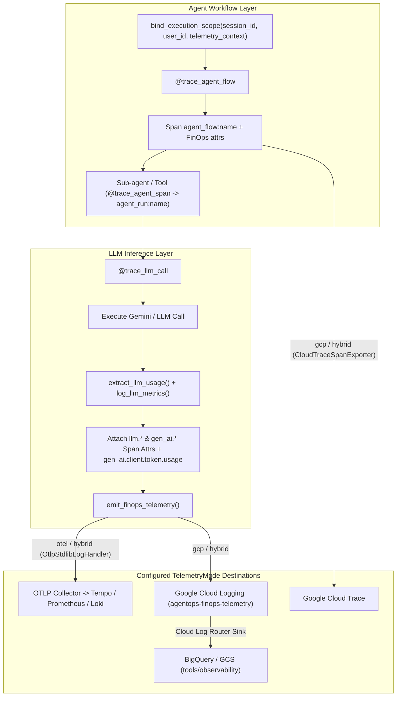

# Universal OpenTelemetry Tracing & FinOps Telemetry Guide (`v1.0.0`)

```
Copyright 2026 Google. This software is provided as-is, without
warranty or representation for any use or purpose. Your use of it is
subject to your agreement with Google.
```

## 1. Executive Summary

`agentops_sdk.telemetry` delivers framework-agnostic distributed tracing and decoupled LLM FinOps metering across both Google Cloud Observability (`gcp` / `hybrid`) and standard OTLP collectors (`otlp`):

1. **Unified Telemetry Configuration (`configure_telemetry`)**: Single initializer supporting `auto`, `gcp`, `otlp`, `hybrid`, and `off` modes, configuring trace processors, metric readers, and native stdlib log forwarding (`OtlpStdlibLogHandler`).
2. **Async-Safe Execution Scope (`bind_execution_scope`)**: Propagates `session_id`, `user_id`, and `TelemetryContext` across synchronous call stacks and `asyncio` tasks via Python `contextvars.ContextVar`.
3. **Hierarchical Span Decorators (`@trace_agent_flow`, `@trace_agent_span`)**: Establishes clean parent-child waterfall spans (`agent_flow:<name>`, `agent_run:<agent_name>`) tagged with `business.kpi_id`, `business.pl_impact_line`, `agentops.project.name`, and `agentops.environment`.
4. **Decoupled FinOps Token Telemetry (`@trace_llm_call`, `log_llm_metrics`)**: Extracts model names and token counts across Vertex AI/Google GenAI, OpenAI-style `usage`, and dictionary outputs without hardcoding price tables in client SDKs.

---

## 2. Architectural Overview



---

## 3. Provider & Decorator Specifications

### 3.1 `configure_telemetry` (`telemetry/provider.py`)
```python
from agentops_sdk.domain.models import TelemetryMode
from agentops_sdk.telemetry import configure_telemetry

handles = configure_telemetry(
    mode=TelemetryMode.OTLP,       # "auto" | "gcp" | "otlp" | "hybrid" | "off"
    project_id=None,               # Optional override (defaults to GCPSettings)
    service_name="agentops-service",
    collector_url="http://127.0.0.1:4317",
)
# ...
handles.flush()
handles.shutdown()
```

### 3.2 `@trace_agent_flow` & `@trace_agent_span`
```python
def trace_agent_flow(
    context: TelemetryContext | None = None,
    *,
    flow_name: str | None = None,
    agent_role: str | None = None,
    kpi_id: str | None = None,
    pl_impact_line: str | None = None,
    project_name: str | None = None,
    environment: str | None = None,
): ...


def trace_agent_span(
    span_name: str | None = None,
    *,
    agent_name: str | None = None,
    agent_urn: str | None = None,
): ...
```

#### OpenTelemetry Span Attributes Attached
| Attribute Key | Description | Source |
|---|---|---|
| `business.kpi_id` | Slugified business KPI identifier | `TelemetryContext` / `@trace_agent_flow` |
| `business.pl_impact_line` | Slugified P&L budget/impact line | `TelemetryContext` / `@trace_agent_flow` |
| `agentops.project.name` | Logical service / agent project name | `TelemetryContext` |
| `agentops.environment` | Deployment environment (`dev`, `staging`, `prod`) | `TelemetryContext` |
| `agentops.session.id` | Conversational session ID (when non-empty) | `ExecutionScope` |
| `agentops.user.id` | Authenticated user ID (when non-empty) | `ExecutionScope` |
| `agentops.agent.role` / `agentops.agent.name` | Sub-agent role/name identifier | `@trace_agent_flow` / `@trace_agent_span` |
| `agentops.agent.urn` | Canonical agent URN (`urn:agentops:agent:<name>`) | `@trace_agent_span` |

### 3.3 `@trace_llm_call` & `log_llm_metrics`
```python
def trace_llm_call(
    context: TelemetryContext | None = None,
    *,
    model_name_override: str | None = None,
    kpi_id: str | None = None,
    pl_impact_line: str | None = None,
    project_name: str | None = None,
    environment: str | None = None,
): ...
```

`extract_llm_usage()` inspects:
1. `LLMUsageMetric` directly.
2. Google GenAI / Vertex AI responses (`usage_metadata.prompt_token_count`, `candidates_token_count`, `cached_content_token_count`).
3. OpenAI / LiteLLM mappings (`usage.prompt_tokens`, `completion_tokens`, `cached_tokens`).
4. Plain dictionaries (`input_tokens`, `output_tokens`, `cached_tokens`, `model_name`).

`log_llm_metrics(*, model_name, input_tokens, output_tokens, cached_tokens=0)` attaches `llm.model_name`, `llm.usage.prompt_tokens`, `llm.usage.completion_tokens`, `llm.usage.cached_tokens`, `gen_ai.request.model`, `gen_ai.usage.input_tokens`, and `gen_ai.usage.output_tokens` to the active span and increments the `gen_ai.client.token.usage` counter.

---

## 4. Decoupled FinOps Token Economics & Structured Logs

Hardcoding pricing tables inside client runtimes leads to drift across model SKUs and enterprise rate cards. Instead, `@trace_llm_call` records raw counts, latency (`llm.latency_ms`), status (`OK` / `ERROR`), and correlation metadata so downstream FinOps joins in BigQuery compute cost accurately against live rate cards.

`emit_finops_telemetry()` always emits a structured log record via stdlib `logging` (picked up by `OtlpStdlibLogHandler` in `otlp`/`hybrid` modes) and ships directly to Google Cloud Logging (`AGENTOPS_FINOPS_LOG_NAME`, default `"agentops-finops-telemetry"`) **only** when the active telemetry mode is `gcp` or `hybrid`:

```json
{
  "event_type": "finops_llm_telemetry",
  "llm.model_name": "gemini-2.5-flash",
  "llm.input_tokens": 420,
  "llm.output_tokens": 160,
  "llm.cached_tokens": 200,
  "llm.latency_ms": 182.415,
  "llm.status": "OK",
  "business.kpi_id": "supply-chain-efficiency",
  "business.pl_impact_line": "inventory-holding-cost",
  "agentops.project.name": "inventory-advisor",
  "agentops.environment": "prod",
  "agentops.session.id": "sess-89412",
  "agentops.user.id": "dealer-4711",
  "trace_id": "9dcef5c0c089279e5efef1496eb2e7d6",
  "span_id": "f51d95c940e6ef61",
  "timestamp": "2026-11-18T12:00:00Z"
}
```

Errors in `error_message` are scrubbed via `scrub_sensitive_text()` prior to logging and export.

---

## 5. Thread-Safe Client Caching & Hygiene (`v1.0.0`)

- **Pooled Cloud Logging Clients**: `telemetry/finops.py` caches `google.cloud.logging.Client` per project ID under `_FINOPS_CLIENT_LOCK`, closing cached clients cleanly on `reset_telemetry()`.
- **Clean Scope Resolution**: User and session attribution come solely from `ExecutionScope` (`bind_execution_scope`), with zero hardcoded developer defaults.
- **No Unintended GCP Writes in `otlp` Mode**: Running tutorials or local full-stack harnesses with `mode="otlp"` never writes to Cloud Logging even when Application Default Credentials exist.

---

## 6. Verification & E2E Tests

Run unit tests and the FinOps E2E harness:

```bash
# Hermetic telemetry & FinOps unit tests
pytest tests/unit/test_telemetry.py --eval-mode=in_memory -v

# Live GCP 4-part E2E suite
./tests/e2e_universal_trace_and_finops/run_all_finops_trace_tests.sh <your-gcp-project>
```
