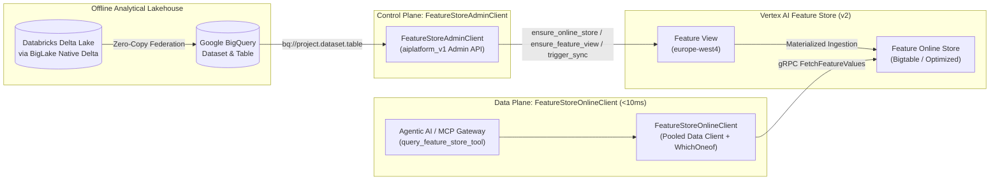
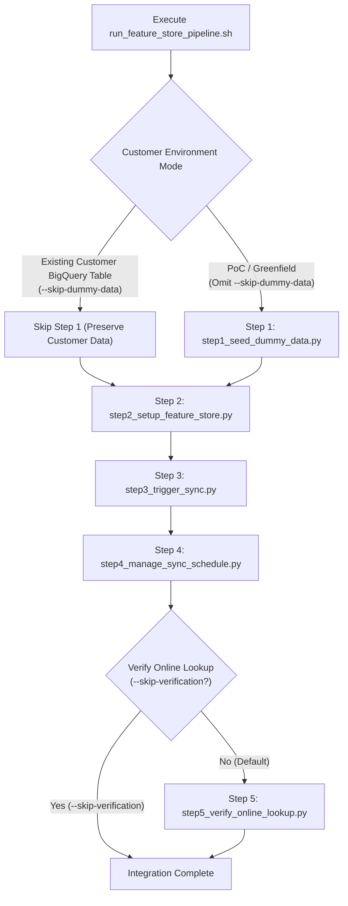

<!--
Copyright 2026 Google. This software is provided as-is, without
warranty or representation for any use or purpose. Your use of it is
subject to your agreement with Google.
-->

# Vertex AI Feature Online Store (v2) Synchronization & Serving Framework (`v1.0.0`)

This guide provides the developer and operations reference for provisioning, synchronizing, and serving low-latency online features using **Vertex AI Feature Online Store (v2)** through `agentops_sdk.feature_store` and `tools/feature_store_migration/`.

---

## 1. Architectural Overview (`ADR-1`: Control Plane vs. Data Plane)

In `v1.0.0`, Feature Store operations follow a strict hexagonal split under [`sdk/src/agentops_sdk/feature_store/`](../sdk/src/agentops_sdk/feature_store/) and [`sdk/src/agentops_sdk/ports/feature_store.py`](../sdk/src/agentops_sdk/ports/feature_store.py):

*   **Control Plane (`FeatureStoreAdminClient`)**: Provisions Bigtable-backed or Optimized `FeatureOnlineStore` instances (`ensure_online_store`), registers or updates BigQuery-backed `FeatureView` resources (`ensure_feature_view`), triggers on-demand syncs (`trigger_sync`), and inspects/updates in-engine cron schedules (`set_sync_schedule`, `get_sync_schedule`).
*   **Data Plane (`FeatureStoreOnlineClient` / `FeatureOnlineStorePort`)**: Performs low-latency online lookups (`read_online_features`, `aread_online_features`) with dedicated serving endpoint caching (`BoundedTTLCache(maxsize=256, ttl_seconds=300.0)` + 64-stripe locking) and strict Protobuf `WhichOneof("value")` scalar/array/struct extraction.
*   **Explicit Hermetic Test Double (`InMemoryFeatureOnlineStore`)**: Implements `FeatureOnlineStorePort` for unit tests and `--dry-run` workflows. **Zero silent simulation fallbacks** exist in `FeatureStoreAdminClient` or `FeatureStoreOnlineClient`.



---

## 2. Installation, Configuration & Environment Variables

Install the Feature Store optional extra (or `[all]`):
```bash
pip install "agentops-sdk[feature-store]==1.0.0"
# Or from repository root:
pip install -e ".[feature-store]"
```

| Environment Variable (Primary / Aliases) | Default | Description |
| :--- | :--- | :--- |
| `GOOGLE_CLOUD_PROJECT`, `GCP_PROJECT`, `AGENTOPS_PROJECT_ID` | `None` (resolved via ADC when available; required in live mode) | Target GCP project ID hosting Vertex AI and BigQuery. |
| `GOOGLE_CLOUD_LOCATION`, `GOOGLE_CLOUD_REGION`, `GCP_REGION`, `AGENTOPS_LOCATION` | `"europe-west4"` | Primary GCP region (`{location}-aiplatform.googleapis.com`). |
| `MCP_ALLOWED_ENTITY_TYPES` | `""` (empty) | Optional comma-separated `entity_type` allowlist enforced by `mcp_servers/src/server.py:query_feature_store_tool`. |

---

## 3. Core Python SDK Reference (`agentops_sdk.feature_store`)

### 3.1 Provisioning, Syncing & Scheduling (`FeatureStoreAdminClient`)

[`sdk/src/agentops_sdk/feature_store/admin.py`](../sdk/src/agentops_sdk/feature_store/admin.py) manages `FeatureOnlineStore` and `FeatureView` lifecycles idempotently (`Bigtable` autoscaling or `Optimized` with `DedicatedServingEndpoint`):

```python
from agentops_sdk.feature_store import FeatureStoreAdminClient

with FeatureStoreAdminClient(
    project_id="my-gcp-project",
    location="europe-west4",
) as admin:
    # 1. Ensure Bigtable-backed Feature Online Store exists
    store_info = admin.ensure_online_store(
        "customer_online_store",
        store_type="bigtable",  # or "optimized"
        min_nodes=1,
        max_nodes=3,
        wait_for_completion=True,
    )

    # 2. Ensure Feature View points to BigQuery table (or BigLake Delta view)
    view_info = admin.ensure_feature_view(
        "customer_online_store",
        "fv_part_inventory",
        bigquery_uri="bq://my-gcp-project.supply_chain_dataset.part_inventory_features",
        entity_id_columns=("part_id",),
        cron_schedule="0 */4 * * *",
        wait_for_completion=True,
    )

    # 3. Trigger on-demand ingestion sync and await terminal state
    sync_status = admin.trigger_sync(
        "customer_online_store",
        "fv_part_inventory",
        wait_for_completion=True,
        timeout_seconds=600.0,
    )
    print(f"Sync finished: {sync_status['sync_state']}")

    # 4. Inspect active schedule and latest sync (ordered create_time desc)
    schedule = admin.get_sync_schedule("customer_online_store", "fv_part_inventory")
    print(f"Cron={schedule['cron_schedule']}, LastState={schedule['last_sync_state']}")

    # 5. Disable recurring in-engine cron schedule (on-demand sync only)
    admin.set_sync_schedule(
        "customer_online_store",
        "fv_part_inventory",
        cron_schedule=None,
    )
```

### 3.2 Low-Latency Online Lookups (`FeatureStoreOnlineClient`)

[`sdk/src/agentops_sdk/feature_store/online_client.py`](../sdk/src/agentops_sdk/feature_store/online_client.py) implements `FeatureOnlineStorePort` for sync (`read_online_features`) and async (`aread_online_features`) serving:
*   **Single & Composite Keys**: Accepts `entity_ids: Sequence[EntityKey]` where `EntityKey = str | Sequence[str]`. Composite keys are normalized as `":".join(parts)` in output maps.
*   **Dedicated Endpoint Discovery & Caching**: Inspects `store.dedicated_serving_endpoint.public_endpoint_domain_name` (falling back to `{location}-aiplatform.googleapis.com`), caching domains in a 64-stripe lock-protected `BoundedTTLCache(maxsize=256, ttl_seconds=300.0)` and evicting stale entries on transport failures (`GoogleAPICallError`, `OSError`, `TimeoutError`).
*   **Typed Protobuf Extraction (`extract_feature_value`)**: Inspects `pb.WhichOneof("value")` across scalars (`bool_value`, `int64_value`, `double_value`, `string_value`, `bytes_value`), arrays (`int64_array_value`, `double_array_value`, `string_array_value`, `bool_array_value`), and recursive `struct_value` (depth cap `16`).
*   **Projection vs. Full Feature Read**: Pass `features=[...]` to project specific columns, or omit `features=None` to return all non-null feature values stored for each entity.

```python
from agentops_sdk.feature_store import FeatureStoreOnlineClient

with FeatureStoreOnlineClient(
    project_id="my-gcp-project",
    location="europe-west4",
) as online:
    # Return all stored features for two entities
    all_features = online.read_online_features(
        "customer_online_store",
        "fv_part_inventory",
        entity_ids=["PART-00104", "PART-00105"],
    )

    # Or project explicit feature columns
    projected = online.read_online_features(
        "customer_online_store",
        "fv_part_inventory",
        entity_ids=["PART-00104"],
        features=["stock_level", "lead_time_days"],
    )
```

### 3.3 Hermetic Testing (`InMemoryFeatureOnlineStore`)

[`sdk/src/agentops_sdk/feature_store/in_memory.py`](../sdk/src/agentops_sdk/feature_store/in_memory.py) provides a thread-safe in-memory double implementing the identical `FeatureOnlineStorePort` contract:

```python
from agentops_sdk.feature_store import InMemoryFeatureOnlineStore

store = InMemoryFeatureOnlineStore()
store.seed_features(
    "customer_online_store",
    "fv_part_inventory",
    {
        "PART-00104": {"stock_level": 42, "lead_time_days": 5, "is_critical": False},
        ("eu", "PART-00105"): {"stock_level": 8, "lead_time_days": 14, "is_critical": True},
    },
)
result = store.read_online_features(
    "customer_online_store",
    "fv_part_inventory",
    entity_ids=["PART-00104", ["eu", "PART-00105"]],
    features=["stock_level", "is_critical"],
)
```

---

## 4. CLI Migration & Sync Toolkit (`tools/feature_store_migration/`)

All migration scripts are importable package modules executed via `python -m tools.feature_store_migration.<module>` from the repository root:

### 4.1 Available Modules

| Module | Purpose |
| :--- | :--- |
| `tools.feature_store_migration.step1_seed_dummy_data` | Creates day-partitioned BigQuery dataset/table and seeds deterministic synthetic feature rows. |
| `tools.feature_store_migration.step2_setup_feature_store` | Provisions `FeatureOnlineStore` (`bigtable` or `optimized`) and `FeatureView`. |
| `tools.feature_store_migration.step3_trigger_sync` | Triggers an on-demand `FeatureView` sync and optionally polls to `SUCCEEDED` / `FAILED`. |
| `tools.feature_store_migration.step4_manage_sync_schedule` | Inspects (`--get`), sets (`--set-cron`), or clears (`--disable`) the in-engine cron schedule. |
| `tools.feature_store_migration.step5_verify_online_lookup` | Verifies online reads via `FeatureStoreOnlineClient` (or `InMemoryFeatureOnlineStore` in `--dry-run`). |
| `tools.feature_store_migration.sync_orchestrator` | Runs Steps 1–4 end-to-end with optional `--load-dummy-data`, `--sync-cron`, `--wait`, and `--dry-run`. |

### 4.2 Step-by-Step Module Invocation

```bash
# Step 1: Seed synthetic BigQuery data (optional for PoCs)
python -m tools.feature_store_migration.step1_seed_dummy_data \
    --project my-gcp-project \
    --region europe-west4 \
    --dataset supply_chain_dataset \
    --table part_inventory_features \
    --num-records 100 \
    --prefix PART

# Step 2: Provision Feature Online Store & Feature View
python -m tools.feature_store_migration.step2_setup_feature_store \
    --project my-gcp-project \
    --region europe-west4 \
    --dataset supply_chain_dataset \
    --table part_inventory_features \
    --online-store customer_online_store \
    --feature-view fv_part_inventory \
    --store-type bigtable \
    --min-nodes 1 \
    --max-nodes 3 \
    --sync-cron "0 */4 * * *" \
    --wait

# Step 3: Trigger on-demand sync and await completion
python -m tools.feature_store_migration.step3_trigger_sync \
    --project my-gcp-project \
    --region europe-west4 \
    --online-store customer_online_store \
    --feature-view fv_part_inventory \
    --wait \
    --timeout 300

# Step 4: Inspect, set, or disable in-engine cron schedule
python -m tools.feature_store_migration.step4_manage_sync_schedule \
    --project my-gcp-project --region europe-west4 \
    --online-store customer_online_store --feature-view fv_part_inventory --get

python -m tools.feature_store_migration.step4_manage_sync_schedule \
    --project my-gcp-project --region europe-west4 \
    --online-store customer_online_store --feature-view fv_part_inventory --set-cron "0 2 * * *"

python -m tools.feature_store_migration.step4_manage_sync_schedule \
    --project my-gcp-project --region europe-west4 \
    --online-store customer_online_store --feature-view fv_part_inventory --disable

# Step 5: Verify online feature reads
python -m tools.feature_store_migration.step5_verify_online_lookup \
    --project my-gcp-project \
    --region europe-west4 \
    --online-store customer_online_store \
    --feature-view fv_part_inventory \
    --entity-ids PART-1001 PART-1002

# Alternative: Single orchestrator invocation (Steps 1-4)
python -m tools.feature_store_migration.sync_orchestrator \
    --project my-gcp-project \
    --region europe-west4 \
    --dataset supply_chain_dataset \
    --table part_inventory_features \
    --online-store customer_online_store \
    --feature-view fv_part_inventory \
    --load-dummy-data \
    --num-records 250 \
    --sync-cron "0 */4 * * *" \
    --wait
```

### 4.3 Production Shell Pipeline (`run_feature_store_pipeline.sh`)

[`tools/feature_store_migration/run_feature_store_pipeline.sh`](../tools/feature_store_migration/run_feature_store_pipeline.sh) orchestrates Steps 1–5 against live GCP APIs (or `--dry-run` for offline validation):



```bash
# Production integration with existing customer BigQuery table
./tools/feature_store_migration/run_feature_store_pipeline.sh \
    --project customer-prod-project \
    --region europe-west4 \
    --dataset customer_features_dw \
    --table user_profile_features \
    --online-store customer_online_store \
    --feature-view user_profile_features_view \
    --cron-schedule "0 */4 * * *" \
    --skip-dummy-data \
    --entity-ids "USER_84920" "USER_84921" \
    --wait

# Offline validation / dry-run (no GCP mutations)
./tools/feature_store_migration/run_feature_store_pipeline.sh --dry-run
```

---

## 5. MCP Gateway Feature Store Access (`query_feature_store_tool`)

Agents accessing Feature Store tools through [`mcp_servers/src/server.py`](../mcp_servers/src/server.py) call `query_feature_store_tool(entity_type, entity_ids, features)`:
*   Caller identity is verified via HTTP `Authorization: Bearer <JWT>` (`HeaderBindingMiddleware`) or `ExecutionScope` (`MCP_REQUIRE_AUTH=true`).
*   `authorize_feature_store_tenant()` enforces:
    1. Non-empty `entity_type` and whitespace-free `entity_ids`.
    2. Global `MCP_ALLOWED_ENTITY_TYPES` allowlist (if set).
    3. Verified JWT `tenant_id` (or `tid`) presence for non-admin callers (`role not in {"admin", "superadmin"}`), optional claim-level `allowed_entity_types` and `allowed_entity_ids`, and cross-tenant `tenant:entity_id` prefix rejection (`CWE-284`).

---

## 6. IAM Permissions & Troubleshooting

| Service Account Role | Purpose |
| :--- | :--- |
| `roles/aiplatform.featureStoreAdmin` | Create and manage `FeatureOnlineStore` and `FeatureView` resources. |
| `roles/aiplatform.featureStoreUser` | Execute `FetchFeatureValues` online reads at agent runtime. |
| `roles/bigquery.dataEditor` + `roles/bigquery.jobUser` | Provision offline feature datasets/tables and run Feature View sync jobs. |

*   **Region Mismatch (`400 FAILED_PRECONDITION`)**: Keep the source BigQuery dataset and the Vertex AI `FeatureOnlineStore` in the same region (default `europe-west4`).
*   **Empty Online Lookups**: Ensure `trigger_sync(..., wait_for_completion=True)` reaches `SUCCEEDED` before calling `read_online_features()`.

---

## 7. Automated Verification Suites

```bash
# Hermetic unit & LSP contract suites
pytest -v tests/unit/test_feature_store.py tests/unit/test_tools_feature_store.py tests/contract/test_feature_store_contract.py --eval-mode=in_memory

# E2E shell suite (offline dry-run + InMemory contract, or live GCP)
./tests/e2e_feature_store/run_all_feature_store_tests.sh --offline
./tests/e2e_feature_store/run_all_feature_store_tests.sh <your-gcp-project> europe-west4
```
