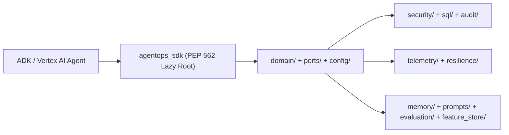

# Architecture & Hexagonal Design (`v1.0.0`)

`agentops_sdk` follows a strict **Hexagonal (Ports & Adapters)** architecture separating pure domain contracts from Google Cloud and hermetic in-memory adapters.

## Subpackage Map (12 Subpackages)

- **Core**: `domain/` (frozen Pydantic v2 DTOs, `ContextVar` execution scope, `BoundedTTLCache`, exceptions), `ports/` (`11` `@runtime_checkable` `typing.Protocol` interfaces), `config/` (`pydantic-settings` schemas).
- **Governance & Security**: `security/`, `sql/`, `audit/`.
- **Observability & Resilience**: `telemetry/`, `resilience/`.
- **Agent State & Quality**: `memory/`, `prompts/`, `evaluation/`, `feature_store/`.

## Packaging & Extras (`pyproject.toml`)

- Requires Python `>=3.11,<3.15` (`pyjwt>=2.10.0`, `sqlglot>=30.0.0`).
- Ships PEP 561 `py.typed` and `agentops_eval` `pytest11` plugin (`sdk/src/agentops_sdk/pytest_plugin.py`).
- Optional extras: `[cloudsql]`, `[eval]`, `[ragas]`, `[feature-store]`, `[mcp]`, `[all]`, `[dev]`.

See [docs/sdk_design.md](../docs/sdk_design.md) for the full design specification.
