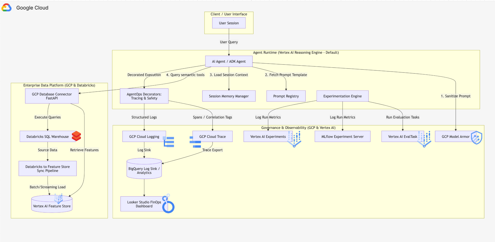

# AgentOps Governance Framework & SDK (`v1.0.0`) Wiki

Welcome to the **AgentOps Governance Framework & SDK** Wiki — an open-source, customer-agnostic Python platform (`agentops-sdk==1.0.0`) for building, securing, observing, and evaluating enterprise AI agents on Google Cloud Platform.



## Quick Navigation

| Wiki Page | Coverage |
| :--- | :--- |
| [[Architecture-and-Hexagonal-Design]] | 12-subpackage Hexagonal Ports & Adapters layout, PEP 562 lazy root facade, `pyproject.toml` extras |
| [[Security-Auth-and-SQL-Governance]] | RS256/Entra/PEM `JWTAuthEngine`, JWKS SSRF guard, `SQLASTValidator`, scope-aware `RowLevelPolicyEngine`, Model Armor, Cloud DLP, `AuditLedger` |
| [[Observability-and-FinOps]] | `configure_telemetry(mode="gcp\|otlp\|hybrid")`, `OtlpStdlibLogHandler`, `@trace_*`, `UseCaseTracker`, Log Router CLI, `examples/full_stack/` |
| [[Memory-Prompts-and-Evaluation]] | `CloudSQLSessionMemory`, `VertexMemoryBank` (`memory_type` filtering), `CompositeMemory`, `PromptRegistry`, `VertexEvalTaskAdapter` (`gemini-3.8-flash`), Quality Gates |
| [[MCP-Gateway-and-CICD]] | FastMCP Governance Gateway (`mcp_servers/src/`), `HeaderBindingMiddleware`, `FeatureStoreOnlineClient`, 40-SHA pinned GitHub Actions, `@sha256:` container digests & Cloud Build wheel pipelines |

## Quickstart (`v1.0.0`)

```bash
pip install -e ".[all,dev]"
MODE=hermetic python examples/full_stack/run_full_stack.py --hermetic
pytest -q tests/unit tests/contract --eval-mode=in_memory
```

## Key Invariants (`v1.0.0`)

- **Fail-Closed by Default**: Zero silent mock fallbacks in production adapters (`SecurityGuard`, `OutputDLPSanitizer`, `BigQueryAuditAdapter`, `CloudSQLSessionMemory`, `VertexMemoryBank`, `VertexEvalTaskAdapter`, `PromptRegistry`).
- **Explicit Test Doubles**: Use `InMemory*`, `LocalRuleSafetyScanner`, and `RegexPrivacyScrubber` for deterministic offline/hermetic testing.
- **Canonical Reference Docs**: See [docs/README.md](../docs/README.md) and [v1.0.0 Release Notes](../releases/v1.0.0_agentops_sdk_initial_release.md).
